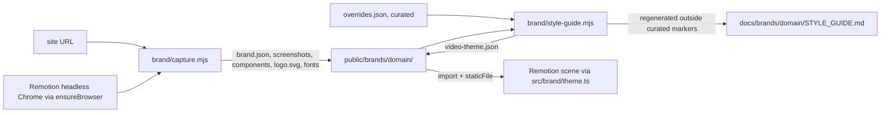

# Brand Capture

How this repo pulls a brand from a live website with Playwright — design tokens, colours, fonts, type
scale, motion tokens, components, logo and screenshots — and turns it into a video theme and a
per-brand video style guide. Read it before capturing a site or making a film for a captured brand.

Source of truth: [`brand/capture.mjs`](../brand/capture.mjs) (capture),
[`brand/style-guide.mjs`](../brand/style-guide.mjs) (theme and guide generation),
[`src/brand/theme.ts`](../src/brand/theme.ts) (Remotion helpers). Per brand, `brand.json` is the
captured source and `overrides.json` the curated one (§5). Related:
[MOTION_REEL.md](MOTION_REEL.md) — the reel and its motion techniques;
[MOTION_REEL.md §22](MOTION_REEL.md#22-brief-persona-and-studio-rules) — studio rules and example prompts;
[`docs/brands/`](brands/) — one `STYLE_GUIDE.md` per captured brand.

| Tag          | Meaning                                 |
| ------------ | --------------------------------------- |
| `[captured]` | Read from the live site                 |
| `[derived]`  | Computed from captured values           |
| `[curated]`  | Chosen in the review pass (§6)          |
| `[measured]` | Measured in this repo; conditions in §9 |
| `[?]`        | Unverified; tracked in §11              |

| §   | Section                                                 | Look here for                                                          |
| --- | ------------------------------------------------------- | ---------------------------------------------------------------------- |
| 1   | [Rules](#1-rules)                                       | What capture and generation must and must not do                       |
| 2   | [Task lookup](#2-task-lookup)                           | Which script or file for a given job                                   |
| 3   | [Traps and limits](#3-traps-and-limits)                 | What the capture misses or gets wrong, and how to catch it             |
| 4   | [How it works](#4-how-it-works)                         | Pipeline, browser, what each stage reads and writes                    |
| 5   | [Files and fields](#5-files-and-fields)                 | Output folders, `brand.json` fields, `overrides.json` keys             |
| 6   | [Review pass](#6-review-pass)                           | What a person or agent decides after capture, and where it is recorded |
| 7   | [Video theme and Remotion](#7-video-theme-and-remotion) | `video-theme.json` derivations; `loadBrandFonts`, `brandEasing`        |
| 8   | [Decisions](#8-decisions)                               | Choices made and the alternatives that don't work                      |
| 9   | [Measurements](#9-measurements)                         | Capture times and accuracy on real sites                               |
| 10  | [Exceptions](#10-exceptions)                            | Departures from the studio rules' example prompts                      |
| 11  | [Open items](#11-open-items)                            | Known gaps and what would close them                                   |

---

## 1. Rules

### Do

1. **Capture only sites you have the right to use** — your own product, a client's with permission, or
   for internal reference. Screenshots, logos and fonts belong to the site's owner.
2. **Run the review pass (§6) before a captured brand goes into a film.**
   - Why: the capture reads what the page paints, not what the brand intends — the accent can be
     missing from the page entirely (§3).
3. **Record curated choices in `overrides.json`, never in `brand.json`** — `brand.json` is rewritten on
   every capture.
4. **Edit a `STYLE_GUIDE.md` only between `<!-- curated:… -->` markers** — `npm run brand:guide`
   rewrites everything else and keeps only those regions.
5. **Re-run `npm run brand:guide -- <domain>` after every capture or `overrides.json` change** — it
   regenerates `video-theme.json` and the guide from both files.
6. **Look at the screenshots after capture** — they show consent banners, pop-ups and loading states
   the capture did not dismiss.

### Never

- **Never commit captured font files** — `public/brands/*/fonts/` is git-ignored; brand fonts are
  usually licensed to the site's owner.
- **Never publish a film using captured fonts without a licence** — record a substitute in
  `overrides.json` (`fonts`) instead.
- **Never treat an uncurated guide as approved** — a section headed `— NOT CURATED` has not been
  reviewed.

---

## 2. Task lookup

| I need to…                                  | Use                                                         | Notes                                                                 |
| ------------------------------------------- | ----------------------------------------------------------- | --------------------------------------------------------------------- |
| Capture a site                              | `npm run brand:capture -- <url>`                            | Writes `public/brands/<domain>/`; add `--no-fonts` to skip font files |
| Generate the theme and style guide          | `npm run brand:guide -- <domain>`                           | Writes `video-theme.json` and `docs/brands/<domain>/STYLE_GUIDE.md`   |
| Fix the accent, text colour, fonts or tempo | `public/brands/<domain>/overrides.json`, then `brand:guide` | Keys in §5.3                                                          |
| Write brand rules, voice, what to animate   | The `curated:` regions of the brand's `STYLE_GUIDE.md`      | §6                                                                    |
| Use a brand in a scene                      | `video-theme.json` + `src/brand/theme.ts`                   | §7                                                                    |
| Use a captured screenshot or crop in a film | `staticFile("brands/<domain>/screenshots/…")`               | Captures live under `public/` for this reason (§8)                    |

---

## 3. Traps and limits

- **Accent missing or wrong** → the accent may be declared but never painted on the page (anthropic.com:
  `--color-clay` on 0 elements), or the page's most saturated colours belong to illustrations
  (linear.app: pink from artwork while the brand indigo `--color-indigo` is unused) → read §2.2 of the
  guide and the colour tokens, then set `accent` in `overrides.json`.
- **Text colour is body grey, not the headline colour** → the text role is the colour covering the
  most characters, which is usually body copy → set `text` in `overrides.json` when headlines differ.
- **Video type scale out of order** (H1 smaller than H2) → the site's own `h1` is smaller than its `h2`
  (anthropic.com: serif `h1` 40.8 px, sans `h2` 51.9 px); the scale keeps the site's ratios → choose
  display sizes per shot; the reel's display range is 160–520 px.
- **Consent banner in a screenshot** → the dismisser only clicks buttons named like "Accept all",
  "Accept", "Agree", "Allow all" or "Got it" → check the screenshots (§1, rule 6); dismissals are
  listed in the guide's §11.
- **Pages behind a login are not captured** → no authentication support (§11). Product UI (for
  example `claude.ai`) needs a saved login state.
- **Bot protection or a challenge page** → the capture records whatever the server returned → the
  screenshots show it; capture from a network the site allows.
- **Only the first state of the home page** → no hover states, scroll-triggered or JavaScript-driven
  animation, and no other pages → motion tokens come from CSS only (§11).
- **A font role is empty** → the role is read from the element that uses it (`h1`, `p`, `code`); a mono
  face with no `<code>` on the page falls back to any captured face named "mono" → set `fonts` in
  `overrides.json` otherwise.
- **Component crops show the wrong thing** → components are found by tag and class-name patterns with
  size limits (§4) → pick the right crops in the review pass; better selectors are an open item.

---

## 4. How it works

`brand/capture.mjs` drives Remotion's headless Chrome with `playwright-core`, reads the page in the
browser, and writes files; `brand/style-guide.mjs` turns those into a theme and a guide.

| Stage           | Reads                                                                        | Produces                                                                                        |
| --------------- | ---------------------------------------------------------------------------- | ----------------------------------------------------------------------------------------------- |
| Load            | URL at 1440 × 900, 2 × scale                                                 | Page after `networkidle`; consent dismissed; `document.fonts.ready`                             |
| Stylesheets     | Readable `document.styleSheets`; others fetched with `page.request`          | Custom properties on `:root`/`html`, `@font-face`, `@keyframes`                                 |
| Tokens          | Computed values of every custom property                                     | Colour tokens (normalised), easing tokens, duration tokens                                      |
| Usage           | Up to 5000 visible elements                                                  | Colours by area, by text length, by count, on links/buttons; fonts, radii, shadows, transitions |
| Colour analysis | Colour usage + tokens, in OKLab                                              | Accent candidates and neutrals (§5.2)                                                           |
| Type            | First visible `h1`, `h2`, `h3`, `p`, `small`, `button`, `a`, `nav a`, `code` | Family, size, weight, line height, letter spacing                                               |
| Components      | Tag and class patterns with size limits                                      | Up to 1 logo, 1 nav, 4 buttons, 3 cards, 3 badges, 2 inputs, 1 footer                           |
| Screenshots     | Desktop, full page (capped at 6000 px), 390 × 844 mobile at 3 ×              | PNGs                                                                                            |
| Downloads       | Font responses, icons, `og:image`                                            | Files under `fonts/` and `images/`                                                              |

- **Colours are normalised through a 1 × 1 canvas**, so `oklch()`, `color()` and named colours all
  become `#rrggbb` plus alpha.
- **Accent score** = `(elements + 3 × interactive elements + 25 if a token name matches
accent|brand|primary|highlight|cta|clay) × min(1, chroma / 0.08)`; candidates need OKLab chroma
  ≥ 0.06. Neutrals are colours in use with chroma < 0.03, sorted light to dark.

Where it lives: [`brand/capture.mjs`](../brand/capture.mjs). Run: `npm run brand:capture -- <url>`.

---

## 5. Files and fields

### 5.1 Output folders

| Path                                      | Holds                                                         | Git                         |
| ----------------------------------------- | ------------------------------------------------------------- | --------------------------- |
| `public/brands/<domain>/brand.json`       | Everything captured (§5.2)                                    | Committed                   |
| `public/brands/<domain>/overrides.json`   | Curated choices (§5.3)                                        | Committed; hand-edited      |
| `public/brands/<domain>/video-theme.json` | Derived theme (§7)                                            | Committed; generated        |
| `public/brands/<domain>/screenshots/`     | `desktop-1440x900.png`, `mobile-390x844.png`, `full-page.png` | Committed                   |
| `public/brands/<domain>/components/`      | `<kind>-<n>.png` crops                                        | Committed                   |
| `public/brands/<domain>/logo.svg`         | Logo when it is an inline SVG                                 | Committed                   |
| `public/brands/<domain>/images/`          | Icons, `og:image`                                             | Committed                   |
| `public/brands/<domain>/fonts/`           | Captured font files                                           | **Ignored** (licences)      |
| `docs/brands/<domain>/STYLE_GUIDE.md`     | The brand's video style guide                                 | Committed; partly generated |

### 5.2 `brand.json` fields

| Field                                    | Holds                                                                                                   |
| ---------------------------------------- | ------------------------------------------------------------------------------------------------------- |
| `url`, `domain`, `capturedAt`, `capture` | Source, time, browser version, viewports, duration, log of dismissals and fetches                       |
| `meta`                                   | Title, description, `og:image`, `theme-color`, icons, first 8 `h1`/`h2` headlines                       |
| `palette`                                | `pageBackground`, `backgroundByArea`, `textByLength`, `neutrals`, `accentCandidates`                    |
| `colorTokens`                            | Colour custom properties: `name`, `hex`, `alpha`                                                        |
| `typography`                             | Per element: `family`, `stack`, `size` (px), `weight`, `lineHeight`, `letterSpacing`, `color`, `sample` |
| `fonts`                                  | Families by text length, loaded faces, `@font-face` rules, downloaded `files`                           |
| `motion`                                 | `easingTokens`, `durationTokens`, `usedDurations`, `usedEasings`, `keyframes`                           |
| `shape`                                  | `radius` and `shadow` tallies                                                                           |
| `components`                             | `kind`, `file`, `box`, computed `style` and text                                                        |
| `logo`, `images`, `screenshots`          | Paths relative to the brand folder                                                                      |
| `cssVars`                                | Every custom property on `:root`/`html`, resolved                                                       |

### 5.3 `overrides.json` keys

| Key          | Overrides                               | Example                       |
| ------------ | --------------------------------------- | ----------------------------- |
| `name`       | Brand name in the guide title           | `"Anthropic"`                 |
| `accent`     | Accent colour                           | `"#d97757"`                   |
| `background` | Background colour                       | `"#faf9f5"`                   |
| `text`       | Text colour                             | `"#141413"`                   |
| `fonts`      | `{ display, text, mono }` family names  | `{ "mono": "anthropicMono" }` |
| `bpm`        | Tempo for converting durations to beats | `128` (default)               |

---

## 6. Review pass

After capture, a person or agent looks at the screenshots and crops and records the decisions the
capture cannot make. Until then the guide's curated sections are headed `— NOT CURATED`.

| Decision                                 | Evidence in the guide                     | Recorded in                             |
| ---------------------------------------- | ----------------------------------------- | --------------------------------------- |
| The accent                               | §2.2 candidates, §2.4 tokens, screenshots | `overrides.json` `accent`               |
| The text colour                          | §2.1, §3.2 colours per element            | `overrides.json` `text`                 |
| Font roles and licensed-font substitutes | §3.1, §3.2                                | `overrides.json` `fonts`; curated rules |
| Do and Never for the brand in motion     | §2–§7, screenshots                        | `curated:rules` (§1 of the guide)       |
| Voice and on-screen copy                 | §7 headlines, title, description          | `curated:voice` (§8)                    |
| Which components to animate, and how     | §6 crops, §4 easing                       | `curated:animate` (§9)                  |

- **Every curated rule names its evidence** (a section of the guide or a screenshot), so the next
  capture can show whether it still holds.
- **Re-run `npm run brand:guide -- <domain>` after editing** to clear the `NOT CURATED` status and
  regenerate the contents table.

The worked example is [`docs/brands/anthropic.com/STYLE_GUIDE.md`](brands/anthropic.com/STYLE_GUIDE.md).

---

## 7. Video theme and Remotion

`video-theme.json` is the derived, import-ready subset of a brand for scenes.

| Field       | Derivation                                                                                                                                                                                      |
| ----------- | ----------------------------------------------------------------------------------------------------------------------------------------------------------------------------------------------- |
| `colors`    | `background`, `text`, `accent` (override, else top candidate), `neutrals`, opaque colour `tokens`                                                                                               |
| `fonts`     | `display` = `h1` family, `text` = `p` family, `mono` = `code` family or a captured "mono" face; each with captured `files` and a `googleFont` name when `@remotion/google-fonts` has the family |
| `type`      | Web sizes × `56 / body size` (px at 1920 × 1080), so body lands on the 56 px phone minimum ([MOTION_REEL.md §1](MOTION_REEL.md#1-rules))                                                        |
| `easing`    | Easing tokens and used curves as `[x1, y1, x2, y2]`; keywords map to CSS values (`ease` = 0.25, 0.1, 0.25, 1) `[spec]`                                                                          |
| `durations` | Used transition durations in ms and in beats at `bpm`                                                                                                                                           |
| `radius`    | Radius values by use                                                                                                                                                                            |

| Export (`src/brand/theme.ts`) | Does                                                                             |
| ----------------------------- | -------------------------------------------------------------------------------- |
| `VideoTheme`                  | Type for an imported `video-theme.json` (`theme as VideoTheme`)                  |
| `loadBrandFonts(theme)`       | Registers captured font files with `@remotion/fonts` `loadFont` via `staticFile` |
| `brandEasing(theme, name)`    | A token such as `--ease-out-quart` as an easing function                         |

- **`brandEasing` uses `cubicBezier`** in [`src/reel/math.ts`](../src/reel/math.ts): Newton's method
  with a bisection fallback; matches CSS `ease` at 0.5 → 0.8024 `[measured]`.
- **Easing points are `number[]`, not tuples** — JSON imports widen tuples, so `brandEasing` checks
  for four values.

---

## 8. Decisions

| Decision                                                           | Why                                                                                                                                         | Alternatives that don't work, and why                                                                           |
| ------------------------------------------------------------------ | ------------------------------------------------------------------------------------------------------------------------------------------- | --------------------------------------------------------------------------------------------------------------- |
| `playwright-core` driving Remotion's Chrome (`ensureBrowser`)      | No second browser download; the same Chrome renders the films                                                                               | Full `playwright` package — downloads its own Chromium build (≈ 150 MB) that this repo does not otherwise need  |
| Captures under `public/brands/<domain>/`                           | `staticFile` only reads `public/`, so screenshots, crops and fonts drop straight into scenes                                                | `./assets` (studio prompt 2) — Remotion cannot load from it without copying (§10)                               |
| One style guide per brand in `docs/brands/<domain>/`               | Brands change independently                                                                                                                 | One `docs/STYLE_GUIDE.md` — every new capture overwrites the last brand                                         |
| `brand.json` as source; guide generated, with curated regions kept | Captured values have one home and the guide never drifts from them                                                                          | A hand-written guide — copies values that go stale; a fully generated guide — loses human judgement on each run |
| Uncurated sections shown with `— NOT CURATED` in the heading       | Status in the heading is visible and searchable ([DOCUMENTATION_GUIDELINES.md §4.4](DOCUMENTATION_GUIDELINES.md#44-numbering-and-headings)) | "TBD" bodies — banned by the guidelines; omitting the section — breaks fixed numbering                          |
| OKLab chroma for accent vs neutral                                 | Perceptual; separates warm greys from real colour                                                                                           | HSL saturation — near-black and near-white colours read as saturated                                            |
| Colours normalised through a canvas                                | Handles `oklch()`, `color()`, named colours                                                                                                 | Regex on `rgb()` — misses modern colour syntax                                                                  |

---

## 9. Measurements

Measured 2026-10-25 on an Apple Silicon Mac (8 cores, 24 GB), Chrome headless shell 157, `playwright-core` 1.64.1.

| Site          | Time   | Tokens (colour, easing) | Fonts   | Components | Accent result                                                                 |
| ------------- | ------ | ----------------------- | ------- | ---------- | ----------------------------------------------------------------------------- |
| anthropic.com | 7.7 s  | 259 (95, 4)             | 7 files | 10         | `#d97757` — correct, from token names; 0 elements paint it                    |
| linear.app    | 18.3 s | 380 (140, 18)           | 3 files | 14         | `#f79ce0` — wrong (illustration pink); brand indigo `#5e6ad2` is a token only |

- **The linear.app capture was a test and is not kept in the repo.**
- **A Remotion still using the anthropic.com theme rendered the captured fonts, palette and
  `--ease-out-quart`** — the pipeline works end to end.

---

## 10. Exceptions

Departures from example prompt 2 ([MOTION_REEL.md §22.3](MOTION_REEL.md#223-example-prompts)).

| Rule departed from                            | Where                     | Reason                                                                   |
| --------------------------------------------- | ------------------------- | ------------------------------------------------------------------------ |
| Prompt 2: "Save everything to ./assets"       | `public/brands/<domain>/` | Remotion's `staticFile` reads only `public/` (§8)                        |
| Prompt 2: "Use real screenshots (Playwright)" | `playwright-core`         | Same Playwright API; uses Remotion's Chrome instead of a second download |

---

## 11. Open items

| Item                                                                       | Status | Unblocked by                                                               |
| -------------------------------------------------------------------------- | ------ | -------------------------------------------------------------------------- |
| No capture of pages behind a login                                         | Open   | A `--storage-state <file>` option using a Playwright login session         |
| Motion tokens come from CSS only; JavaScript-driven animation is invisible | Open   | Recording the page with Playwright video, or sampling transforms over time |
| Single page per capture                                                    | Open   | Accepting several URLs and merging tallies                                 |
| Component detection by class-name patterns misses or mis-crops             | Open   | Per-brand selectors in `overrides.json`                                    |
| The generated guide's tables are not Prettier-aligned                      | Open   | Running Prettier from `brand/style-guide.mjs` or on commit                 |
| No sans substitute chosen for anthropic.com's licensed sans                | Open   | A licence, or a substitute recorded in `overrides.json` `fonts`            |
