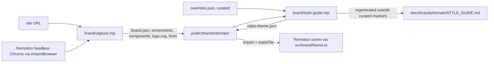

# Brand Capture

How the kit's brand capture works inside: the Playwright capture, the colour analysis, the guide
generator and the decisions behind them. For using it — the procedure, rules, traps, file formats and
the review pass — see the [capture-brand skill](../.agents/skills/capture-brand/SKILL.md), which is
their home and travels with the kit to other projects.

Source of truth: [`brand/capture.mjs`](../brand/capture.mjs) (capture),
[`brand/style-guide.mjs`](../brand/style-guide.mjs) (theme and guide generation),
[`src/brand/theme.ts`](../src/brand/theme.ts) (Remotion helpers). Related:
[MOTION_KIT.md](MOTION_KIT.md) — the CLI and how skills are packaged; [`docs/brands/`](brands/) — one
`STYLE_GUIDE.md` per captured brand in this repo.

| Tag          | Meaning                                 |
| ------------ | --------------------------------------- |
| `[captured]` | Read from the live site                 |
| `[derived]`  | Computed from captured values           |
| `[curated]`  | Chosen in the review pass (§6)          |
| `[measured]` | Measured in this repo; conditions in §9 |
| `[?]`        | Unverified; tracked in §11              |

| §   | Section                                                 | Look here for                                       |
| --- | ------------------------------------------------------- | --------------------------------------------------- |
| 1   | [Rules](#1-rules)                                       | Pointer: rules → capture-brand skill                |
| 2   | [Task lookup](#2-task-lookup)                           | Pointer: the procedure → capture-brand skill        |
| 3   | [Traps and limits](#3-traps-and-limits)                 | Pointer: traps → capture-brand skill                |
| 4   | [How it works](#4-how-it-works)                         | Pipeline, browser, what each stage reads and writes |
| 5   | [Files and fields](#5-files-and-fields)                 | Pointer: files and fields → capture-brand skill     |
| 6   | [Review pass](#6-review-pass)                           | Pointer: review pass → capture-brand skill          |
| 7   | [Video theme and Remotion](#7-video-theme-and-remotion) | Pointer: video theme → capture-brand skill          |
| 8   | [Decisions](#8-decisions)                               | Choices made and the alternatives that don't work   |
| 9   | [Measurements](#9-measurements)                         | Capture times and accuracy on real sites            |
| 10  | [Exceptions](#10-exceptions)                            | Departures from the studio rules' example prompts   |
| 11  | [Open items](#11-open-items)                            | Known gaps and what would close them                |

---

## 1. Rules

Moved to the capture-brand skill: [rules and traps](../.agents/skills/capture-brand/references/rules.md).

---

## 2. Task lookup

Moved to the capture-brand skill: [the procedure](../.agents/skills/capture-brand/SKILL.md), run with `npx motion-kit brand capture` and `brand guide`.

---

## 3. Traps and limits

Moved to the capture-brand skill: [rules and traps](../.agents/skills/capture-brand/references/rules.md#traps).

---

## 4. How it works

`brand/capture.mjs` drives Remotion's headless Chrome with `playwright-core`, reads the page in the
browser, and writes files; `brand/style-guide.mjs` turns those into a theme and a guide.

| Stage           | Reads                                                                        | Produces                                                                                        |
| --------------- | ---------------------------------------------------------------------------- | ----------------------------------------------------------------------------------------------- |
| Load            | URL at 1440 × 900, 2 × scale                                                 | Page after `networkidle`; consent dismissed; `document.fonts.ready`                             |
| Stylesheets     | Readable `document.styleSheets`; others fetched with `page.request`          | Custom properties on `:root`/`html`, `@font-face`, `@keyframes`                                 |
| Tokens          | Computed values of every custom property                                     | Colour tokens (normalised), easing tokens, duration tokens                                      |
| Usage           | Up to 5000 visible elements                                                  | Colours by area, by text length, by count, on links/buttons; fonts, radii, shadows, transitions |
| Colour analysis | Colour usage + tokens, in OKLab                                              | Accent candidates and neutrals (`brand.json` `palette`)                                         |
| Type            | First visible `h1`, `h2`, `h3`, `p`, `small`, `button`, `a`, `nav a`, `code` | Family, size, weight, line height, letter spacing                                               |
| Components      | Tag and class patterns with size limits                                      | Up to 1 logo, 1 nav, 4 buttons, 3 cards, 3 badges, 2 inputs, 1 footer                           |
| Screenshots     | Desktop, full page (capped at 6000 px), 390 × 844 mobile at 3 ×              | PNGs                                                                                            |
| Downloads       | Font responses, icons, `og:image`                                            | Files under `fonts/` and `images/`                                                              |

- **Colours are normalised through a 1 × 1 canvas**, so `oklch()`, `color()` and named colours all
  become `#rrggbb` plus alpha.
- **Accent score** = `(elements + 3 × interactive elements + 25 if a token name matches
accent|brand|primary|highlight|cta|clay) × min(1, chroma / 0.08)`; candidates need OKLab chroma
  ≥ 0.06. Neutrals are colours in use with chroma < 0.03, sorted light to dark.

Where it lives: [`brand/capture.mjs`](../brand/capture.mjs). Run: `npm run brand:capture -- <url>`.

---

## 5. Files and fields

Moved to the capture-brand skill: [files and fields](../.agents/skills/capture-brand/references/files.md).

---

## 6. Review pass

Moved to the capture-brand skill: [review pass](../.agents/skills/capture-brand/references/review-pass.md). Worked example: [`docs/brands/anthropic.com/STYLE_GUIDE.md`](brands/anthropic.com/STYLE_GUIDE.md).

---

## 7. Video theme and Remotion

Moved to the capture-brand skill: [video theme](../.agents/skills/capture-brand/references/files.md#video-theme). Helpers: [`src/brand/theme.ts`](../src/brand/theme.ts) — `VideoTheme`, `loadBrandFonts`, `brandEasing`; `cubicBezier` in [`src/lib/math.ts`](../src/lib/math.ts).

---

## 8. Decisions

| Decision                                                           | Why                                                                                                                                         | Alternatives that don't work, and why                                                                           |
| ------------------------------------------------------------------ | ------------------------------------------------------------------------------------------------------------------------------------------- | --------------------------------------------------------------------------------------------------------------- |
| `playwright-core` driving Remotion's Chrome (`ensureBrowser`)      | No second browser download; the same Chrome renders the films                                                                               | Full `playwright` package — downloads its own Chromium build (≈ 150 MB) that this repo does not otherwise need  |
| Captures under `public/brands/<domain>/`                           | `staticFile` only reads `public/`, so screenshots, crops and fonts drop straight into scenes                                                | `./assets` (studio prompt 2) — Remotion cannot load from it without copying (§10)                               |
| One style guide per brand in `docs/brands/<domain>/`               | Brands change independently                                                                                                                 | One `docs/STYLE_GUIDE.md` — every new capture overwrites the last brand                                         |
| `brand.json` as source; guide generated, with curated regions kept | Captured values have one home and the guide never drifts from them                                                                          | A hand-written guide — copies values that go stale; a fully generated guide — loses human judgement on each run |
| Uncurated sections shown with `— NOT CURATED` in the heading       | Status in the heading is visible and searchable ([DOCUMENTATION_GUIDELINES.md §4.4](DOCUMENTATION_GUIDELINES.md#44-numbering-and-headings)) | "TBD" bodies — banned by the guidelines; omitting the section — breaks fixed numbering                          |
| OKLab chroma for accent vs neutral                                 | Perceptual; separates warm greys from real colour                                                                                           | HSL saturation — near-black and near-white colours read as saturated                                            |
| Colours normalised through a canvas                                | Handles `oklch()`, `color()`, named colours                                                                                                 | Regex on `rgb()` — misses modern colour syntax                                                                  |

---

## 9. Measurements

Measured 2026-10-25 on an Apple Silicon Mac (8 cores, 24 GB), Chrome headless shell 157, `playwright-core` 1.64.1.

| Site          | Time   | Tokens (colour, easing) | Fonts   | Components | Accent result                                                                 |
| ------------- | ------ | ----------------------- | ------- | ---------- | ----------------------------------------------------------------------------- |
| anthropic.com | 7.7 s  | 259 (95, 4)             | 7 files | 10         | `#d97757` — correct, from token names; 0 elements paint it                    |
| linear.app    | 18.3 s | 380 (140, 18)           | 3 files | 14         | `#f79ce0` — wrong (illustration pink); brand indigo `#5e6ad2` is a token only |

- **The linear.app capture was a test and is not kept in the repo.**
- **A Remotion still using the anthropic.com theme rendered the captured fonts, palette and
  `--ease-out-quart`** — the pipeline works end to end.

---

## 10. Exceptions

Departures from example prompt 2 ([MOTION_REEL.md §22.3](MOTION_REEL.md#223-example-prompts)).

| Rule departed from                            | Where                     | Reason                                                                   |
| --------------------------------------------- | ------------------------- | ------------------------------------------------------------------------ |
| Prompt 2: "Save everything to ./assets"       | `public/brands/<domain>/` | Remotion's `staticFile` reads only `public/` (§8)                        |
| Prompt 2: "Use real screenshots (Playwright)" | `playwright-core`         | Same Playwright API; uses Remotion's Chrome instead of a second download |

---

## 11. Open items

| Item                                                                       | Status | Unblocked by                                                               |
| -------------------------------------------------------------------------- | ------ | -------------------------------------------------------------------------- |
| No capture of pages behind a login                                         | Open   | A `--storage-state <file>` option using a Playwright login session         |
| Motion tokens come from CSS only; JavaScript-driven animation is invisible | Open   | Recording the page with Playwright video, or sampling transforms over time |
| Single page per capture                                                    | Open   | Accepting several URLs and merging tallies                                 |
| Component detection by class-name patterns misses or mis-crops             | Open   | Per-brand selectors in `overrides.json`                                    |
| The generated guide's tables are not Prettier-aligned                      | Open   | Running Prettier from `brand/style-guide.mjs` or on commit                 |
| No sans substitute chosen for anthropic.com's licensed sans                | Open   | A licence, or a substitute recorded in `overrides.json` `fonts`            |
