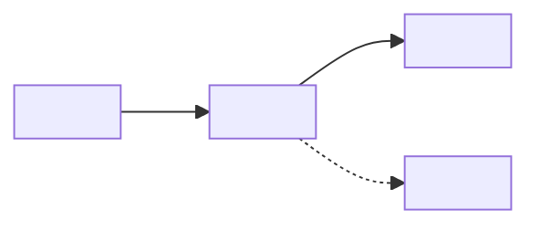

# Documentation Guidelines

How to write, restructure, and maintain **every doc in `docs/`**. The goal is **complete and
scannable**: everything a developer needs is written down, and a coding agent finds it without reading
the whole doc. Shorter is not the goal — findable is.

Related: [README.md](../README.md) — setup, commands and the list of docs; Storybook
(`npm run storybook`) — component usage and the rendered design tokens (§2).

| §   | Section                                                   | Look here for                                                                       |
| --- | --------------------------------------------------------- | ----------------------------------------------------------------------------------- |
| 1   | [Principles](#1-principles)                               | What docs are for; one home per fact; docs describe the repo as it is now           |
| 2   | [Where knowledge lives](#2-where-knowledge-lives)         | `docs/` vs README vs Storybook vs code comments vs git                              |
| 3   | [Doc types](#3-doc-types)                                 | Which kind of doc you're writing and what it opens with                             |
| 4   | [Structure](#4-structure)                                 | Naming, opening block, section building blocks, numbering, contents table, sections |
| 5   | [Content](#5-content)                                     | What to capture; rationale, history, values, sources; what may be removed           |
| 6   | [Writing style](#6-writing-style)                         | Bullets, prose, terminology                                                         |
| 7   | [Markdown mechanics](#7-markdown-mechanics)               | Tables, code blocks, links, banners, tags, formatting, Mermaid diagrams             |
| 8   | [Keeping docs true](#8-keeping-docs-true)                 | Verifying against code, inbound links, README                                       |
| 9   | [Rewriting an existing doc](#9-rewriting-an-existing-doc) | The rules that keep a rewrite from losing information                               |
| 10  | [Length and splitting](#10-length-and-splitting)          | No length limit; signals to restructure, when to split, how to measure              |
| 11  | [Template](#11-template)                                  | Copyable skeleton                                                                   |
| 12  | [Pre-commit checklist](#12-pre-commit-checklist)          | The last pass before committing a doc                                               |

---

## 1. Principles

1. **Docs hold the knowledge; code holds the implementation.** Anything someone needs to understand,
   change, or avoid breaking the app is written down: constraints, decisions and their reasons,
   alternatives that don't work, measurements, traps. **Never leave it only in a code comment, a commit
   message or a PR description.**
2. **Docs describe the repo as it is now.** No changelogs, investigation narratives, or status of
   finished work — git holds history. A doc is a specification, not a notepad (§5.3).
3. **Optimize, don't minimize.** Restructure, deduplicate, and tighten wording. Remove only what §5.6
   allows: what is wrong, obsolete, history, repeated, filler, or belongs somewhere else.
4. **Scannable means findable.** Predictable structure, headings with the words people search for,
   rules separated from their reasons, tables for anything looked up.
5. **Docs and code agree.** Docs restate values from code where that helps the reader, and every
   restated value is kept in sync (§8). A disagreement is a bug: find out which side is intended before
   changing either.
6. **Write for a coding agent making a change.** It arrives through search or the contents table, reads
   one section, and acts on it. People benefit from the same properties.
7. **Each fact has one home.** §2 says where each kind of knowledge lives. Everywhere else links to it.
   - Why: two copies of the same fact drift apart, and a reader cannot tell which one is current.
8. **Workflow lives where it runs.** Commands live in `package.json` scripts and the README; automation
   lives in scripts and hooks; agent procedures live in a skill or agent under [`.agents/`](../.agents/)
   ([AGENTS.md](../AGENTS.md)). A doc keeps the rules and reasons those steps follow — what must hold,
   what order matters and why — and links the script or skill. It never copies a command recipe or a
   skill's steps, and a skill cites the doc rather than copying its sections.

---

## 2. Where knowledge lives

| Knowledge                                                                | Home                                                                                                | Not in                        |
| ------------------------------------------------------------------------ | --------------------------------------------------------------------------------------------------- | ----------------------------- |
| Setup, requirements, `npm` commands                                      | [README.md](../README.md)                                                                           | `docs/`                       |
| Cross-cutting rules, architecture, decisions, traps                      | `docs/`                                                                                             | Code comments alone, PRs      |
| How to use a component: props, variants, states                          | Its Storybook stories, plus TSDoc on its props type (Storybook autodocs reads it)                   | `docs/`                       |
| Design token values                                                      | `tokens/*.json` (source); Storybook **Foundations/Design Tokens** (rendered, generated from source) | Hand-copied tables in `docs/` |
| Why one line of code is the way it is                                    | A comment at the declaration — and the decision in `docs/` if it constrains other code (§5.2)       |                               |
| Agent workflow: procedures, scripts, agent prompts                       | [`.agents/`](../.agents/) skills and agents, listed in [AGENTS.md](../AGENTS.md)                    | `docs/`                       |
| History: what changed, when, and why it changed                          | Git commits and PRs                                                                                 | `docs/`                       |
| Generated output (`src/tokens/generated/`, `dist/`, `storybook-static/`) | Nowhere — it is rebuilt; document the source and the build instead                                  | `docs/`, git                  |

- **A doc links to Storybook rather than copying what Storybook renders from source.** The token story
  reads `tokens/*.json` directly, so it is always current; a copied table is not. The doc keeps the
  rules for using tokens and the reasons behind them.
- **Component docs live with the component.** `docs/` covers what spans components: conventions,
  composition patterns, shared state, accessibility rules.

---

## 3. Doc types

| Type                | Example topics                                                | Opens with                                | Must also contain                                                                                       |
| ------------------- | ------------------------------------------------------------- | ----------------------------------------- | ------------------------------------------------------------------------------------------------------- |
| Rules and reference | Design tokens, component conventions, accessibility, this doc | Rules (Do / Never)                        | Task lookup, reference tables, traps, exceptions, the reason behind each rule                           |
| System explanation  | Architecture, routing, data fetching, state management        | The shape of the system and its contracts | How it works, decisions and the alternatives that don't work, measurements, traps                       |
| Tooling and config  | Token build, Storybook, linting and formatting, CI            | The settings that matter                  | The reason for every non-default setting; what the tool must not be changed to do                       |
| Working notes       | Open questions, known issues                                  | Open items, grouped by what unblocks them | Status per item. Open items only: a closed item's outcome moves into the doc that owns the topic (§5.3) |
| Proposals           | A planned feature or migration                                | Status banner                             | Goals, conflicts with today's design, what to measure or decide first                                   |

A doc that mixes types opens with the type most readers come for.

---

## 4. Structure

### 4.1 Naming

- New docs: `docs/<TOPIC>.md` in upper snake case, titled `# <Topic>` — `docs/DESIGN_TOKENS.md`,
  `# Design Tokens`.
- Renaming an existing doc or its title changes links — check inbound links first (§8).

### 4.2 Opening block

Every doc starts with these, in order. Omit an item only when it doesn't apply.

| Item            | Form                                                                             | Example                                                           |
| --------------- | -------------------------------------------------------------------------------- | ----------------------------------------------------------------- |
| Title           | `# <Topic>`                                                                      |                                                                   |
| Status banner   | Blockquote with a bold status, when the doc isn't a normal spec                  | `> **STATUS: NOT IMPLEMENTED.**` · `> **STATUS: PROPOSAL.**`      |
| Purpose         | 1–4 lines: what it covers and who needs it                                       |                                                                   |
| Source of truth | The files it describes; which doc wins where two overlap                         | "Source of truth: `tokens/*.json` and `scripts/build-tokens.mjs`" |
| Related docs    | Links to neighbours, with what each holds                                        |                                                                   |
| Stability note  | When code comments cite its `§n`                                                 | "Code cites §3 — do not renumber"                                 |
| Legend          | Every tag the doc uses                                                           | `[spec]` = from an external specification                         |
| Contents table  | `§ \| Section \| Look here for`, when the doc is over ~150 lines — rules in §4.5 | This doc                                                          |

### 4.3 Section building blocks

Pick the blocks a doc needs and keep them in this order. **Omit empty blocks** — no "None" or "TBD"
placeholders.

| Block                        | Holds                                                                                    |
| ---------------------------- | ---------------------------------------------------------------------------------------- |
| Rules / critical constraints | What must and must not happen — the one home for each rule                               |
| Task lookup                  | `I need to… \| Use \| Notes` → component, hook, token, file                              |
| Traps                        | Anything that fails silently or misleads: symptom → cause → fix                          |
| How it works                 | Explanation, data flow, contracts; a Mermaid diagram for any flow (§7.1)                 |
| Reference tables             | Values readers choose from or look up: props, routes, environment variables, breakpoints |
| Decisions                    | Decision, why, alternatives that don't work and why                                      |
| Measurements                 | Value, conditions (browser, device, build), source                                       |
| Exceptions                   | `Value \| Where \| Reason` register for departures from the doc's rules                  |
| Open items                   | Status, what unblocks it                                                                 |
| Cross-references             | Where related topics live                                                                |

- **Procedures are not doc blocks** (§1, Principle 8). A command belongs in a `package.json` script and
  the README; the doc keeps the rules and reasons around it, in the blocks above, and names the script —
  `Run: npm run tokens:build.`
- **A section that is replaced by a pointer keeps its number** as a one-line link, so cited `§n` still
  resolve (§4.4).

### 4.4 Numbering and headings

- **Number sections** (`## 1.`, `### 1.1`) so docs and code comments can cite `§n`.
- **Numbers run in order, without gaps or duplicates.** Don't split one section across two headings
  ("— continued").
- **Add material under the next free number instead of renumbering.** If a renumber is unavoidable,
  update every inbound `§n` in the same change (§8).
- **Headings use the words a reader searches for**: "Focus management", not "Keeping users oriented".
- **An open item's status goes in its heading or table row**: `— BLOCKED`. Closed items leave the doc
  (§5.3).
- Separate top-level sections with `---`.

### 4.5 Contents table

- **Add a contents table when a doc is over ~150 lines.** Place it at the end of the opening block,
  before the first `---`.
- **Use exactly three columns**: `| § | Section | Look here for |`.

| Column        | Contents                                                                                                                     |
| ------------- | ---------------------------------------------------------------------------------------------------------------------------- |
| `§`           | The section number. `—` for an unnumbered section, such as Quick rules                                                       |
| Section       | A link to the heading: `[Doc types](#3-doc-types)`. Link text is the heading without its number                              |
| Look here for | What a reader comes to the section to find — short noun phrases separated by commas or semicolons. Don't restate the heading |

- **List every `##` section, in document order.** In a doc over ~1,000 lines, also list the `###`
  subsections readers jump to directly, numbered `3.3`.
- **Anchors follow GitHub's heading slugs**: lowercase; spaces become `-`; punctuation other than `-`
  and `_` is dropped. `` ## 3. Props and `children` `` → `#3-props-and-children`;
  `## 2.3 Contrast minimums (accessibility)` → `#23-contrast-minimums-accessibility`. An em dash drops
  out and leaves a double hyphen: `### 3.1 Space — padding` → `#31-space--padding`.
- **Update the table in the same change as any heading edit.** Check every link resolves in the Markdown
  preview before committing.

### 4.6 Writing a section

A reader — usually a coding agent — lands in one section from search and reads only that section.

- **Make it self-contained.** Name components, hooks and files in full, and link terms defined
  elsewhere (`see §2.3`). Never "as above" or "the earlier table".
- **Answer first.** The first line says what the section decides or holds; details follow.
- **One topic per section.** The heading's scope matches the content; a second topic gets its own
  section.
- **Order the inside consistently**, skipping parts that don't apply:
  1. What the section decides or holds — one line
  2. Rules or the answer
  3. Why
  4. Details: values, tables, diagram
  5. Example
  6. Where it lives — file and export
  7. Related sections and docs — links, not summaries
- **Add a subsection** when the topic shifts, a second lookup table appears, or the section passes
  ~600 words (§10).
- **Heading depth**: `##` for sections, `###` for subsections, `####` only when unavoidable — never
  deeper.

```markdown
## 4. <Topic>

<One line: what this section decides or holds.>

- **<Rule>** — <reason>.

| <Key> | <Value> | <Use> |
| ----- | ------- | ----- |

Where it lives: [`<file>`](../src/path/to/file.tsx) — `<ExportName>`.

Related: §2, [<doc>](<DOC>.md).
```

---

## 5. Content

### 5.1 What to capture

For its topic, a doc captures:

- Constraints, and what breaks if they're violated
- Decisions and their reasons, including alternatives that don't work and why
- Measurements, with their conditions (browser, device, build mode) and source
- What a script or workflow must respect — the constraint, the order that matters and why — with the
  script's name (§1, Principle 8)
- Traps — anything that fails silently or misleads
- Approved exceptions to the doc's own rules
- Pointers into the code: file and export
- Open questions and what would answer them

### 5.2 Rationale — keep it, place it

- **Separate the rule from its reason.** State the rule in one line. Put the reason right after it — an
  inline clause when short, a `Why:` sub-bullet when longer — or in a Decisions table or subsection.
  Never bury a rule mid-paragraph.
- **Keep every reason that stops someone reintroducing a known failure**, however long. Tighten the
  wording, not the substance.
- **A code comment can hold the full argument at the declaration; the doc still holds the decision and
  its reason.** Link the file and export.

### 5.3 Current state, not history

- **Describe the repo as it is now.** No changelogs, no investigation narratives, no dated status of
  finished work. Git holds history.
- **Keep the reason, drop the story.** Restate what was learned as a present-tense rule or reason:
  "Breakpoints are literal `px` values — media queries cannot read CSS custom properties", not
  "Breakpoints were variables until we found…".
- **When an open item closes, write its outcome into the doc that owns the topic as current fact**, then
  delete the item. The outcome is every fact, measurement, reason and trap the item established — a
  finding that stops someone repeating a mistake goes in as a rule or a trap. The narrative of how it
  was found is dropped. Working-notes docs keep no closed items.
- **Avoid history words**: _used to_, _was_, _former_, _originally_, _until recently_, _closed on_.

### 5.4 Values from code

- **Restate values when they help a reader choose, understand, or check** — breakpoints, route tables,
  environment variables, prop defaults. Name the symbol and link the file.
- **Don't restate what is already rendered from source** — token scales are in Storybook (§2). Link the
  story instead.
- **Keep restated tables complete** and update them in the same change as the code (§8).

### 5.5 Sources and confidence

- **Say where every figure comes from.** Tag values from an external specification (`[spec]` — WCAG, a
  browser or library spec), give measured values their conditions and date, and label derived or
  assumed values. Define every tag in the legend.
- **Mark anything unverified** (`[?]`, "unverified") and track it as an open item.
- **A tuned constant's comment carries its method, date and value** —
  `// <value>: <how measured>, <date>, <conditions>, <runs>` — not "feels right" or "typical debounce".
  A value nobody has measured says so (`[?]`, unverified) and has an open item.
  - Why: a comment that reads as arbitrary invites the next person to replace a measured value; one
    that names its measurement does not.

### 5.6 What may be removed

| Remove                                                                        | Instead                                                                                         |
| ----------------------------------------------------------------------------- | ----------------------------------------------------------------------------------------------- |
| A wrong fact                                                                  | Fix it. If the mistake is easy to repeat, add the correct rule or a trap                        |
| Content about code that is gone                                               | Delete it. If it explains a current constraint, restate that as a present-tense reason          |
| History: changelogs, investigation narratives, dated status of finished work  | Delete it; git holds it. Keep any current fact or reason it established                         |
| A repeat of something elsewhere in the same doc                               | Keep one copy; link to it                                                                       |
| Filler words                                                                  | Delete them                                                                                     |
| Content that belongs in another doc, the README or Storybook                  | Move it there and link from where it was (§2)                                                   |
| A command recipe or procedure that duplicates a script, the README or a skill | Delete it and name the script or skill; keep each rule and reason it rests on (§1, Principle 8) |
| A fact repeated in another doc                                                | Keep it in the doc that owns the topic; link to it from the other (§6)                          |

Nothing else is removed. Length alone is never a reason (§10).

---

## 6. Writing style

- **One fact per bullet.** Lead with the rule or finding in bold; follow with the reason.
- **Imperative, present tense for rules**: "Use `--color-text-default`", not "it is recommended to use".
- **Prose is for explanation** — How it works, Decisions. Keep paragraphs short and put the point in the
  first sentence.
- **Each rule has one home per doc.** Elsewhere in that doc, link to it (`see §2.3`). Across docs, one
  doc owns a topic and the others link to it.
- **Name the symbol, not a description of it**: `useMediaQuery`, not "the media query hook";
  `--spacing-stack-md`, not "medium vertical spacing".
- **One term per concept, used everywhere.** Define it once where it first matters. Tokens are
  **primitive** or **semantic** — never "base", "raw" or "alias tokens".
- **Every number carries its unit**: `16 px`, `1 rem`, `300 ms`, `4.5:1`, `64 KB`.
- **Cut filler**: _note that_, _it's worth mentioning_, _in order to_, _simply_, _basically_.

---

## 7. Markdown mechanics

| Element         | Rule                                                                                           |
| --------------- | ---------------------------------------------------------------------------------------------- |
| Headings        | `#` syntax only — never a bold paragraph as a heading                                          |
| Code blocks     | Always tag the language: `tsx`, `ts`, `css`, `json`, `sh`, `text`                              |
| Tables          | For any item with 2+ attributes. Keep cells short; a long reason goes in a bullet below        |
| Identifiers     | Backticks for components, hooks, props, files, CSS variables, scripts, literal values          |
| Repo links      | Relative: `[build-tokens.mjs](../scripts/build-tokens.mjs)`                                    |
| Code references | **File + export, not line numbers** — line numbers drift                                       |
| Status banners  | Blockquote at the top: `> **STATUS: …**`                                                       |
| Callouts        | `> [!IMPORTANT]` for a rule a reader must not miss. Use sparingly                              |
| Tags            | Bracketed and defined in the legend: `[spec]`, `[?]`, `[!]`                                    |
| Line length     | Wrap prose near 100 columns                                                                    |
| Emphasis        | Bold the key phrase of a bullet; don't bold whole sentences                                    |
| Formatting      | Prettier formats Markdown on commit (lint-staged); run `npm run format:check` to check by hand |
| Diagrams        | Mermaid for any flow — see §7.1                                                                |

### 7.1 Diagrams

**Draw every flow as a Mermaid diagram** in a ` ```mermaid ` block — never ASCII art. Mermaid is text,
so an agent reads it and a diff stays reviewable, and GitHub renders it.

| Showing                                     | Mermaid type      | Fits                                                |
| ------------------------------------------- | ----------------- | --------------------------------------------------- |
| Pipelines and data flow                     | `flowchart LR`    | The token build: `tokens/*.json` → CSS → components |
| Layering, ownership, dependencies           | `flowchart TD`    | App shell, routes, feature components, shared UI    |
| Calls and handovers between parts over time | `sequenceDiagram` | A form submit: component → hook → API → cache       |
| Lifecycles and modes                        | `stateDiagram-v2` | An async request: idle → loading → success / error  |

- **Put the diagram beside the text that explains it.** The text states the rules; the diagram shows the
  shape. Values in a diagram also appear in a table or text where readers look them up.
- **Label nodes with real names** — files, components, hooks: `BUILD[scripts/build-tokens.mjs]`.
- **Label edges with what flows** along them: data, a prop, a call, an event.
- **Dotted edges (`-.->`) mark optional or conditional paths.**
- **Keep one diagram to about 15 nodes.** Split by stage past that.
- **No `style` or `classDef` colours** — diagrams must read in light and dark themes.
- **Don't diagram a lookup.** Prop lists, routes and token scales are tables.

---

## 8. Keeping docs true

- **Verify every symbol, value, and path against the code before committing.** Grep each one; a value
  in a table is a claim.
- **Change docs in the same commit as the code they describe.** Before renaming a component, hook,
  token, prop, script or environment variable, grep `docs/`, the README and the stories for its name.
- **Grep for the behaviour, not only the symbol, before changing it.** A comment that explains a
  behaviour is a claim, like a doc. When several files explain the same behaviour as intended,
  changing it means changing all of them. A justifying comment shows the behaviour was considered, not
  that it is still right.
- **Resolve disagreements deliberately.** Find which side is intended, fix the other, and record the
  decision if it isn't obvious.
- **Check inbound links before renaming a doc or renaming or renumbering a heading.** Code comments,
  config comments and other docs count (`// See docs/…`, `/* … §4.1 */`):

  ```sh
  grep -rn "DOC_NAME\|§4.1" --exclude-dir=node_modules --exclude-dir=dist .
  ```

- **List every doc in [README.md](../README.md)'s Documentation section** with a one-line description.

---

## 9. Rewriting an existing doc

A rewrite shrinks from deduplication, tighter wording, removed history and content moved to its proper
home (§2) — never from dropped facts or reasons.

- **Inventory before rewriting** every rule, value, decision, reason, measurement, trap, exception and
  open item — from the committed copy too when the doc has uncommitted edits — so nothing leaves without
  a §5.6 reason.
- **Map every item to a destination** — a section, another doc, the README, Storybook, a merge with its
  duplicate, or removal with a §5.6 reason — and check the map before committing.
- **Report what moved and what was removed** in the commit message or PR description.
- **Fix inbound links and `§n` citations** (§8).

---

## 10. Length and splitting

- **There is no word or line limit.** A long doc is fine when readers can find things in it. Its
  contents table (§4.5), numbered sections and Task lookup keep it findable, and code cites its `§n`.
- **Restructure when:**
  - finding one value means reading a whole section
  - the same fact appears in two places
  - a section runs past ~600 words with no table or subheading
  - rules are buried inside explanation
- **Length is never a reason to split a doc.** Split only when it covers topics that change
  independently — along topic lines, keeping cited `§n` stable, with a short hub section that links
  to the parts.
- **Measure before restructuring** — words per section:

  ```sh
  awk '/^#{2,3} /{if (h) print n "\t" h; h=$0; n=0; next} {n+=NF} END{if (h) print n "\t" h}' docs/<DOC>.md
  ```

---

## 11. Template

Keep the opening block; add blocks from §4.3 in order, and drop any that would be empty.

````markdown
# <Topic>

> **STATUS: <NOT IMPLEMENTED | PROPOSAL>** — <one line>.

<What this covers and who needs it.> Source of truth: [<file>](../path/to/file). Related:
[<doc>](<DOC>.md) — <what it holds>.

| Tag      | Meaning                                                          |
| -------- | ---------------------------------------------------------------- |
| `[spec]` | From an external specification (WCAG, a browser or library spec) |

| §   | Section           | Look here for                 |
| --- | ----------------- | ----------------------------- |
| 1   | [Rules](#1-rules) | What must and must not happen |
| 2   | [Traps](#2-traps) | Silent failures               |

---

## 1. Rules

### Do

1. **<Rule>** — <short reason>.
2. **<Rule>.**
   - Why: <longer reason that stops a known failure from coming back>.

### Never

- **<Thing that must not happen>** — <what breaks>.

---

## 2. Traps

- **<Symptom>** → <cause> → <fix>.

---

## 3. How it works

<One line: what this section explains.>

<Short paragraphs, each led by its point.>



Where it lives: [`<file>`](../src/path/to/file.tsx) — `<ExportName>`.

Related: §1, [<doc>](<DOC>.md).

---

## 4. Reference

| Symbol     | Value          | Use   | Source              |
| ---------- | -------------- | ----- | ------------------- |
| `<symbol>` | <value + unit> | <job> | `<file>` / `[spec]` |

---

## 5. Decisions

| Decision   | Why      | Alternatives that don't work, and why |
| ---------- | -------- | ------------------------------------- |
| <decision> | <reason> | <alternative> — <why it doesn't work> |

---

## 6. Exceptions

| Value     | Where    | Reason             |
| --------- | -------- | ------------------ |
| `<value>` | `<file>` | <why it's allowed> |

---

## 7. Open items

| Item       | Status           | Unblocked by                        |
| ---------- | ---------------- | ----------------------------------- |
| <question> | <open / blocked> | <measurement, decision, dependency> |
````

---

## 12. Pre-commit checklist

The last pass before committing a doc. Each check cites the section it tests.

- [ ] **Opening block** is complete and in order (§4.2); the contents table lists every `##` section and
      every link resolves (§4.5).
- [ ] **Sections are numbered** in order with no gaps; no inbound `§n` broke (§4.4, §8).
- [ ] **Each section answers first** and stands alone (§4.6).
- [ ] **Every rule has its reason**, next to it (§5.2).
- [ ] **No history words** or narratives (§5.3).
- [ ] **No content that lives elsewhere**: commands are in scripts and the README, component usage and
      token values are in Storybook (§2).
- [ ] **Every symbol, value and path exists** in the code — grepped, not remembered (§8).
- [ ] **Every figure has a source**, and every number has a unit (§5.5, §6).
- [ ] **Flows are Mermaid diagrams**, with no colours (§7.1).
- [ ] **Rewrites lost nothing**: every inventoried item has a destination or a §5.6 reason (§9).
- [ ] **The doc is listed** in the README's Documentation section (§8).
- [ ] **`npm run format:check` passes** (§7).
