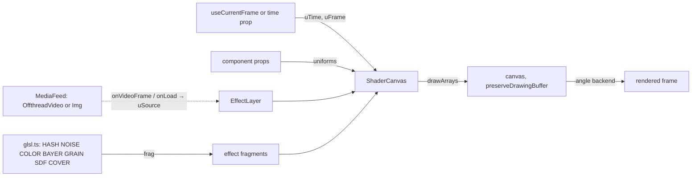

# Effects

How the kit's shader effects work inside: the render flow, the GLSL library, the liquid-glass
optics, the decisions and measurements behind them. For using them — which effect for which request,
every prop, rules and traps — see the [apply-effect skill](../.agents/skills/apply-effect/SKILL.md),
which is their home and travels with the kit.

Source of truth: [`src/effects/`](../src/effects/). Related: [MOTION_KIT.md](MOTION_KIT.md) — the CLI
(`motion-kit filter`, `sheet`, `still`) and packaging; [MOTION_REEL.md](MOTION_REEL.md) — the render
contract and studio rules; [BRAND_CAPTURE.md](BRAND_CAPTURE.md) — brand colours for palettes.

| Tag          | Meaning                                                 |
| ------------ | ------------------------------------------------------- |
| `[measured]` | Measured in this repo; conditions in §11                |
| `[spec]`     | From an external specification or a published technique |
| `[?]`        | Unverified; tracked in §13                              |

| §   | Section                                              | Look here for                                                        |
| --- | ---------------------------------------------------- | -------------------------------------------------------------------- |
| 1   | [Rules](#1-rules)                                    | Pointer: rules → apply-effect skill                                  |
| 2   | [Task lookup](#2-task-lookup)                        | Pointer: task lookup → apply-effect skill                            |
| 3   | [Traps](#3-traps)                                    | Pointer: traps → apply-effect skill                                  |
| 4   | [Backgrounds](#4-backgrounds)                        | Pointer: backgrounds → apply-effect skill                            |
| 5   | [Filters](#5-filters)                                | Pointer: filters → apply-effect skill                                |
| 6   | [Ripples and beat sync](#6-ripples-and-beat-sync)    | Pointer: ripples → apply-effect skill                                |
| 7   | [Liquid glass](#7-liquid-glass)                      | Optics of liquid glass (props and iOS patterns → apply-effect skill) |
| 8   | [How it works](#8-how-it-works)                      | `ShaderCanvas`, `EffectLayer`, GLSL library, render flow             |
| 9   | [Review and showcase](#9-review-and-showcase)        | `EffectsShowcase`, `LiquidGlassDemo`, `FrameSheet`                   |
| 10  | [Decisions](#10-decisions)                           | Choices made and the alternatives that don't work                    |
| 11  | [Measurements](#11-measurements)                     | Render times, bitrates, determinism                                  |
| 12  | [Licence and provenance](#12-licence-and-provenance) | Where the techniques come from; what was not copied                  |
| 13  | [Open items](#13-open-items)                         | Gaps and what would close them                                       |

---

## 1. Rules

Moved to the apply-effect skill: [rules and traps](../.agents/skills/apply-effect/references/rules.md).

---

## 2. Task lookup

Moved to the apply-effect skill: [task lookup](../.agents/skills/apply-effect/references/catalog.md#task-lookup).

---

## 3. Traps

Moved to the apply-effect skill: [traps](../.agents/skills/apply-effect/references/rules.md#traps).

---

## 4. Backgrounds

Moved to the apply-effect skill: [backgrounds — props, defaults, technique](../.agents/skills/apply-effect/references/catalog.md#backgrounds).

---

## 5. Filters

Moved to the apply-effect skill: [filters and media input](../.agents/skills/apply-effect/references/catalog.md#filters); [filter a whole video](../.agents/skills/apply-effect/references/catalog.md#filter-a-whole-video) with `npx motion-kit filter`.

---

## 6. Ripples and beat sync

Moved to the apply-effect skill: [ripples](../.agents/skills/apply-effect/references/catalog.md#ripples-and-beat-sync).

---

## 7. Liquid glass

`LiquidGlass` draws a backdrop and glass panels in one canvas; UI content (text, icons) goes in
`children`, positioned in composition pixels above the glass.

### 7.1 Props

Moved to the apply-effect skill: [liquid glass props](../.agents/skills/apply-effect/references/catalog.md#liquid-glass).

### 7.2 Optics

- **One shape for all panels**: the panels' rounded-rectangle distance fields are joined with a
  polynomial smooth minimum `[spec]` (Quílez), so panels within `smooth` px merge like liquid.
- **Dome profile**: inside the shape, distance to the edge `e` gives `k = 1 − e / bevel` (1 at the rim,
  0 inside) and height `h = 1 − k^2.6`. Its slope ramps smoothly across the whole bevel, so the image
  bows toward the rim instead of kinking at the edge; small panels are full domes.
- **Refraction (Snell's law)**: the surface normal is `normalize(outlineNormal · slope, 1)` with
  `slope = 2.6 · k^1.6 · refraction / bevel`. The view ray is bent with GLSL `refract(…, 1 / ior)`
  `[spec]` and travels to the backdrop through glass `refraction · (0.35 + 0.65 h)` deep; the
  displacement is capped at `2.5 · bevel`.
- **Outward sampling**: the backdrop is sampled outward from the rim, so the curve shows a compressed,
  wrapped view of what surrounds the glass (the Liquid Glass look); inward sampling only magnifies the
  edge ([traps](../.agents/skills/apply-effect/references/rules.md#traps)).
- **Dispersion**: red, green and blue sample at displacements × (1 + 0.3 d), × 1, × (1 − 0.3 d), so
  rainbow fringes appear where high-contrast detail crosses the curve.
- **Frost**: the backdrop is rendered to a mipmapped texture; blur samples a mip level plus a ring of
  8 taps.
- **Light**: from the 3D normal — steep rim areas (`1 − N.z`) catch a highlight on the side facing
  `lightAngle` and shade on the far side, plus a bright edge line all round; the drop shadow is the shape's distance field, offset and blurred
  exponentially.

### 7.3 iOS patterns

Moved to the apply-effect skill: [iOS patterns](../.agents/skills/apply-effect/references/catalog.md#ios-patterns).

---

## 8. How it works

Every effect is one fragment shader on a WebGL2 canvas, redrawn on each render from uniforms derived
from the frame.

- **`ShaderCanvas`** compiles its fragment once per context, then each render sets `uResolution`,
  `uTime`, `uFrame` and the effect's uniforms, uploads textures and draws one fullscreen triangle.
  GL resources persist between renders; nothing visual does.
- **`EffectLayer`** adds a `MediaFeed`; each decoded frame triggers a redraw through the canvas handle.
- **`LiquidGlass`** manages its own two-pass context: backdrop into a framebuffer (gradient program,
  cover-fit blit of media, or a clear colour), `generateMipmap`, then the glass program to the screen.
- **GLSL library** (`glsl.ts`): `HASH` (PCG integer hash), `NOISE` (3D gradient noise, quintic fade,
  `fbm3`), `COLOR` (sRGB ↔ linear, OKLab → linear), `BAYER`, `ign`, `GRAIN` (triangular, per frame),
  `SDF` (`sdRoundRect`, `smin`), `COVER`.
- **Context release**: on unmount each canvas calls `WEBGL_lose_context` after the commit, so a
  StrictMode remount keeps its context.

---

## 9. Review and showcase

| Composition         | Size        | Length         | Shows                                                                             |
| ------------------- | ----------- | -------------- | --------------------------------------------------------------------------------- |
| `EffectsShowcase`   | 1920 × 1080 | 11 × 2 s, 22 s | Every background, every filter over `public/samples/`, liquid glass over an image |
| `LiquidGlassDemo`   | 1080 × 1920 | 5.5 s          | iOS screen: widget, tiles, merging buttons, stretching tab lens                   |
| `LiquidGlassTabBar` | 1920 × 1080 | 6 s            | Floating tab bar over drifting clouds, stretching selection lens                  |
| `FrameSheet`        | computed    | —              | Any registered target at chosen frames, in one grid                               |

- **Review an effect with `node render.mjs frames <composition> <f,f,…>`** before a full render (the
  studio rules' loop, MOTION_REEL.md §22.2); confirm crisp effects at full size ([traps](../.agents/skills/apply-effect/references/rules.md#traps)).
- **Samples**: `public/samples/footage.mp4` (12 s, 960 × 540) and `public/samples/still.png` are cut
  from this repo's reel.

---

## 10. Decisions

| Decision                                                                       | Why                                                                                                          | Alternatives that don't work, and why                                                                                                                    |
| ------------------------------------------------------------------------------ | ------------------------------------------------------------------------------------------------------------ | -------------------------------------------------------------------------------------------------------------------------------------------------------- |
| Our own shaders from published techniques                                      | React Bits' licence (MIT + Commons Clause) forbids redistributing its components "as a ported version" (§12) | Porting their code — not allowed if this repo is shared                                                                                                  |
| Raw WebGL2, no three.js                                                        | Small, dependency-free, full control of the draw per frame                                                   | three.js / react-three-fiber — heavier, and its render loop must be disabled for Remotion anyway                                                         |
| Uniforms from the frame; scripted ripples and springs instead of pointer input | Pure function of time ([rules](../.agents/skills/apply-effect/references/rules.md))                          | The originals' rAF clocks and pointer state — differ run to run and cannot be scrubbed                                                                   |
| OKLab for gradient stops                                                       | Even, vivid blends                                                                                           | sRGB or linear-RGB mixing — muddy or too-bright midpoints                                                                                                |
| `angle` GL backend, pinned                                                     | Fastest, identical output run to run (§11)                                                                   | Default backend — slower, pixel differences from `angle`                                                                                                 |
| Backdrop drawn inside the glass canvas                                         | WebGL cannot sample the page                                                                                 | CSS `backdrop-filter` — no refraction, dispersion or rim optics; HTML-in-canvas — unverified (§13)                                                       |
| Glass refraction by Snell's law through a dome profile, sampled outward        | Bending grows smoothly toward the rim and wraps the surroundings, like Apple's Liquid Glass                  | A fixed displacement along the rim normal — a thin band that reads as a border, not a curve; inward sampling — magnifies the edge instead of wrapping it |
| Texture props as getters                                                       | Media frames arrive after render; the draw must read the latest frame                                        | Values captured at render — upload the previous (or no) frame ([traps](../.agents/skills/apply-effect/references/rules.md#traps))                        |
| `FrameSheet` targets inside `<Sequence width height>`                          | Effects size their canvas from `useVideoConfig()`                                                            | Plain `Freeze` — children see the sheet's size                                                                                                           |

---

## 11. Measurements

Measured 2026-10-25, Apple Silicon Mac (8 cores, 24 GB), Remotion 4.0.538, Chrome headless shell 157,
`gl: "angle"`, concurrency 3.

| Measurement                                                                          | Value                              |
| ------------------------------------------------------------------------------------ | ---------------------------------- |
| `EffectsShowcase` full render, 1320 frames                                           | 53–90 s (varies with machine load) |
| `LiquidGlassDemo` full render, 330 frames                                            | 17 s                               |
| `LiquidGlassTabBar` full render, 360 frames                                          | 17 s                               |
| `EffectsShowcase` bitrate at CRF 16                                                  | 87 Mb/s (240 MB for 22 s)          |
| `LiquidGlassDemo` / `LiquidGlassTabBar` bitrate at CRF 16                            | 40 / 47 Mb/s                       |
| Reel bitrate at CRF 16, for comparison                                               | ≈ 5 Mb/s                           |
| Same frame rendered twice (dither over video, glass over image, glass demo, tab bar) | Byte-identical                     |
| Probe still, `angle` / default / `swangle`                                           | 0.56 s / 1.9 s / 2.3 s             |
| 60 frames with 8-sample motion blur over a shader                                    | 2.9 s, no crash                    |

---

## 12. Licence and provenance

- **The looks were studied from five React Bits components** — Fluid Glass, Gradient Waves, Pixel
  Blast, Grainient, Dither (reactbits.dev, MIT + Commons Clause). Their source was read to identify
  the techniques; no code, shader or parameter set was copied or translated.
- **The techniques are published and general**: ordered (Bayer) dithering, halftone screens,
  interleaved gradient noise, gradient noise and fBm, domain warping, OKLab, ray-marched heightfields,
  signed-distance shapes and smooth minimum, mipmap blur. Component names here differ from React Bits'
  where theirs are product names.

---

## 13. Open items

| Item                                                                              | Status | Unblocked by                                                                                             |
| --------------------------------------------------------------------------------- | ------ | -------------------------------------------------------------------------------------------------------- |
| Filters and glass over React/DOM scenes (for example the reel's scenes)           | Open   | Testing Remotion's experimental HTML-in-canvas, or rendering the scene to video first and filtering that |
| Crisp effects under motion blur                                                   | Open   | A blur-before-quantise option inside `Dither` and `PixelField`                                           |
| Per-panel glass styles (different frost or tint per panel)                        | Open   | Per-panel uniforms in `LiquidGlass`                                                                      |
| Delivery bitrate of grainy effects                                                | Open   | A delivery encode preset (CRF 20–23) in `render.mjs`                                                     |
| Studio playback frame rate of heavy effects (`GradientWaves`) is unmeasured `[?]` | Open   | Measuring Studio playback at 1080p                                                                       |
| StrictMode context handling is reasoned, not observed `[?]`                       | Open   | Confirming Studio's StrictMode and watching context counts                                               |
