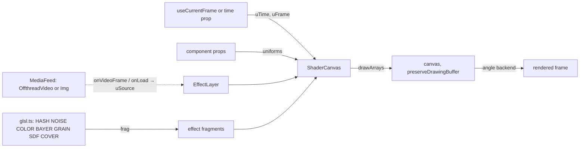

# Effects

The shader toolbox for films in this repo: animated backgrounds (grainy gradients, ray-marched waves,
drifting clouds, pixel fields, dither fields), filters over video and images (dither, halftone, pixel mosaic, gradient
map), and liquid-glass UI for Apple-style interface animation. Read it before adding an effect to a
film or writing a new one.

Source of truth: [`src/effects/`](../src/effects/) — import from
[`src/effects/index.ts`](../src/effects/index.ts). Related: [MOTION_REEL.md](MOTION_REEL.md) — the
render contract and studio rules every film follows (§1, §22.2 there);
[BRAND_CAPTURE.md](BRAND_CAPTURE.md) — a captured brand's colours, for effect palettes.

| Tag          | Meaning                                                 |
| ------------ | ------------------------------------------------------- |
| `[measured]` | Measured in this repo; conditions in §11                |
| `[spec]`     | From an external specification or a published technique |
| `[?]`        | Unverified; tracked in §13                              |

| §   | Section                                              | Look here for                                                             |
| --- | ---------------------------------------------------- | ------------------------------------------------------------------------- |
| 1   | [Rules](#1-rules)                                    | What every effect must and must not do                                    |
| 2   | [Task lookup](#2-task-lookup)                        | "The user asks for …" → which component and props                         |
| 3   | [Traps](#3-traps)                                    | Black filters, blurred dither, huge files, crashes, moiré                 |
| 4   | [Backgrounds](#4-backgrounds)                        | `Gradient`, `GradientWaves`, `PixelField`, `Dither` without a source      |
| 5   | [Filters](#5-filters)                                | `Dither`, `PixelField`, `GradientMap` over video and images; `MediaInput` |
| 6   | [Ripples and beat sync](#6-ripples-and-beat-sync)    | Scripted ripples in place of clicks; ripples on the beat grid             |
| 7   | [Liquid glass](#7-liquid-glass)                      | `LiquidGlass` props, optics, iOS patterns (tab lens, merging buttons)     |
| 8   | [How it works](#8-how-it-works)                      | `ShaderCanvas`, `EffectLayer`, GLSL library, render flow                  |
| 9   | [Review and showcase](#9-review-and-showcase)        | `EffectsShowcase`, `LiquidGlassDemo`, `FrameSheet`                        |
| 10  | [Decisions](#10-decisions)                           | Choices made and the alternatives that don't work                         |
| 11  | [Measurements](#11-measurements)                     | Render times, bitrates, determinism                                       |
| 12  | [Licence and provenance](#12-licence-and-provenance) | Where the techniques come from; what was not copied                       |
| 13  | [Open items](#13-open-items)                         | Gaps and what would close them                                            |

---

## 1. Rules

### Do

1. **Drive every effect from the frame** — components read `useCurrentFrame()`, or take `time` in
   seconds; no `requestAnimationFrame`, clocks or pointer input.
   - Why: the render contract (MOTION_REEL.md §22.2); Remotion renders frames out of order and in
     parallel.
2. **Script what the originals did with the pointer**: ripples are `Ripple` events (§6), glass panels
   move by springs, cursors follow paths.
3. **Render with the `angle` GL backend** — `render.mjs` and `remotion.config.ts` set it.
   - Why: it is the fastest backend and renders identically run to run (§11); other backends differ by
     a few pixel values.
4. **Keep crisp effects (`Dither`, `PixelField`) outside `CameraMotionBlur`** — layer them above the
   blurred content, or render that film without blur.
   - Why: blur averages 8 subframes, which turns hard dither cells into in-between tones (§3).
5. **Put media for filters under `public/`** and pass the path (`{ video: "samples/footage.mp4" }`);
   absolute URLs also work.
6. **Judge crisp effects from full-size frames**, not sheet thumbnails — downscaled dither and mosaics
   show moiré that is not in the film (§3).

### Never

- **Never use `Math.random`** in an effect — shaders hash coordinates and the frame index (`HASH`,
  `GRAIN` in `glsl.ts`).
- **Never stack more than a few WebGL layers in one frame** — Chrome keeps about 16 live contexts per
  page, and each `CameraMotionBlur` sample is another copy (§3). Combine looks in one shader instead.
- **Never point a filter or `LiquidGlass` at page content** — WebGL cannot read the DOM; the source is
  a video, an image, or a shader drawn in the same canvas (§13).

---

## 2. Task lookup

| The user asks for…                           | Use                                        | Start from                                                            |
| -------------------------------------------- | ------------------------------------------ | --------------------------------------------------------------------- |
| A dithering effect on their video            | `Dither` with `source={{ video }}`         | `mode="bayer8"`, `pixelSize={3}`, a 2–4 colour `palette`              |
| A 1-bit / Game Boy / retro look              | `Dither`                                   | `palette` of 2 or 4 colours, `mode="bayer4"`, `pixelSize={4}`         |
| Newspaper or comic halftone                  | `Dither`                                   | `mode="halftone"`, `pixelSize={8}`, `angle={45}`, palette ink + paper |
| Engraving / hatching                         | `Dither`                                   | `mode="lines"` or `"crosshatch"`, `pixelSize={6}`                     |
| A grainy gradient background                 | `Gradient`                                 | `type="mesh"`, 3–4 brand colours, `grain={0.06}`                      |
| A silky or flowing gradient                  | `Gradient`                                 | `type="linear"`, `bands={3}`, `silk={0.8}`, `warp={0.8}`              |
| Hard-edged colour blocks that drift          | `Gradient`                                 | `type="conic"` or `"linear"`, `softness={0.15}`                       |
| A 3D wave / ocean / landscape gradient       | `GradientWaves`                            | defaults; set the four colours                                        |
| A sky with drifting clouds                   | `Sky`                                      | `cover={0.55}`, `sharpness={0.6}`                                     |
| Pixel, LED or dot-matrix background          | `PixelField`                               | `shape="circle"`, `background`, `cellSize={14}`                       |
| Pixels that pulse on the beat                | `PixelField` or `Dither` with `ripples`    | §6                                                                    |
| Mosaic / pixelated footage                   | `PixelField` with `source`, `sourceColor`  | `shape="square"`, `cellSize={12}`                                     |
| Duotone, tritone or brand-tinted footage     | `GradientMap`                              | 2–3 `colors`, `grain={0.06}`                                          |
| Film grain on footage                        | `GradientMap`                              | `amount={0}` (original colours) and `grain`                           |
| Apple Liquid Glass / iOS UI animation        | `LiquidGlass`                              | `LiquidGlassDemo`, `LiquidGlassTabBar` (§7.3)                         |
| A floating glass tab bar                     | `LiquidGlass` + a stretching lens panel    | `LiquidGlassTabBar` (§7.3)                                            |
| Glass over an animated effect                | `LiquidGlass` with `backdrop={{ shader }}` | `{ fragment: SKY_FRAGMENT, uniforms: skyUniforms({}) }`               |
| Frosted-glass cards over a photo or gradient | `LiquidGlass`                              | `glass={{ frost: 8 }}`                                                |
| Shapes that melt together                    | `LiquidGlass` with `glass.smooth`          | `smooth` ≈ 30–40 px                                                   |
| An effect this toolbox lacks                 | `ShaderCanvas` with your own fragment      | §8; copy a component as the template                                  |

---

## 3. Traps

- **Filter renders black** → the media frame arrived after the texture was read → texture props are
  getters read at draw time (`EffectLayer` passes `() => frame.current`); keep that pattern in new
  media effects.
- **Dither or pixels look soft and grey** → `CameraMotionBlur` averaged subframes over a crisp effect →
  keep crisp effects outside the blur (§1, rule 4).
- **Film is hundreds of megabytes** → per-frame grain and dither are noise H.264 cannot compress: the
  showcase is 87 Mb/s at CRF 16 versus about 5 Mb/s for the reel (§11) → lower `grain`, raise
  `grainSize` to 2–3 px, or encode the delivery copy at CRF 20–23.
- **Sheet thumbnails show stripes or moiré** → 9–14 px cells scaled to a quarter alias → check a
  full-size `node render.mjs still <frame> <composition>`.
- **`FrameSheet` thumbnails are stretched or mis-positioned** → `useVideoConfig()` inside the sheet
  returned the sheet's size → each target renders inside `<Sequence width height>` so effects see the
  target's size; keep it.
- **`Error: Page crashed!` or "Too many active WebGL contexts"** → too many effect canvases alive at
  once → fewer layers, shorter overlaps between sequences; unmounted effects release their context
  after the commit (`ShaderCanvas`, `LiquidGlass`).
- **"Does this look like a foreign page?" when rendering** → Remotion's port probe hit a running
  Studio on :3000 → `render.mjs` uses port 3555; override with `RENDER_PORT`.
- **"WebGL2 unavailable"** → a backend without WebGL2 → `chromiumOptions.gl = "angle"`.
- **Glass refraction is invisible** → there is nothing behind the glass to bend (a flat sky, a soft
  gradient) → refraction shows on detail: clouds (`Sky`), an image, text, stripes. Raise `refraction`
  and widen `bevel` toward half the panel's height for a full dome.
- **Glass rim magnifies instead of wrapping** → samples taken inward from the rim stretch the edge →
  the shader samples outward (`disp = −R.xy …`), so the curve shows a compressed view of the
  surroundings; keep that sign.
- **Glass panels bridge into each other** → panels closer than about `smooth / 2` merge → keep gaps
  ≥ `smooth / 2`, or set `smooth: 0` when nothing should melt.

---

## 4. Backgrounds

Backgrounds fill the frame from time alone; each takes `time` (seconds, default frame / fps) and `style`.

### 4.1 Gradient

The primary background: colour stops mixed in OKLab, domain-warped so they flow, with optional silk
bands and per-frame grain.

| Prop         | Default      | Does                                                         |
| ------------ | ------------ | ------------------------------------------------------------ |
| `colors`     | required     | 2–6 hex stops                                                |
| `type`       | `"mesh"`     | `mesh` (drifting colour points), `linear`, `radial`, `conic` |
| `angle`      | `0`          | Degrees, for `linear` and `conic`                            |
| `center`     | `[0.5, 0.5]` | 0–1 position, for `radial` and `conic`                       |
| `speed`      | `1`          | Flow speed                                                   |
| `scale`      | `1.2`        | Noise feature size; higher = smaller features                |
| `warp`       | `1`          | Domain-warp strength; `0` = straight gradient                |
| `bands`      | `0`          | Silk bands across the frame; `0` disables                    |
| `silk`       | `0.5`        | Silk sheen strength, 0–1                                     |
| `softness`   | `1`          | `0` = hard colour regions, `1` = smooth blends               |
| `grain`      | `0.06`       | Grain amount, 0–0.3                                          |
| `grainSize`  | `1.2`        | Grain size, px                                               |
| `contrast`   | `1`          | Lightness contrast in OKLab                                  |
| `saturation` | `1`          | Chroma multiplier in OKLab                                   |
| `seed`       | `0`          | Changes the noise field and mesh paths                       |
| `resolution` | `1`          | Render scale                                                 |

- **Technique**: two-level domain warp — gradient noise displaces the coordinates of a second noise,
  which displaces the gradient's input `[spec]` (Quílez, "domain warping"). Mesh mode places one
  point per colour on slow Lissajous paths and blends by inverse distance, power `1 + 2·(1 − softness)`.
- **OKLab mixing** keeps midpoints vivid; sRGB mixing goes muddy between complementary colours.

### 4.2 GradientWaves

A ray-marched wave surface under a gradient sky.

| Prop           | Default   | Does                                               |
| -------------- | --------- | -------------------------------------------------- |
| `skyColor`     | `#1a1440` | Top of the sky                                     |
| `horizonColor` | `#7b5cff` | Horizon and fog                                    |
| `waveColor`    | `#2a1a6e` | Troughs                                            |
| `crestColor`   | `#ffb8f0` | Crests, sun highlights                             |
| `speed`        | `0.5`     | Wave speed and camera travel                       |
| `amplitude`    | `1`       | Wave height                                        |
| `frequency`    | `0.45`    | Higher = smaller waves                             |
| `choppiness`   | `0.4`     | `0` rolling sine, `1` sharp crests                 |
| `cameraHeight` | `2.2`     | Camera height above the surface                    |
| `tilt`         | `12`      | Camera pitch below the horizon, degrees            |
| `fog`          | `1`       | Higher = shorter view distance                     |
| `sunAngle`     | `20`      | Sun direction, degrees                             |
| `sheen`        | `0.8`     | Sun specular on the water                          |
| `grain`        | `0.05`    | Grain amount                                       |
| `resolution`   | `0.75`    | Render scale; the ray march is the heaviest effect |

- **Technique**: height = four directional wave trains, octave-stacked, crests sharpened by
  `pow(sin, 1 + 2.5·choppiness)`; each pixel's ray steps toward the surface, then bisects the last
  step 6 times; shading mixes troughs to crests by height, adds diffuse, sun specular, fresnel sky
  reflection and exponential fog.

### 4.3 PixelField (background)

Without `source`, `PixelField` is a grid of shaped pixels sized by animated noise. Props are in §5.2.

### 4.4 Dither (background)

Without `source`, `Dither` dithers its own domain-warped noise waves (`waveSpeed`, `waveFrequency`,
`waveWarp`). Props are in §5.1.

### 4.5 Sky

Drifting clouds on a sky gradient — a detailed backdrop for liquid glass, and a background in its own right.

| Prop                       | Default              | Does                      |
| -------------------------- | -------------------- | ------------------------- |
| `topColor`, `bottomColor`  | `#0b1a44`, `#27457f` | Sky gradient              |
| `cloudColor`, `shadeColor` | `#e9eef7`, `#2d3f66` | Lit and shadowed cloud    |
| `cover`                    | `0.5`                | `0` clear, `1` overcast   |
| `sharpness`                | `0.3`                | `0` wispy, `1` hard-edged |
| `speed`                    | `1`                  | Drift speed               |
| `scale`                    | `1.5`                | Higher = smaller clouds   |
| `grain`                    | `0.03`               | Grain amount              |

- **Technique**: 6-octave gradient-noise fBm, lightly domain-warped (0.22), thresholded into density;
  sampling the density again toward the light gives soft self-shadowing. Strong warp turns clouds
  into marble — keep it low.
- **As a glass backdrop**: `backdrop={{ shader: { fragment: SKY_FRAGMENT, uniforms: skyUniforms({ … }) } }}`.

Where it lives: [`backgrounds/Gradient.tsx`](../src/effects/backgrounds/Gradient.tsx),
[`backgrounds/Sky.tsx`](../src/effects/backgrounds/Sky.tsx),
[`backgrounds/GradientWaves.tsx`](../src/effects/backgrounds/GradientWaves.tsx).

---

## 5. Filters

A filter samples a video or image as the `uSource` texture; the same component without `source` is a
background (§4).

### 5.1 Dither

| Prop                                     | Default              | Does                                                                                 |
| ---------------------------------------- | -------------------- | ------------------------------------------------------------------------------------ |
| `source`                                 | —                    | `MediaInput` (§5.4); omit for the noise-wave background                              |
| `mode`                                   | `"bayer8"`           | `bayer8`, `bayer4`, `bayer2`, `halftone`, `lines`, `crosshatch`, `noise`, `none`     |
| `pixelSize`                              | `4`                  | Cell size, px                                                                        |
| `palette`                                | —                    | Dark → light hex colours (up to 8), mapped by luminance; omit to keep source colours |
| `levels`                                 | `2`                  | Levels per channel when there is no palette                                          |
| `contrast`                               | `1`                  | Applied before quantising                                                            |
| `brightness`                             | `0`                  | Added before quantising                                                              |
| `gamma`                                  | `1`                  | > 1 darkens mid-tones                                                                |
| `angle`                                  | `45`                 | Screen angle for `halftone`, `lines`, `crosshatch`, degrees                          |
| `waveSpeed`, `waveFrequency`, `waveWarp` | `0.25`, `1.6`, `1.2` | Background-mode noise waves                                                          |
| `ripples`                                | —                    | §6; brighten as they pass                                                            |
| `rippleSpeed`, `rippleWidth`             | `0.9`, `0.08`        | Ring speed (canvas heights per second) and width                                     |

- **Technique**: snap to the cell grid (rotated for screens), tone, then
  `index = floor(luma · (N − 1) + threshold)`. Bayer thresholds come from the recursive definition —
  each bit of (x, y) adds a base-4 digit from the 2 × 2 pattern (0 2 / 3 1) — verified against the
  textbook 4 × 4 and 8 × 8 matrices `[spec]`. Halftone uses radial distance in a rotated cell;
  `noise` uses interleaved gradient noise `[spec]` (Jimenez 2014).

### 5.2 PixelField

| Prop                                      | Default                 | Does                                                                         |
| ----------------------------------------- | ----------------------- | ---------------------------------------------------------------------------- |
| `source`                                  | —                       | `MediaInput`; omit for the noise-field background                            |
| `shape`                                   | `"square"`              | `square`, `circle`, `diamond`, `triangle`, `cross`, `ring`                   |
| `cellSize`                                | `14`                    | Cell pitch, px                                                               |
| `color`                                   | `#d97757`               | Pixel colour                                                                 |
| `sourceColor`                             | `false`                 | Filter mode: pixels take the footage colour                                  |
| `background`                              | —                       | Fill behind the pixels; omit for transparent                                 |
| `scale`, `density`, `speed`, `driftAngle` | `2.2`, `0.6`, `1`, `30` | Background-mode noise: size, coverage, speed, drift direction                |
| `dither`                                  | `0`                     | `0` pixel size follows the value; `1` pixels switch on/off by ordered dither |
| `jitter`                                  | `0`                     | Random per-pixel size variation                                              |
| `twinkle`                                 | `0.2`                   | Per-pixel shimmer                                                            |
| `edgeFade`                                | `0`                     | Fade toward the frame edges                                                  |
| `ripples`, `rippleSpeed`, `rippleWidth`   | —, `0.8`, `0.06`        | §6                                                                           |

- **Technique**: each cell computes one value (noise or source luminance, plus ripples, twinkle and
  jitter), turns it into a coverage size, and draws the shape as a signed-distance mask with 1.2 px
  anti-aliasing; output is premultiplied so a transparent field composites over other layers.

### 5.3 GradientMap

| Prop                 | Default       | Does                              |
| -------------------- | ------------- | --------------------------------- |
| `source`             | required      | `MediaInput`                      |
| `colors`             | required      | Shadows → highlights, 2–6 hex     |
| `amount`             | `1`           | `0` original, `1` fully mapped    |
| `contrast`           | `1`           | Luminance contrast before mapping |
| `grain`, `grainSize` | `0.06`, `1.2` | Film grain                        |

### 5.4 Media input

| `MediaInput`                         | Loads with       | Notes                                                         |
| ------------------------------------ | ---------------- | ------------------------------------------------------------- |
| `{ video: "path.mp4", trimBefore? }` | `OffthreadVideo` | Frame-accurate; each decoded frame arrives via `onVideoFrame` |
| `{ image: "path.png" }`              | Remotion `Img`   | Render waits for load                                         |

- **Paths are under `public/`** (passed to `staticFile`); `http(s):`, `data:` and `/` paths pass through.
- **Sources are cover-fitted** to the canvas (`COVER` in `glsl.ts`).
- **The media element stays in the DOM at opacity 0**; video filters are muted — add an
  `Html5Audio` for sound.

Where it lives: [`filters/`](../src/effects/filters/), [`media.tsx`](../src/effects/media.tsx) —
`MediaFeed`, `EffectLayer`.

---

## 6. Ripples and beat sync

`ripples` replaces the originals' click ripples: each is `{ x, y, at, strength? }` — position 0–1 from
the top-left, start time in seconds.

- **The 8 most recent started ripples are active** (`MAX_RIPPLES`); each ring travels at
  `rippleSpeed` canvas heights per second and fades exponentially.
- **Land ripples on the measured beat grid** with `timeAtBeat` from [`src/reel/time.ts`](../src/reel/time.ts):

```tsx
import { timeAtBeat } from "../reel/time";
const ripples = [8, 9, 10, 11].map((b, i) => ({
  x: [0.3, 0.7, 0.5, 0.2][i],
  y: 0.5,
  at: timeAtBeat(b),
}));
<PixelField shape="circle" background="#0d0d10" ripples={ripples} />;
```

- **Times are relative to the effect's own timeline** — inside a `Sequence`, subtract the sequence's
  start.

Where it lives: [`ripples.ts`](../src/effects/ripples.ts) — `Ripple`, `rippleUniforms`, `RIPPLE_GLSL`.

---

## 7. Liquid glass

`LiquidGlass` draws a backdrop and glass panels in one canvas; UI content (text, icons) goes in
`children`, positioned in composition pixels above the glass.

### 7.1 Props

| Prop                 | Default          | Does                                                                                                         |
| -------------------- | ---------------- | ------------------------------------------------------------------------------------------------------------ |
| `backdrop`           | required         | `{ gradient: GradientProps }`, `{ shader: { fragment, uniforms } }`, `{ color }`, `{ video }` or `{ image }` |
| `panels`             | required         | Up to 8 `{ x, y, width, height, radius? }` in composition px; `radius` defaults to a capsule                 |
| `glass`              | `DEFAULT_GLASS`  | Partial `GlassStyle`, below                                                                                  |
| `time`, `resolution` | frame / fps, `1` | Backdrop time; render scale                                                                                  |

| `GlassStyle`                               | Default            | Does                                                                          |
| ------------------------------------------ | ------------------ | ----------------------------------------------------------------------------- |
| `refraction`                               | `80`               | Glass thickness, px: scales how far the curved rim bends the backdrop         |
| `bevel`                                    | `64`               | Width of the curved rim, px; a panel under twice this is a full dome (a lens) |
| `ior`                                      | `1.5`              | Index of refraction: `1` no bending, `1.5` glass, higher bends more           |
| `dispersion`                               | `0.4`              | Chromatic split at the rim, 0–1                                               |
| `frost`                                    | `1.5`              | Blur radius, px; `0` = clear glass                                            |
| `saturation`                               | `1.35`             | Vibrancy of what is seen through the glass                                    |
| `brightness`                               | `1.06`             | Brightness through the glass                                                  |
| `tint`, `tintAmount`                       | `#ffffff`, `0.06`  | Glass tint                                                                    |
| `specular`                                 | `0.9`              | Rim highlight strength                                                        |
| `lightAngle`                               | `115`              | Light direction, degrees: 0 from the right, 90 from the top                   |
| `edgeWidth`                                | `1.2`              | Bright edge line, px                                                          |
| `shadow`, `shadowSoftness`, `shadowOffset` | `0.25`, `28`, `10` | Drop shadow strength, blur px, downward offset px                             |
| `smooth`                                   | `0`                | Panels closer than this many px melt together                                 |

### 7.2 Optics

- **One shape for all panels**: the panels' rounded-rectangle distance fields are joined with a
  polynomial smooth minimum `[spec]` (Quílez), so panels within `smooth` px merge like liquid.
- **Dome profile**: inside the shape, distance to the edge `e` gives `k = 1 − e / bevel` (1 at the rim,
  0 inside) and height `h = 1 − k^2.6`. Its slope ramps smoothly across the whole bevel, so the image
  bows toward the rim instead of kinking at the edge; small panels are full domes.
- **Refraction (Snell's law)**: the surface normal is `normalize(outlineNormal · slope, 1)` with
  `slope = 2.6 · k^1.6 · refraction / bevel`. The view ray is bent with GLSL `refract(…, 1 / ior)`
  `[spec]` and travels to the backdrop through glass `refraction · (0.35 + 0.65 h)` deep; the
  displacement is capped at `2.5 · bevel`.
- **Outward sampling**: the backdrop is sampled outward from the rim, so the curve shows a compressed,
  wrapped view of what surrounds the glass (the Liquid Glass look); inward sampling only magnifies the
  edge (§3).
- **Dispersion**: red, green and blue sample at displacements × (1 + 0.3 d), × 1, × (1 − 0.3 d), so
  rainbow fringes appear where high-contrast detail crosses the curve.
- **Frost**: the backdrop is rendered to a mipmapped texture; blur samples a mip level plus a ring of
  8 taps.
- **Light**: from the 3D normal — steep rim areas (`1 − N.z`) catch a highlight on the side facing
  `lightAngle` and shade on the far side, plus a bright edge line all round; the drop shadow is the shape's distance field, offset and blurred
  exponentially.

### 7.3 iOS patterns

[`LiquidGlassDemo`](../src/effects/showcase/LiquidGlassDemo.tsx) (1080 × 1920) and
[`LiquidGlassTabBar`](../src/effects/showcase/LiquidGlassTabBar.tsx) (1920 × 1080) are the references:

- **Tab-bar selection lens**: a capsule slightly taller than the bar, so it bulges out of it through
  the smooth union. Its leading and trailing edges follow the same moves on springs of different
  frequency (3.4 Hz and 2.1 Hz), so the lens stretches as it travels and settles (prompt 3,
  MOTION_REEL.md §22.3).
- **Merging buttons**: two circles whose gap springs to 0 melt into one capsule, then part.
- **Widgets and tiles**: rounded rectangles (radius 64 px) with crisp DOM text and SVG icons on top.
- **Floating tab bar** (`LiquidGlassTabBar`): a 640 × 150 capsule with `refraction: 110`, `bevel: 72`
  (nearly a full dome across its height), clear glass (`frost: 0.5`), over `Sky`; the selection lens
  is a capsule 20 px taller than the bar, so it bulges out of it.
- **Wallpaper**: `Sky` as a shader backdrop gives the glass detail to bend; `{ image }` or `{ video }`
  for a photo.

Where it lives: [`ui/LiquidGlass.tsx`](../src/effects/ui/LiquidGlass.tsx) — `LiquidGlass`,
`DEFAULT_GLASS`, `GlassPanel`, `GlassStyle`.

---

## 8. How it works

Every effect is one fragment shader on a WebGL2 canvas, redrawn on each render from uniforms derived
from the frame.



- **`ShaderCanvas`** compiles its fragment once per context, then each render sets `uResolution`,
  `uTime`, `uFrame` and the effect's uniforms, uploads textures and draws one fullscreen triangle.
  GL resources persist between renders; nothing visual does.
- **`EffectLayer`** adds a `MediaFeed`; each decoded frame triggers a redraw through the canvas handle.
- **`LiquidGlass`** manages its own two-pass context: backdrop into a framebuffer (gradient program,
  cover-fit blit of media, or a clear colour), `generateMipmap`, then the glass program to the screen.
- **GLSL library** (`glsl.ts`): `HASH` (PCG integer hash), `NOISE` (3D gradient noise, quintic fade,
  `fbm3`), `COLOR` (sRGB ↔ linear, OKLab → linear), `BAYER`, `ign`, `GRAIN` (triangular, per frame),
  `SDF` (`sdRoundRect`, `smin`), `COVER`.
- **Context release**: on unmount each canvas calls `WEBGL_lose_context` after the commit, so a
  StrictMode remount keeps its context.

---

## 9. Review and showcase

| Composition         | Size        | Length         | Shows                                                                             |
| ------------------- | ----------- | -------------- | --------------------------------------------------------------------------------- |
| `EffectsShowcase`   | 1920 × 1080 | 11 × 2 s, 22 s | Every background, every filter over `public/samples/`, liquid glass over an image |
| `LiquidGlassDemo`   | 1080 × 1920 | 5.5 s          | iOS screen: widget, tiles, merging buttons, stretching tab lens                   |
| `LiquidGlassTabBar` | 1920 × 1080 | 6 s            | Floating tab bar over drifting clouds, stretching selection lens                  |
| `FrameSheet`        | computed    | —              | Any registered target at chosen frames, in one grid                               |

- **Review an effect with `node render.mjs frames <composition> <f,f,…>`** before a full render (the
  studio rules' loop, MOTION_REEL.md §22.2); confirm crisp effects at full size (§3).
- **Samples**: `public/samples/footage.mp4` (12 s, 960 × 540) and `public/samples/still.png` are cut
  from this repo's reel.

---

## 10. Decisions

| Decision                                                                       | Why                                                                                                          | Alternatives that don't work, and why                                                                                                                    |
| ------------------------------------------------------------------------------ | ------------------------------------------------------------------------------------------------------------ | -------------------------------------------------------------------------------------------------------------------------------------------------------- |
| Our own shaders from published techniques                                      | React Bits' licence (MIT + Commons Clause) forbids redistributing its components "as a ported version" (§12) | Porting their code — not allowed if this repo is shared                                                                                                  |
| Raw WebGL2, no three.js                                                        | Small, dependency-free, full control of the draw per frame                                                   | three.js / react-three-fiber — heavier, and its render loop must be disabled for Remotion anyway                                                         |
| Uniforms from the frame; scripted ripples and springs instead of pointer input | Pure function of time (§1)                                                                                   | The originals' rAF clocks and pointer state — differ run to run and cannot be scrubbed                                                                   |
| OKLab for gradient stops                                                       | Even, vivid blends                                                                                           | sRGB or linear-RGB mixing — muddy or too-bright midpoints                                                                                                |
| `angle` GL backend, pinned                                                     | Fastest, identical output run to run (§11)                                                                   | Default backend — slower, pixel differences from `angle`                                                                                                 |
| Backdrop drawn inside the glass canvas                                         | WebGL cannot sample the page                                                                                 | CSS `backdrop-filter` — no refraction, dispersion or rim optics; HTML-in-canvas — unverified (§13)                                                       |
| Glass refraction by Snell's law through a dome profile, sampled outward        | Bending grows smoothly toward the rim and wraps the surroundings, like Apple's Liquid Glass                  | A fixed displacement along the rim normal — a thin band that reads as a border, not a curve; inward sampling — magnifies the edge instead of wrapping it |
| Texture props as getters                                                       | Media frames arrive after render; the draw must read the latest frame                                        | Values captured at render — upload the previous (or no) frame (§3)                                                                                       |
| `FrameSheet` targets inside `<Sequence width height>`                          | Effects size their canvas from `useVideoConfig()`                                                            | Plain `Freeze` — children see the sheet's size                                                                                                           |

---

## 11. Measurements

Measured 2026-10-25, Apple Silicon Mac (8 cores, 24 GB), Remotion 4.0.538, Chrome headless shell 157,
`gl: "angle"`, concurrency 3.

| Measurement                                                                          | Value                              |
| ------------------------------------------------------------------------------------ | ---------------------------------- |
| `EffectsShowcase` full render, 1320 frames                                           | 53–90 s (varies with machine load) |
| `LiquidGlassDemo` full render, 330 frames                                            | 17 s                               |
| `LiquidGlassTabBar` full render, 360 frames                                          | 17 s                               |
| `EffectsShowcase` bitrate at CRF 16                                                  | 87 Mb/s (240 MB for 22 s)          |
| `LiquidGlassDemo` / `LiquidGlassTabBar` bitrate at CRF 16                            | 40 / 47 Mb/s                       |
| Reel bitrate at CRF 16, for comparison                                               | ≈ 5 Mb/s                           |
| Same frame rendered twice (dither over video, glass over image, glass demo, tab bar) | Byte-identical                     |
| Probe still, `angle` / default / `swangle`                                           | 0.56 s / 1.9 s / 2.3 s             |
| 60 frames with 8-sample motion blur over a shader                                    | 2.9 s, no crash                    |

---

## 12. Licence and provenance

- **The looks were studied from five React Bits components** — Fluid Glass, Gradient Waves, Pixel
  Blast, Grainient, Dither (reactbits.dev, MIT + Commons Clause). Their source was read to identify
  the techniques; no code, shader or parameter set was copied or translated.
- **The techniques are published and general**: ordered (Bayer) dithering, halftone screens,
  interleaved gradient noise, gradient noise and fBm, domain warping, OKLab, ray-marched heightfields,
  signed-distance shapes and smooth minimum, mipmap blur. Component names here differ from React Bits'
  where theirs are product names.

---

## 13. Open items

| Item                                                                              | Status | Unblocked by                                                                                             |
| --------------------------------------------------------------------------------- | ------ | -------------------------------------------------------------------------------------------------------- |
| Filters and glass over React/DOM scenes (for example the reel's scenes)           | Open   | Testing Remotion's experimental HTML-in-canvas, or rendering the scene to video first and filtering that |
| Crisp effects under motion blur                                                   | Open   | A blur-before-quantise option inside `Dither` and `PixelField`                                           |
| Per-panel glass styles (different frost or tint per panel)                        | Open   | Per-panel uniforms in `LiquidGlass`                                                                      |
| Delivery bitrate of grainy effects                                                | Open   | A delivery encode preset (CRF 20–23) in `render.mjs`                                                     |
| Studio playback frame rate of heavy effects (`GradientWaves`) is unmeasured `[?]` | Open   | Measuring Studio playback at 1080p                                                                       |
| StrictMode context handling is reasoned, not observed `[?]`                       | Open   | Confirming Studio's StrictMode and watching context counts                                               |
