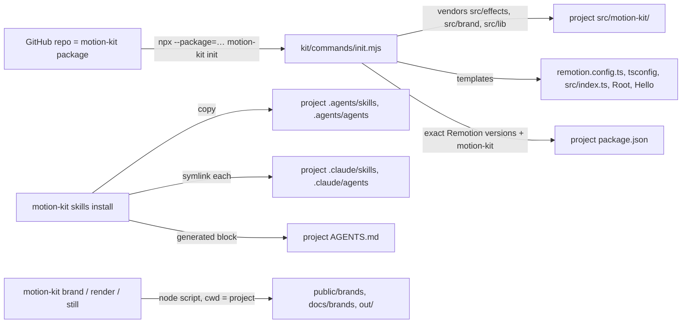
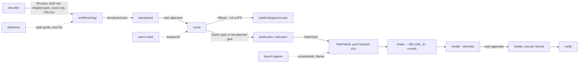

# Motion Kit

How this repo works as **motion-kit**, a portable kit for making motion-graphics films with AI agents:
the CLI that skills call, how `init` sets up any project, and how skills and agents are packaged so any
LLM tool can use them. Read it before adding a CLI command, a skill or an agent.

Source of truth: [`kit/`](../kit/) (CLI, commands, project templates), [`.agents/`](../.agents/)
(skills and agents), [`package.json`](../package.json) (`bin`, `files`). Related:
[AGENTS.md](../AGENTS.md) — instructions every agent reads, with the generated skills index;
[README.md](../README.md) — install and commands; [EFFECTS.md](EFFECTS.md),
[BRAND_CAPTURE.md](BRAND_CAPTURE.md) — the library and capture internals the kit ships.

| Tag          | Meaning                                 |
| ------------ | --------------------------------------- |
| `[measured]` | Measured in this repo; conditions in §9 |

| §   | Section                                   | Look here for                                                       |
| --- | ----------------------------------------- | ------------------------------------------------------------------- |
| 1   | [Rules](#1-rules)                         | What the kit, skills and agents must and must not do                |
| 2   | [Task lookup](#2-task-lookup)             | Start a project, make a film, install skills, update the library    |
| 3   | [Traps](#3-traps)                         | npx forms, first-run download, ports, motion blur, Claude Code      |
| 4   | [How it works](#4-how-it-works)           | From the GitHub repo to a working project; a film from brief to MP4 |
| 5   | [CLI](#5-cli)                             | Every command and what it runs                                      |
| 6   | [Repo layout](#6-repo-layout)             | What ships in the package and what stays in this repo               |
| 7   | [Skills and agents](#7-skills-and-agents) | Format, references, install scopes, the Claude Code bridge          |
| 8   | [Decisions](#8-decisions)                 | Choices made and the alternatives that don't work                   |
| 9   | [Measurements](#9-measurements)           | Package size, clean-project test, tool discovery                    |
| 10  | [Licensing](#10-licensing)                | Remotion, captured brand assets, the kit itself                     |
| 11  | [Open items](#11-open-items)              | What is not built yet and what would close it                       |

---

## 1. Rules

### Do

1. **Skills call `npx motion-kit …`, never repo paths or `npm run` scripts** — a skill must work in
   any project the kit is installed in.
2. **Put the rules a skill relies on in its `references/` folder** — that folder travels with the
   skill and is the rules' one home; this repo's docs link to it.
3. **Edit skills and agents in `.agents/`, never through `.claude/`** — `.claude/` holds symlinks only.
4. **Re-run `npm run mk -- skills install` after adding or renaming a skill** — it relinks `.claude/`
   and regenerates the skills table in `AGENTS.md`.
5. **Keep every Remotion package at one exact version** — `init` copies the kit's versions; a
   mismatch between the project's `remotion` and the kit's renderer breaks bundling.
6. **Add new kit source to `files` in `package.json`**, and nothing else — the package must not ship
   this repo's films, media or brand captures.

### Never

- **Never ship captured brand fonts or captures in the package** — `files` excludes `public/`.
- **Never edit a project's `src/motion-kit/` files you want to keep** — `motion-kit update`
  overwrites them; copy a file out of the folder to customise it.

---

## 2. Task lookup

| I need to…                           | Run                                                                        | Notes                                                             |
| ------------------------------------ | -------------------------------------------------------------------------- | ----------------------------------------------------------------- |
| Start a new film project             | `npx --package=github:alxv2016/claude-animation motion-kit init --install` | In an empty folder or an existing app; `#<branch>` pins a branch  |
| Install the skills for this project  | `npx motion-kit skills install`                                            | `.agents/` + `.claude/` links + `AGENTS.md` block                 |
| Install the skills for every project | `npx motion-kit skills install --scope user`                               | `~/.agents/` + `~/.claude/` links                                 |
| Skip the Claude Code links           | `… skills install --no-claude`                                             |                                                                   |
| Refresh the vendored library         | `npx motion-kit update`                                                    | Overwrites `src/motion-kit/`                                      |
| Check a setup                        | `npx motion-kit doctor`                                                    | Node, render browser, ffmpeg, config, skills                      |
| Use the CLI inside this repo         | `npm run mk -- <command>`                                                  | npx does not link a package's own `bin`                           |
| Add a skill                          | `.agents/skills/<name>/SKILL.md` (+ `references/`), then `skills install`  | §7                                                                |
| Start a film                         | `npx motion-kit new-film <slug> --bpm 120 --bars 8 --formats 9:16,16:9`    | Then the make-motion-film skill; §4                               |
| Storyboard a film for approval       | `npx motion-kit storyboard src/films/<slug>`                               | make-motion-film skill; studio rule R20                           |
| Add a film's sound and beat grid     | `npx motion-kit score src/films/<slug>`                                    | score-and-beats skill: effects only, over the user's track if any |
| Study a reference video              | `npx motion-kit reference <video>`                                         | capture-reference-style skill                                     |
| Add Remotion's own skills            | `npx skills add remotion-dev/skills`                                       | Optional; theirs, not the kit's (§8)                              |

---

## 3. Traps

- **`npx <tarball>` fails with "Permission denied"** → npx treats a bare path as a command → use
  `npx --package=<spec> motion-kit <command>`.
- **The first render or `doctor` downloads 171 MB** → Remotion's Chrome Headless Shell is fetched per
  project on first use `[measured]` → expected; needs network once.
- **"Does this look like a foreign page?" when rendering** → a running Studio holds Remotion's default
  port → the kit renders on 3555; set `RENDER_PORT` to change it.
- **"port 3555 … is not available"** → two kit renders running at once, in any projects → run them
  one after another, or give one a different `RENDER_PORT` `[measured]`.
- **Shadows and gradients band, flat colours shift, only in renders** → Remotion's `CameraMotionBlur`
  adds samples at 1/n opacity and the 8-bit compositor rounds each, snapping every channel to a
  multiple of n (`#e9e5da` → `#e8e8d8` at 8 samples) `[measured]` → use the kit's `MotionBlur`, which
  draws sample k at 1/k opacity over the running result; static pixels keep their exact value.
- **Claude Code ignores `AGENTS.md`** → versions before 2.1.277 only read `CLAUDE.md` → the kit repo's
  `CLAUDE.md` is one line, `@AGENTS.md`; add the same to a project that uses an older version.
- **Claude Code does not see `.agents/`** → it discovers skills in `.claude/skills/` only → `skills
install` symlinks each skill there; a real folder already in place is left alone and reported.
- **`motion-kit frames` fails in a project** → it needs this repo's `FrameSheet` composition → use
  `motion-kit sheet`, which works for any composition.
- **`EncodingError: The source image cannot be decoded` or `blob:… ERR_FILE_NOT_FOUND` while filtering**
  → a render tab read a video
  frame before it was ready and retried → harmless when the render finishes `[measured]`.

---

## 4. How it works

The kit is this repo's root package. `init` copies its Remotion-side library into a project; every
other command runs one of the kit's scripts with the project as the working directory.

- **Scripts resolve their dependencies from the kit** (`@remotion/renderer`, `playwright-core`) and
  their paths from the project (`src/index.ts`, `public/`, `docs/`, `out/`).

A film runs from brief to MP4 through the kit's commands; the make-motion-film skill drives it.

- **The vendored library is plain source the project owns**: Remotion bundles it like any other file,
  with no build step.

---

## 5. CLI

[`kit/bin/motion-kit.mjs`](../kit/bin/motion-kit.mjs) — the interface skills call.

| Command                                                                                               | Runs                          | Writes (in the project)                                                                    |
| ----------------------------------------------------------------------------------------------------- | ----------------------------- | ------------------------------------------------------------------------------------------ |
| `init [--force] [--install] [--kit <spec>]`                                                           | `kit/commands/init.mjs`       | `src/motion-kit/`, templates, `package.json`, `.gitignore`                                 |
| `update`                                                                                              | `init --update`               | `src/motion-kit/` (overwritten)                                                            |
| `brand capture <url> [--no-fonts]`                                                                    | `brand/capture.mjs`           | `public/brands/<domain>/`                                                                  |
| `brand guide <domain>`                                                                                | `brand/style-guide.mjs`       | `video-theme.json`, `docs/brands/<domain>/STYLE_GUIDE.md`                                  |
| `render <composition> [--crf n] [--out file] [--props json] [--animatic]`                             | `kit/lib/render-core.mjs`     | `out/<composition>.mp4` (H.264, CRF 16, AAC); `--animatic`: half size, `-animatic.mp4`     |
| `still <composition> <frame> [--scale n] [--props json]`                                              | `kit/lib/render-core.mjs`     | `out/frame-<composition>-<frame>.png`                                                      |
| `sheet <composition> [--frames … \| --every n \| --beats file [--offset f] \| --count n]`             | `kit/commands/sheet.mjs`      | `out/sheet-<composition>.png`: stills in a grid, any composition                           |
| `filter <video> --effect dither\|pixel\|gradient-map [--params json]`                                 | `kit/commands/filter.mjs`     | `out/<name>-<effect>.mp4` at the video's size, rate, length and sound                      |
| `verify <file> [--lufs -14]`                                                                          | `kit/commands/verify.mjs`     | — (exit 1 on a failed check)                                                               |
| `frames <composition> <f,f,…>`                                                                        | `render.mjs frames`           | `out/frames-<composition>.png` (this repo's `FrameSheet`, §3)                              |
| `new-film <slug> [--title t] [--bpm 120] [--bars 8] [--fps 60] [--formats 16:9,…] [--chapters "A,B"]` | `kit/commands/film.mjs`       | `src/films/<slug>/` from `kit/templates/film/`; registers it in `src/Root.tsx`             |
| `storyboard <film dir> [--cols n] [--width px] [--out file]`                                          | `kit/commands/storyboard.mjs` | `out/storyboard-<slug>.png` from `storyboard.json`                                         |
| `score <film dir \| score.mjs>`                                                                       | `kit/commands/score.mjs`      | `public/<slug>/score.wav`, `cues.json`, `beats.json` (the track's or planned), `film.json` |
| `beats <audio> [--beats n] [--band low\|full] [--bpm 90-180] [--out file]`                            | `kit/commands/score.mjs`      | A measured `beats.json` for any audio or video file, with `downbeats` and `onsets`         |
| `master <audio> [--out file] [--lufs -14]`                                                            | `kit/commands/score.mjs`      | A supplied track at −14 LUFS, −1.5 dBFS ceiling                                            |
| `reference <video> [--name n] [--every 0.5] [--rate 10]`                                              | `kit/commands/reference.mjs`  | `refs/<name>/`: `frames/`, `contact.png`, `analysis.json`                                  |
| `skills list`                                                                                         | `kit/commands/skills.mjs`     | —                                                                                          |
| `skills install [--scope project\|user] [--no-claude] [--force]`                                      | `kit/commands/skills.mjs`     | `.agents/`, `.claude/` links, `AGENTS.md` block                                            |
| `doctor`                                                                                              | `kit/commands/doctor.mjs`     | —                                                                                          |

- **`init` never overwrites without `--force`**, except the vendored library under `update`.
- **`--kit <spec>`** sets the `motion-kit` dependency written to `package.json` (default
  `github:alxv2016/claude-animation`).

---

## 6. Repo layout

| Path                                                                            | In the package | Role                                                                                                                                        |
| ------------------------------------------------------------------------------- | -------------- | ------------------------------------------------------------------------------------------------------------------------------------------- |
| `kit/bin`, `kit/commands`                                                       | Yes            | CLI                                                                                                                                         |
| `kit/templates/project/`                                                        | Yes            | Files `init` writes                                                                                                                         |
| `.agents/skills`, `.agents/agents`                                              | Yes            | Portable skills and agents                                                                                                                  |
| `src/effects/`, `src/brand/`, `src/lib/`                                        | Yes            | Library vendored by `init`, with `FilterVideo` and the two glass demos as examples (`EffectsShowcase` is skipped)                           |
| `kit/lib/`                                                                      | Yes            | Render core (GL backend, port, master encode) and ffprobe/ffmpeg helpers                                                                    |
| `kit/templates/film/`                                                           | Yes            | Files `new-film` writes                                                                                                                     |
| `brand/`, `render.mjs`, `audio/`                                                | Yes            | Scripts the CLI runs; `audio/engine.mjs` is the sound engine every film uses (effects; music instruments and `piano.mjs` only for the reel) |
| `src/films/`, `refs/`                                                           | No             | Films made in this repo; reference studies (git-ignored: someone else's work)                                                               |
| `src/reel/`, `src/effects/showcase/EffectsShowcase.tsx`, `src/review/`, `demo/` | Not vendored   | This repo's films, review tools and viewer                                                                                                  |
| `public/`, `docs/`, `out/`                                                      | No             | This repo's media, docs and renders                                                                                                         |

---

## 7. Skills and agents

| Item             | Format                                                                                         |
| ---------------- | ---------------------------------------------------------------------------------------------- |
| Skill            | `.agents/skills/<name>/SKILL.md`: front matter `name`, `description`; body = the procedure     |
| Skill references | `.agents/skills/<name>/references/*.md`: the rules, formats and checklists the procedure needs |
| Agent            | `.agents/agents/<name>.md`: front matter `name`, `description`; body = the role prompt         |

- **Portable front matter only** (`name`, `description`): tools ignore keys they don't know, so
  Claude-only keys (`tools`, `model`, `skills`) may be added to agents without breaking other tools.
- **`description` leads with what the skill does, then "Use when …"** — tools match tasks against it;
  Claude Code truncates descriptions past 1,536 characters.
- **Install scopes**: `project` → `./.agents/` (+ `./.claude/` links, relative); `user` → `~/.agents/`
  (+ `~/.claude/` links, absolute).
- **The `AGENTS.md` block** between `<!-- motion-kit:skills:start -->` and `…:end -->` lists every
  installed skill and agent; tools without skill discovery read it there.

| Skill                                                                                                                 | Status |
| --------------------------------------------------------------------------------------------------------------------- | ------ |
| [`capture-brand`](../.agents/skills/capture-brand/SKILL.md)                                                           | Built  |
| [`apply-effect`](../.agents/skills/apply-effect/SKILL.md)                                                             | Built  |
| [`review-film`](../.agents/skills/review-film/SKILL.md)                                                               | Built  |
| [`render-and-deliver`](../.agents/skills/render-and-deliver/SKILL.md)                                                 | Built  |
| [`make-motion-film`](../.agents/skills/make-motion-film/SKILL.md), with six type playbooks in `types/`                | Built  |
| [`score-and-beats`](../.agents/skills/score-and-beats/SKILL.md)                                                       | Built  |
| [`capture-reference-style`](../.agents/skills/capture-reference-style/SKILL.md)                                       | Built  |
| Agents [`brand-curator`](../.agents/agents/brand-curator.md), [`film-critic`](../.agents/agents/film-critic.md)       | Built  |
| Agents [`scene-animator`](../.agents/agents/scene-animator.md), [`style-analyst`](../.agents/agents/style-analyst.md) | Built  |

- **Video types are playbooks inside one skill** (`make-motion-film/types/*.md`), not separate skills:
  the pipeline is the same for every type; only inputs, structure, look and sound differ. Each
  playbook holds its example prompts verbatim.

---

## 8. Decisions

| Decision                                                                           | Why                                                                                                                                            | Alternatives that don't work, and why                                                                                                                             |
| ---------------------------------------------------------------------------------- | ---------------------------------------------------------------------------------------------------------------------------------------------- | ----------------------------------------------------------------------------------------------------------------------------------------------------------------- |
| A CLI as the interface skills call                                                 | Same command in every project and from every tool                                                                                              | Repo `npm run` scripts — exist only in this repo                                                                                                                  |
| The repo root is the package (`bin`, `files`)                                      | `npx github:owner/repo` installs a repo's root package                                                                                         | A `packages/motion-kit` workspace — npm cannot install a sub-folder of a GitHub repo                                                                              |
| `init` vendors the library into `src/motion-kit/`                                  | Remotion bundles project source directly; the project can read and adapt it                                                                    | Importing TypeScript from `node_modules` — needs a build step or bundler config per project                                                                       |
| `.agents/` canonical, `.claude/` symlinks per item                                 | One copy, readable by any tool; Claude Code discovers it `[measured]`                                                                          | Copies in both — drift; one folder-level symlink — collides with a project's own `.claude/skills`                                                                 |
| `CLAUDE.md` = `@AGENTS.md`                                                         | One instruction file for every tool, including Claude Code before 2.1.277                                                                      | Separate `CLAUDE.md` content — two files to keep in step                                                                                                          |
| Skill rules live in `references/`                                                  | They must travel with the skill; one home per fact                                                                                             | Links to this repo's `docs/` — break in other projects                                                                                                            |
| GitHub distribution first; `private: true`                                         | No npm account or release process needed yet; no accidental publish                                                                            | npm publish now — premature while the skill set is incomplete                                                                                                     |
| The kit's own `MotionBlur`                                                         | Exact colours on static pixels; no banding in shadows and gradients                                                                            | Remotion's `CameraMotionBlur` and `HtmlInCanvasMotionBlur` — both add 1/n-opacity layers in 8 bits (§3)                                                           |
| Beat grid measured from the user's track; planned for effects only                 | Picture follows what the ear hears; code-placed effects sit exactly on the plan                                                                | Times computed from a track's nominal BPM — drift from its real onsets                                                                                            |
| The kit never composes music; films get sound effects only                         | Synthesized grooves and melodies sounded like stock music; effects synced to picture make motion feel physical, and the user chooses the music | A default synthesized groove — every film sounded the same, and cheap                                                                                             |
| Two user gates on every film: storyboard, then contact sheet and animatic          | The user decides what the film is while change is cheap, and sees it move before the full render                                               | A conditional checkpoint — skipped on short requests, which is when it mattered                                                                                   |
| One review by the `film-critic`, never the author, then the user decides           | An author scores what the code meant; the user, not a score threshold, decides what is worth fixing                                            | Self-review — passed a film with dead beats and unhidden cuts at 8s; a ≥3-round loop to 8+ — four rounds of ~25 min crept 6.0 → 6.4 with the user out of the loop |
| `Assemble` lands one piece per real element                                        | The UI forms itself as the product does; no lines the image does not have                                                                      | A uniform tile grid — slices devices and screens, leaves seams; reads as a cheap slideshow transition                                                             |
| `reference` reads cuts from every frame                                            | Cut times exact to a frame `[measured]`                                                                                                        | Resampling to 10 fps with `-r` — drops and repeats frames, cuts 0.1–0.2 s late `[measured]`                                                                       |
| Remotion's skills referenced, not vendored                                         | Their repo has no licence, and they change with each Remotion release                                                                          | Copying them into `.agents/` — no right to redistribute, and they go stale                                                                                        |
| Reference style guides in `docs/references/<name>/`, frames in git-ignored `refs/` | The guide is the project's; the frames are someone else's work                                                                                 | Committing the frames — redistributes the reference                                                                                                               |

---

## 9. Measurements

Measured 2026-10-25 on an Apple Silicon Mac (Node 22.14.0, npm 11.6.4).

| Measurement                                                                                                    | Value                                                                                                                                                         |
| -------------------------------------------------------------------------------------------------------------- | ------------------------------------------------------------------------------------------------------------------------------------------------------------- |
| Package (`npm pack`)                                                                                           | 123.5 kB, 87 files, 374 kB unpacked                                                                                                                           |
| Clean project: `init --install`                                                                                | 262 packages in 4 s                                                                                                                                           |
| Clean project: typecheck after `init`                                                                          | No errors                                                                                                                                                     |
| Clean project: `doctor`                                                                                        | All checks pass (after a 171 MB Chrome download)                                                                                                              |
| Clean project: `still Hello 120`                                                                               | Rendered: liquid glass over `Sky`                                                                                                                             |
| Clean project: `brand capture https://example.com`, `brand guide`                                              | Both complete; guide links to the installed skill                                                                                                             |
| Claude Code 2.1.195, fresh session in this repo                                                                | Lists `capture-brand` (via the `.claude/` symlink); loads `AGENTS.md` (via `CLAUDE.md`)                                                                       |
| Claude Code 2.1.195, fresh session: skills and agents                                                          | Lists all four skills and both agents through `.claude/` symlinks                                                                                             |
| `film-critic` run on `LiquidGlassTabBar` via `claude -p`                                                       | Scorecard with frame evidence; hook 6, variety 4 (R12); no source files changed                                                                               |
| `filter` on `public/samples/footage.mp4` (halftone) and `out/reel.mp4` (gradient map, with audio)              | Both rendered; all 720 frames of the first scanned, none black or glitched                                                                                    |
| `sheet Reel --beats src/reel/beats.json`                                                                       | Same frames as the reel's `ContactSheet`, with motion blur                                                                                                    |
| `verify` on the filtered reel                                                                                  | All checks pass; −13.8 LUFS, −1.4 dBTP                                                                                                                        |
| A project set up before `FilterVideo` existed: `update`, `skills install --force`, `filter`, `sheet`, `verify` | All work; `filter` renders from the kit's own entry, independent of the project's `Root`                                                                      |
| From GitHub (`#motion-kit-phase-1`) into an empty folder: `init --install`, typecheck, `skills install`        | All complete                                                                                                                                                  |
| Clean project: `new-film launch --formats 9:16,16:9`, `score`                                                  | Registered both compositions; −14.02 LUFS, peak −1.50 dBFS; 16/16 beats detected at 120.04 BPM, max residual 3.5 ms                                           |
| Clean project: a test film using `Assemble` (the tile version, since replaced), `MorphBox`, `Cursor`           | Typecheck passes; contact sheets in both formats show every state; `render` and `verify` pass for both (9 s, −14.4 LUFS, −1.5 dBTP)                           |
| `MotionBlur` against `CameraMotionBlur` on a still frame                                                       | Static pixels exact (`#e9e5da` stays `#e9e5da`; `CameraMotionBlur`: `#e8e8d8`); moving edges blurred                                                          |
| `reference` on the test film (cuts at 2.0 and 6.0 s)                                                           | Cuts at 2.000 and 6.000 s; with 10 fps `-r` resampling they read 2.2 and 6.2 s                                                                                |
| `reference` on the reel                                                                                        | Hard cuts 7.5, 11.25, 13.133 s; its designed transitions (iris, blinds, dolly) correctly not counted; 5 s for 15 s of video                                   |
| Clean project: `new-film intro --formats 1:1`, `score`, typecheck, `still`                                     | All complete; the template's placeholder renders through `MotionBlur`                                                                                         |
| Claude Code 2.1.195, fresh session in this repo                                                                | Lists all seven skills and all four agents                                                                                                                    |
| `score src/reel` after the effects-only engine (`music: true` in the reel's score)                             | WAV bit-identical (SHA-1 `ff88f698…`); `beats.json` and `cues.json` unchanged                                                                                 |
| An effects-only film's `score` (37 cues)                                                                       | −14.03 LUFS, peak −1.50 dBFS; planned grid; `verify` on the WAV: −13.6 LUFS, −1.1 dBTP                                                                        |
| `score` with `track: public/reel.wav` (the reel as a stand-in track)                                           | Grid 128.004 BPM, offset 2.9 ms (the reel's own); downbeats on bar starts; 83 onsets in 8 s; `beat(n)` follows the track; no music instruments in the session |
| `new-film kit-smoke --formats 9:16,16:9`, `score`, typecheck                                                   | Brief with the Join column; effects-only score, −14.00 LUFS, planned grid; no errors                                                                          |
| `storyboard` on a six-shot product film                                                                        | One panel per shot: key frame from the capture, copy, motion, join, sound, beats and times                                                                    |
| `Assemble` by element: a five-device row cut at its two white gaps; a grid of 13 screens                       | Pieces land whole, centre first; no seams or slices on the sheet                                                                                              |
| `SPRINGS` presets, step response                                                                               | snappy 0.8 % / 0.23 s, default 0 % / 0.44 s, heavy 1.1 % / 0.36 s, playful 12.1 % (2 % settle)                                                                |
| An effects-only film (52 cues) at the old −1.5 dBFS ceiling, after AAC                                         | −0.7 dBTP (FAIL); at the new −2.5 dBFS effects-only ceiling: −1.7 dBTP (pass), −14.3 LUFS                                                                     |
| `MotionBlur` 16 samples, 120° shutter, on a 20 s film with scrubbed video and `LiquidGlass`                    | Renders; stepped echoes on fast scale moves become blur (8 samples showed copies). Stills take about twice as long                                            |
| `LiquidGlass` with `placement` over a placed product photo and over a still                                    | The glass refracts the same pixels the scene shows beneath it; ground colour outside the photo                                                                |

---

## 10. Licensing

- **Remotion** is free for individuals and small companies; larger companies need a company licence
  (see remotion.dev/license). Every project the kit sets up inherits this.
- **Captured brand assets** (screenshots, logos, fonts) belong to the site's owner; the capture-brand
  skill's rules govern their use.
- **The kit has no licence file yet** (§11).

---

## 11. Open items

| Item                                                                                                   | Status | Unblocked by                                                     |
| ------------------------------------------------------------------------------------------------------ | ------ | ---------------------------------------------------------------- |
| `frames` uses this repo's `FrameSheet` (`sheet` works anywhere)                                        | Open   | Retiring `frames` in favour of `sheet`                           |
| 9:16 safe areas (`SAFE` in `src/lib/layout.ts`) are estimates                                          | Open   | Measuring each platform's overlays on a phone                    |
| The sound effects and the reel's score are checked by numbers (loudness, peak, cue timing), not by ear | Open   | A listening pass                                                 |
| `MotionBlur` at 10 samples                                                                             | Open   | A render of a heavy film at 10; `CameraMotionBlur` crashed there |
| A full film made by an agent from a brief with `make-motion-film`, with `scene-animator` in parallel   | Open   | Running one of the example prompts end to end                    |
| A licence for the kit                                                                                  | Open   | Choosing one                                                     |
| npm publishing                                                                                         | Later  | Deciding to publish; removing `private`                          |
