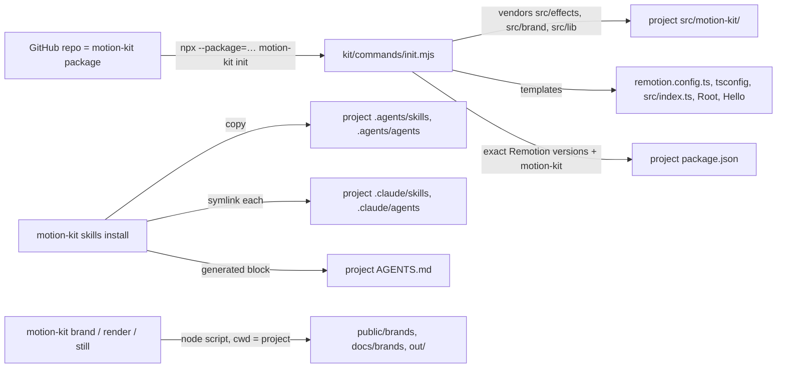

# Motion Kit

How this repo works as **motion-kit**, a portable kit for making motion-graphics films with AI agents:
the CLI that skills call, how `init` sets up any project, and how skills and agents are packaged so any
LLM tool can use them. Read it before adding a CLI command, a skill or an agent.

Source of truth: [`kit/`](../kit/) (CLI, commands, project templates), [`.agents/`](../.agents/)
(skills and agents), [`package.json`](../package.json) (`bin`, `files`). Related:
[AGENTS.md](../AGENTS.md) — instructions every agent reads, with the generated skills index;
[README.md](../README.md) — install and commands; [EFFECTS.md](EFFECTS.md),
[BRAND_CAPTURE.md](BRAND_CAPTURE.md) — the library and capture internals the kit ships.

| Tag          | Meaning                                 |
| ------------ | --------------------------------------- |
| `[measured]` | Measured in this repo; conditions in §9 |
| `[?]`        | Unverified; tracked in §11              |

| §   | Section                                   | Look here for                                                    |
| --- | ----------------------------------------- | ---------------------------------------------------------------- |
| 1   | [Rules](#1-rules)                         | What the kit, skills and agents must and must not do             |
| 2   | [Task lookup](#2-task-lookup)             | Start a project, install skills, add a skill, update the library |
| 3   | [Traps](#3-traps)                         | npx forms, first-run download, ports, old Claude Code versions   |
| 4   | [How it works](#4-how-it-works)           | From the GitHub repo to a working project                        |
| 5   | [CLI](#5-cli)                             | Every command and what it runs                                   |
| 6   | [Repo layout](#6-repo-layout)             | What ships in the package and what stays in this repo            |
| 7   | [Skills and agents](#7-skills-and-agents) | Format, references, install scopes, the Claude Code bridge       |
| 8   | [Decisions](#8-decisions)                 | Choices made and the alternatives that don't work                |
| 9   | [Measurements](#9-measurements)           | Package size, clean-project test, tool discovery                 |
| 10  | [Licensing](#10-licensing)                | Remotion, captured brand assets, the kit itself                  |
| 11  | [Open items](#11-open-items)              | What is not built yet and what would close it                    |

---

## 1. Rules

### Do

1. **Skills call `npx motion-kit …`, never repo paths or `npm run` scripts** — a skill must work in
   any project the kit is installed in.
2. **Put the rules a skill relies on in its `references/` folder** — that folder travels with the
   skill and is the rules' one home; this repo's docs link to it.
3. **Edit skills and agents in `.agents/`, never through `.claude/`** — `.claude/` holds symlinks only.
4. **Re-run `npm run mk -- skills install` after adding or renaming a skill** — it relinks `.claude/`
   and regenerates the skills table in `AGENTS.md`.
5. **Keep every Remotion package at one exact version** — `init` copies the kit's versions; a
   mismatch between the project's `remotion` and the kit's renderer breaks bundling.
6. **Add new kit source to `files` in `package.json`**, and nothing else — the package must not ship
   this repo's films, media or brand captures.

### Never

- **Never ship captured brand fonts or captures in the package** — `files` excludes `public/`.
- **Never edit a project's `src/motion-kit/` files you want to keep** — `motion-kit update`
  overwrites them; copy a file out of the folder to customise it.

---

## 2. Task lookup

| I need to…                           | Run                                                                        | Notes                                                            |
| ------------------------------------ | -------------------------------------------------------------------------- | ---------------------------------------------------------------- |
| Start a new film project             | `npx --package=github:alxv2016/claude-animation motion-kit init --install` | In an empty folder or an existing app; `#<branch>` pins a branch |
| Install the skills for this project  | `npx motion-kit skills install`                                            | `.agents/` + `.claude/` links + `AGENTS.md` block                |
| Install the skills for every project | `npx motion-kit skills install --scope user`                               | `~/.agents/` + `~/.claude/` links                                |
| Skip the Claude Code links           | `… skills install --no-claude`                                             |                                                                  |
| Refresh the vendored library         | `npx motion-kit update`                                                    | Overwrites `src/motion-kit/`                                     |
| Check a setup                        | `npx motion-kit doctor`                                                    | Node, render browser, ffmpeg, config, skills                     |
| Use the CLI inside this repo         | `npm run mk -- <command>`                                                  | npx does not link a package's own `bin`                          |
| Add a skill                          | `.agents/skills/<name>/SKILL.md` (+ `references/`), then `skills install`  | §7                                                               |

---

## 3. Traps

- **`npx <tarball>` fails with "Permission denied"** → npx treats a bare path as a command → use
  `npx --package=<spec> motion-kit <command>`.
- **The first render or `doctor` downloads 171 MB** → Remotion's Chrome Headless Shell is fetched per
  project on first use `[measured]` → expected; needs network once.
- **"Does this look like a foreign page?" when rendering** → a running Studio holds Remotion's default
  port → the kit renders on 3555; set `RENDER_PORT` to change it.
- **Claude Code ignores `AGENTS.md`** → versions before 2.1.277 only read `CLAUDE.md` → the kit repo's
  `CLAUDE.md` is one line, `@AGENTS.md`; add the same to a project that uses an older version.
- **Claude Code does not see `.agents/`** → it discovers skills in `.claude/skills/` only → `skills
install` symlinks each skill there; a real folder already in place is left alone and reported.
- **`motion-kit frames` or the reel's contact sheet fail in a project** → they need a `FrameSheet` or
  `ContactSheet` composition, which only this repo registers today (§11).

---

## 4. How it works

The kit is this repo's root package. `init` copies its Remotion-side library into a project; every
other command runs one of the kit's scripts with the project as the working directory.

- **Scripts resolve their dependencies from the kit** (`@remotion/renderer`, `playwright-core`) and
  their paths from the project (`src/index.ts`, `public/`, `docs/`, `out/`).
- **The vendored library is plain source the project owns**: Remotion bundles it like any other file,
  with no build step.

---

## 5. CLI

[`kit/bin/motion-kit.mjs`](../kit/bin/motion-kit.mjs) — the interface skills call.

| Command                                                          | Runs                      | Writes (in the project)                                    |
| ---------------------------------------------------------------- | ------------------------- | ---------------------------------------------------------- |
| `init [--force] [--install] [--kit <spec>]`                      | `kit/commands/init.mjs`   | `src/motion-kit/`, templates, `package.json`, `.gitignore` |
| `update`                                                         | `init --update`           | `src/motion-kit/` (overwritten)                            |
| `brand capture <url> [--no-fonts]`                               | `brand/capture.mjs`       | `public/brands/<domain>/`                                  |
| `brand guide <domain>`                                           | `brand/style-guide.mjs`   | `video-theme.json`, `docs/brands/<domain>/STYLE_GUIDE.md`  |
| `render <composition>`                                           | `render.mjs film`         | `out/<composition>.mp4` (H.264, CRF 16, AAC)               |
| `still <composition> <frame>`                                    | `render.mjs still`        | `out/frame-<composition>-<frame>.png`                      |
| `frames <composition> <f,f,…>`                                   | `render.mjs frames`       | `out/frames-<composition>.png` (§3)                        |
| `skills list`                                                    | `kit/commands/skills.mjs` | —                                                          |
| `skills install [--scope project\|user] [--no-claude] [--force]` | `kit/commands/skills.mjs` | `.agents/`, `.claude/` links, `AGENTS.md` block            |
| `doctor`                                                         | `kit/commands/doctor.mjs` | —                                                          |

- **`init` never overwrites without `--force`**, except the vendored library under `update`.
- **`--kit <spec>`** sets the `motion-kit` dependency written to `package.json` (default
  `github:alxv2016/claude-animation`).

---

## 6. Repo layout

| Path                                                         | In the package    | Role                                                                     |
| ------------------------------------------------------------ | ----------------- | ------------------------------------------------------------------------ |
| `kit/bin`, `kit/commands`                                    | Yes               | CLI                                                                      |
| `kit/templates/project/`                                     | Yes               | Files `init` writes                                                      |
| `.agents/skills`, `.agents/agents`                           | Yes               | Portable skills and agents                                               |
| `src/effects/`, `src/brand/`, `src/lib/`                     | Yes               | Library vendored by `init` (`src/effects/showcase/` is skipped)          |
| `brand/`, `render.mjs`, `audio/`                             | Yes               | Scripts the CLI runs (`audio/` is reel-specific today, §11)              |
| `src/reel/`, `src/effects/showcase/`, `src/review/`, `demo/` | No (not vendored) | This repo's films, review tools and viewer — examples built with the kit |
| `public/`, `docs/`, `out/`                                   | No                | This repo's media, docs and renders                                      |

---

## 7. Skills and agents

| Item             | Format                                                                                         |
| ---------------- | ---------------------------------------------------------------------------------------------- |
| Skill            | `.agents/skills/<name>/SKILL.md`: front matter `name`, `description`; body = the procedure     |
| Skill references | `.agents/skills/<name>/references/*.md`: the rules, formats and checklists the procedure needs |
| Agent            | `.agents/agents/<name>.md`: front matter `name`, `description`; body = the role prompt         |

- **Portable front matter only** (`name`, `description`): tools ignore keys they don't know, so
  Claude-only keys (`tools`, `model`, `skills`) may be added to agents without breaking other tools.
- **`description` leads with what the skill does, then "Use when …"** — tools match tasks against it;
  Claude Code truncates descriptions past 1,536 characters.
- **Install scopes**: `project` → `./.agents/` (+ `./.claude/` links, relative); `user` → `~/.agents/`
  (+ `~/.claude/` links, absolute).
- **The `AGENTS.md` block** between `<!-- motion-kit:skills:start -->` and `…:end -->` lists every
  installed skill and agent; tools without skill discovery read it there.

| Skill                                                                               | Status                            |
| ----------------------------------------------------------------------------------- | --------------------------------- |
| [`capture-brand`](../.agents/skills/capture-brand/SKILL.md)                         | Built                             |
| `apply-effect`, `review-film`, `render-and-deliver`                                 | Next (§11)                        |
| `make-motion-film` (+ type playbooks), `score-and-beats`, `capture-reference-style` | After the film-kit refactor (§11) |
| Agents `brand-curator`, `film-critic`, `scene-animator`, `style-analyst`            | Planned (§11)                     |

---

## 8. Decisions

| Decision                                           | Why                                                                         | Alternatives that don't work, and why                                                             |
| -------------------------------------------------- | --------------------------------------------------------------------------- | ------------------------------------------------------------------------------------------------- |
| A CLI as the interface skills call                 | Same command in every project and from every tool                           | Repo `npm run` scripts — exist only in this repo                                                  |
| The repo root is the package (`bin`, `files`)      | `npx github:owner/repo` installs a repo's root package                      | A `packages/motion-kit` workspace — npm cannot install a sub-folder of a GitHub repo              |
| `init` vendors the library into `src/motion-kit/`  | Remotion bundles project source directly; the project can read and adapt it | Importing TypeScript from `node_modules` — needs a build step or bundler config per project       |
| `.agents/` canonical, `.claude/` symlinks per item | One copy, readable by any tool; Claude Code discovers it `[measured]`       | Copies in both — drift; one folder-level symlink — collides with a project's own `.claude/skills` |
| `CLAUDE.md` = `@AGENTS.md`                         | One instruction file for every tool, including Claude Code before 2.1.277   | Separate `CLAUDE.md` content — two files to keep in step                                          |
| Skill rules live in `references/`                  | They must travel with the skill; one home per fact                          | Links to this repo's `docs/` — break in other projects                                            |
| GitHub distribution first; `private: true`         | No npm account or release process needed yet; no accidental publish         | npm publish now — premature while the skill set is incomplete                                     |

---

## 9. Measurements

Measured 2026-10-25 on an Apple Silicon Mac (Node 22.14.0, npm 11.6.4).

| Measurement                                                                                             | Value                                                                                   |
| ------------------------------------------------------------------------------------------------------- | --------------------------------------------------------------------------------------- |
| Package (`npm pack`)                                                                                    | 59.8 kB, 41 files, 176 kB unpacked                                                      |
| Clean project: `init --install`                                                                         | 262 packages in 4 s                                                                     |
| Clean project: typecheck after `init`                                                                   | No errors                                                                               |
| Clean project: `doctor`                                                                                 | All checks pass (after a 171 MB Chrome download)                                        |
| Clean project: `still Hello 120`                                                                        | Rendered: liquid glass over `Sky`                                                       |
| Clean project: `brand capture https://example.com`, `brand guide`                                       | Both complete; guide links to the installed skill                                       |
| Claude Code 2.1.195, fresh session in this repo                                                         | Lists `capture-brand` (via the `.claude/` symlink); loads `AGENTS.md` (via `CLAUDE.md`) |
| From GitHub (`#motion-kit-phase-1`) into an empty folder: `init --install`, typecheck, `skills install` | All complete                                                                            |

---

## 10. Licensing

- **Remotion** is free for individuals and small companies; larger companies need a company licence
  (see remotion.dev/license). Every project the kit sets up inherits this.
- **Captured brand assets** (screenshots, logos, fonts) belong to the site's owner; the capture-brand
  skill's rules govern their use.
- **The kit has no licence file yet** (§11).

---

## 11. Open items

| Item                                                                                                                                                     | Status | Unblocked by                                                                     |
| -------------------------------------------------------------------------------------------------------------------------------------------------------- | ------ | -------------------------------------------------------------------------------- |
| Skills `apply-effect`, `review-film`, `render-and-deliver`; agents `brand-curator`, `film-critic`                                                        | Next   | Writing them on the pattern of `capture-brand`                                   |
| Film kit: per-film score, beat measurement and contact sheet (today `audio/` and the reel's sheet are reel-specific); `FrameSheet` usable in any project | Open   | The film-kit refactor, before `make-motion-film`                                 |
| `make-motion-film` with playbooks (showreel, story, intro, product film, UI motion, app UI glass), `score-and-beats`, `capture-reference-style`          | Open   | The film kit; a piano voice; a multi-format layout system (MOTION_REEL.md §22.3) |
| A licence for the kit                                                                                                                                    | Open   | Choosing one                                                                     |
| npm publishing                                                                                                                                           | Later  | Deciding to publish; removing `private`                                          |
