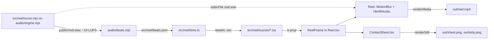

# Motion Reel

The 15 s showreel in `src/reel/`: how it is built, timed, scored and rendered, and a reference for
every motion design technique it uses — easing curves, ramps, springs, beat-locked timing, arcs,
squash and stretch, morphing, transitions and camera. Read it before retiming, re-scoring or adding a
scene. The brief and persona are in §22.

Source of truth: [`src/reel/`](../src/reel/) (scenes, timing, easing), [`audio/`](../audio/) (score,
loudness, beat measurement) and [`render.mjs`](../render.mjs) (render modes and encoding). Where a value
here disagrees with the code, the code is current and this doc has a bug (§1, rule 9).

Related: [README.md](../README.md) — install and `npm` scripts; [BRAND_CAPTURE.md](BRAND_CAPTURE.md) —
capturing a website's brand for a film. The studio rules every film follows, and the example prompts,
are in §22.

| Tag          | Meaning                                                           |
| ------------ | ----------------------------------------------------------------- |
| `[measured]` | Measured in this repo; conditions and date in §18                 |
| `[derived]`  | Computed from other values in this doc                            |
| `[spec]`     | From an external specification (ITU-R BS.1770-4, a library's API) |
| `[?]`        | Unverified; tracked in §21                                        |

Units: **beats** (`b`) are the reel's clock; `s` seconds; `f` frames at 60 fps; `px` at 1920 × 1080.

| §    | Section                                                               | Look here for                                                                                               |
| ---- | --------------------------------------------------------------------- | ----------------------------------------------------------------------------------------------------------- |
| 1    | [Rules](#1-rules)                                                     | What every scene and cue must and must not do                                                               |
| 2    | [Task lookup](#2-task-lookup)                                         | Which file and symbol to change for a given edit                                                            |
| 3    | [Traps](#3-traps)                                                     | Crashes, silent desyncs, no sound in preview, misleading output, with fixes                                 |
| 4    | [How it works](#4-how-it-works)                                       | Pipeline from score to MP4; `ReelFrame`; scene windows and layering                                         |
| 5    | [Beat grid and timing](#5-beat-grid-and-timing)                       | BPM, beat ↔ seconds ↔ frames, `beatAt`, `sec`                                                             |
| 6    | [Timeline](#6-timeline)                                               | Bar-by-bar beat map: scene, ground, technique, sound cue                                                    |
| 7    | [Easing curves and ramps](#7-easing-curves-and-ramps)                 | Every easing function, its formula and character; exponential and power ramps                               |
| 7.3  | [Ramps](#73-ramps)                                                    | Zoom, iris, shake and dolly ramp formulas and why each shape                                                |
| 8    | [Springs](#8-springs)                                                 | Closed-form spring, sum-of-springs retargeting, every spring's frequency/damping                            |
| 9    | [Motion techniques](#9-motion-techniques)                             | Squash and stretch, arcs, spacing charts, anticipation, stepping, stagger, ripples, 3D, reveals             |
| 10   | [Transitions](#10-transitions)                                        | The seven scene joins and how each hides the cut                                                            |
| 11   | [Shape morphing](#11-shape-morphing)                                  | Radial-sample morph, polygon ray casting, shape list and key timing                                         |
| 12   | [Camera](#12-camera)                                                  | Zoom about a point, impact shake, build shake, dolly, motion blur                                           |
| 13   | [Sound design](#13-sound-design)                                      | Instruments, chords, cue sheet, sidechain, reverb, mastering to −14 LUFS; audio in the MP4, no-sound checks |
| 13.3 | [Cue sheet](#133-cue-sheet)                                           | Every sound cue by beat and the visual it pairs with                                                        |
| 13.6 | [Audio in the rendered MP4](#136-audio-in-the-rendered-mp4)           | How the WAV is muxed; checking a "no sound" report                                                          |
| 14   | [Beat measurement](#14-beat-measurement)                              | How `beats.json` is measured from the audio; parameters                                                     |
| 15   | [Look and typography](#15-look-and-typography)                        | Palette, faces, minimum text size, chapter captions                                                         |
| 16   | [Review loop](#16-review-loop)                                        | Contact sheet, transition strips, scoring rubric                                                            |
| 17   | [Rendering and encoding](#17-rendering-and-encoding)                  | `render.mjs` modes, codec settings, blur samples, concurrency                                               |
| 18   | [Measurements](#18-measurements)                                      | Loudness, beat-grid fit, render time, file size, review scores                                              |
| 19   | [Decisions](#19-decisions)                                            | Choices made and the alternatives that don't work                                                           |
| 20   | [Exceptions](#20-exceptions)                                          | Departures from the studio rules and why they're allowed                                                    |
| 21   | [Open items](#21-open-items)                                          | Unverified values and what would settle them                                                                |
| 22   | [Brief, persona and studio rules](#22-brief-persona-and-studio-rules) | The brief and persona; on-screen copy; how the reel meets the studio rules; where the example prompts live  |
| 22.1 | [Brief and persona](#221-brief-and-persona)                           | Who the reel speaks as; on-screen copy                                                                      |
| 22.3 | [Example prompts](#223-example-prompts)                               | Where each of the eight prompts lives; what the kit added for them; prompt 3's rules against this reel      |
| 23   | [Preview: Studio and demo page](#23-preview-studio-and-demo-page)     | Scrubbing and playback while editing; the standalone viewer; chapters                                       |

---

## 1. Rules

The reel is a pure function of time, timed in beats from the measured grid.

### Do

1. **Compute every visual value from the beat number `b` alone** — scenes take `b` as a prop and hold
   no state.
   - Why: Remotion renders frames out of order, in parallel tabs, and `MotionBlur` renders
     fractional frames; anything carried between frames renders differently per run (studio rule
     §22.2: render contract).
2. **Time everything in beats, read from [`beats.json`](../src/reel/beats.json) through
   [`time.ts`](../src/reel/time.ts)** (`beatAt`, `timeAtBeat`, `sec`) — never in raw frames or seconds.
   - Why: the grid is measured from the audio (§14); beat-relative timing keeps picture locked to sound
     when the score changes.
3. **Convert a beat delta with `sec()` before passing it to `spring()` or `wobble()`** — their
   frequency and decay constants are in seconds and hertz.
4. **Land hits on the beat; stagger only after it** (`stepped(local - i * 0.025)`, not `+`).
   - Why: a positive stagger offset fires row `i` early — five rows at `+0.12` beats put the last one
     0.6 beats ahead of the kick (§3).
5. **Retarget a value by summing one spring per change** (`barHeight`, cube `turns`) — never restart a
   spring from the current position (§8).
6. **Use seeded randomness only** — `hash`, `noise1`, `mulberry32` in
   [`math.ts`](../src/lib/math.ts) and [`audio/dsp.mjs`](../audio/dsp.mjs).
7. **Regenerate the beat grid after any score change**: `npm run audio` (`motion-kit score src/reel`)
   synthesizes [`src/reel/score.mjs`](../src/reel/score.mjs), masters it, and measures `beats.json`
   from the WAV it just wrote, in one step.
8. **Keep UI text at `UI_SIZE` (56 px) or larger** — 56 px is ≈ 11 pt on a phone-width 16:9 frame;
   46 px failed the phone readability check (§16).
9. **Change this doc in the same commit as any value it restates** (timings, constants, cue sheet).

### Never

- **No `Math.random`, `Date`, CSS transitions, `setTimeout` or `requestAnimationFrame`** — they break
  determinism and Remotion's frame capture.
- **No motion blur above 8 samples** — 10 samples crashed Chrome on the zoom through the "o"
  (frames 100–119) at any concurrency (§3).
- **No second accent colour** — `CLAY` is the only accent (§15).

---

## 2. Task lookup

| I need to…                                      | Change                                                            | Notes                                                                 |
| ----------------------------------------------- | ----------------------------------------------------------------- | --------------------------------------------------------------------- |
| Retime an event                                 | The beat constants inside the scene file                          | Beats are global (`b`), not scene-local; §6 maps bars to beats        |
| Change a curve's feel                           | The easing call in the scene; functions in `math.ts`              | §7 lists every curve and where it is used                             |
| Make a spring bouncier or stiffer               | `spring(dt, freq, damping)` arguments                             | Lower damping → more overshoot; §8 table                              |
| Add a sound cue                                 | `compose` in `src/reel/score.mjs`, then `npm run audio`           | Place cues with `beat(b)`; re-check §14 detection still finds 128 BPM |
| Change tempo or length                          | `bpm` / `duration` in `score.mjs`; `DURATION_FRAMES` in `time.ts` | 128 BPM × 32 beats = 15.0 s exactly                                   |
| Add or replace a scene                          | New file in `src/reel/scenes/`; window in `ReelFrame`             | Plan its entry and exit transition (§10)                              |
| Change a colour or face                         | [`theme.ts`](../src/reel/theme.ts)                                | One display face, one UI face, one accent (§15)                       |
| Check the whole film at a glance                | `npm run sheet` → `out/sheet.png`                                 | One frame per beat, one bar per row (§16)                             |
| Scrub a transition frame by frame               | `node render.mjs strip <b,b,…>` → `out/strip.png`                 | Up to 32 beats per strip                                              |
| Render the final film                           | `npm run render` → `out/reel.mp4`                                 | Settings in §17                                                       |
| Preview and scrub while editing                 | `npm run dev` → Remotion Studio                                   | Live reload, chapter tracks, no blur (§23)                            |
| Show the finished film with a beat timeline     | `npm run demo` → `http://localhost:4173`                          | Needs `out/reel.mp4` and `out/sheet.png` (§23)                        |
| Rename or move a chapter                        | [`chapters.json`](../src/reel/chapters.json)                      | Feeds Studio tracks and the demo page (§23)                           |
| Add a shader background, filter or liquid glass | [EFFECTS.md](EFFECTS.md)                                          | Task lookup in §2 there                                               |

---

## 3. Traps

- **`Error: Page crashed!` during `renderMedia` around frames 100–119** → motion blur at
  10 samples (measured with Remotion's `CameraMotionBlur`, which `MotionBlur` replaced; the layer
  count is the same) stacks ten copies of the 30× zoom and the ball iris; single stills of the same frames
  render fine, so the crash only shows under `renderMedia` → keep `samples={8}` (§17). Lowering
  concurrency or switching `gl` to `angle`/`swangle` does not help.
- **`bad CPU type in executable: ffmpeg`** → `/usr/local/bin/ffmpeg` is an x86-64 build on an Apple
  Silicon Mac without Rosetta → use Remotion's bundled binaries: `npx remotion ffmpeg`,
  `npx remotion ffprobe`. The bundled build lacks `ebur128`, `tile` and `select`, which is why loudness
  is measured in JS (§13.5) and contact sheets are a Remotion composition (§16).
- **Beat detector reports ~240 BPM or misses beat 0** → a median inter-onset interval locks onto the
  eighth-note bass retriggers, and an onset at t = 0 has no rise before it → `beats.mjs` pads 5 ms of
  silence, grid-searches tempo in 90–180 BPM and rejects outliers (§14). Do not reintroduce
  median-IOI tempo estimation.
- **Marquee rows snap before the kick** → stagger added to the beat (`local + i * k`) → subtract it
  (§1, rule 4).
- **Contact sheet frame labelled `b16` shows the previous scene** → beat 16 falls at frame 450.2;
  `Math.round` picks frame 450, which is `b ≈ 15.995` → expected; scenes switch on `b`, not on the
  rounded frame.
- **Cube face text turns muddy grey during the dolly** → text opacity tied to the dolly curve sits at
  10–30 % for most of the zoom → fade it on its own short window, `prog(b, 19.5, 19.68)`.
- **Frame counter shows decimals or skips** → `MotionBlur` passes fractional frames → round
  before display (`GridData` receives `Math.round(frame)`).
- **Text measured at render time has the wrong width** → Google Fonts load after first layout, so
  `measureText` can read fallback metrics → glyph advances for "motion" are hard-coded from the font
  file (`GLYPHS` in `Bounce.tsx`; §21).
- **CSS text baseline is hard to place exactly** → with `line-height: 1`, Instrument Serif's baseline
  sits at 0.84 em (ascent 990 + descent 310 > 1000 units) → `Bounce` draws glyphs as SVG `<text>`,
  whose `y` is the baseline.
- **A caption that slides out stays visible at the next scene's first frame** → exit distance shorter
  than the caption's width → slide at least the caption width (`Lanes` caption: 2200 px).
- **`out/reel.mp4` plays with picture but no sound in VS Code's built-in video preview** → the file's
  audio is AAC, which that preview does not decode `[?]` (inferred, unconfirmed; §21) — the file itself
  has sound → play it in QuickTime or a browser, or preview a copy whose audio is re-encoded to Opus
  (the bundled ffmpeg has `libopus`). Before debugging the render, verify the audio as in §13.6.

---

## 4. How it works

The score is synthesized first; the beat grid is measured from it; every scene reads that grid; one
component composes the scenes and Remotion renders it with the audio.



- **`ReelFrame({ frame })` is the whole film as a function of one number.** It computes
  `b = beatAt(frame / FPS)`, applies impact shake (§12.2) and mounts the scenes whose window contains
  `b`. Fractional frames are valid input.
- **`Reel` wraps `ReelFrame` in `MotionBlur` when rendering and adds `Html5Audio` and
  `ChapterTracks`** (Studio timeline labels, §23). `ContactSheet` renders `ReelFrame` directly at chosen
  beats, without blur or audio.
- **Scenes overlap during transitions.** Later entries in `ReelFrame` paint on top; an incoming scene
  either sits underneath and is revealed (`GridData` under `Rows`) or is clipped on top (`Rows` inside
  the ball iris, `Logo` inside its own iris).

| Scene (file)                                                 | Mounted for `b` in | Layer        | Reveal                     |
| ------------------------------------------------------------ | ------------------ | ------------ | -------------------------- |
| `Bounce` ([Bounce.tsx](../src/reel/scenes/Bounce.tsx))       | `[0, 4.3)`         | bottom       | —                          |
| `GridData` ([GridData.tsx](../src/reel/scenes/GridData.tsx)) | `[7.3, 16)`        | under Rows   | Rows' bands slide off      |
| `Rows` ([Rows.tsx](../src/reel/scenes/Rows.tsx))             | `[4, 8.1)`         | above Bounce | `clip-path` circle (iris)  |
| `Cube` ([Cube.tsx](../src/reel/scenes/Cube.tsx))             | `[16, 20)`         | —            | Hard cut + shake           |
| `Lanes` ([Lanes.tsx](../src/reel/scenes/Lanes.tsx))          | `[20, 24)`         | —            | Cut hidden by dolly        |
| `Morph` ([Morph.tsx](../src/reel/scenes/Morph.tsx))          | `[24, 28.45)`      | under Logo   | Dots converge to its shape |
| `Logo` ([Logo.tsx](../src/reel/scenes/Logo.tsx))             | `[28, 32]`         | top          | `clip-path` circle (iris)  |

Where it lives: [`Reel.tsx`](../src/reel/Reel.tsx) — `ReelFrame`, `Reel`;
[`Root.tsx`](../src/Root.tsx) — compositions `Reel` (1920 × 1080, 60 fps, 900 f) and `ContactSheet`.

---

## 5. Beat grid and timing

The reel runs at 128 BPM for 32 beats (8 bars of 4/4), which is exactly 15.0 s.

| Quantity         | Value                   | Source                             |
| ---------------- | ----------------------- | ---------------------------------- |
| Tempo (score)    | 128 BPM                 | `bpm` in `src/reel/score.mjs`      |
| Tempo (measured) | 128.004 BPM             | `beats.json` `[measured]`          |
| Beat period      | 0.468735 s              | `beats.json` `period` `[measured]` |
| Grid offset      | 2.873 ms                | `beats.json` `offset` `[measured]` |
| Frames per beat  | 28.12 f at 60 fps       | `[derived]`                        |
| Bar length       | 1.875 s, 112.5 f        | `[derived]`                        |
| Duration         | 32 beats, 15.0 s, 900 f | `DURATION` / `DURATION_FRAMES`     |

- **Beats are fractional and global.** `b = 3.5` is the "and" of beat 4 in bar 0; scenes compare
  against absolute beats (`prog(b, 19.5, 20)`).
- **A beat is not a whole number of frames** (28.12 f), so hits fall between frames; Remotion renders
  the nearest frames and `MotionBlur` integrates across the shutter.
- **The offset is the kick's attack peak, not t = 0.** Visual hits land 2.9 ms after the sample start,
  where the ear hears the transient.

| Function           | Returns                    | Use                                       |
| ------------------ | -------------------------- | ----------------------------------------- |
| `beatAt(seconds)`  | Beat number at a time      | `ReelFrame`, spacing-chart tick sampling  |
| `timeAtBeat(beat)` | Seconds at a beat          | Contact sheet frame lookup, tick sampling |
| `sec(beats)`       | A beat duration in seconds | Every `spring` and `wobble` argument      |

Where it lives: [`time.ts`](../src/reel/time.ts). Measurement: §14.

---

## 6. Timeline

One scene per bar; every bar boundary is a downbeat with a transition, and something new happens on
every beat.

| Bar | Beats | Time (s)    | Frames  | Scene      | Ground | Technique shown                         | Sound                                                     |
| --- | ----- | ----------- | ------- | ---------- | ------ | --------------------------------------- | --------------------------------------------------------- |
| 0   | 0–4   | 0.00–1.88   | 0–112   | `Bounce`   | Ink    | Squash and stretch, arcs, spacing chart | Soft kicks; pluck per letter; whoosh; reverse cymbal      |
| 1   | 4–8   | 1.88–3.75   | 113–225 | `Rows`     | Clay   | Beat-locked stepping, kinetic type      | Impact; groove starts; tick per row snap                  |
| 2   | 8–12  | 3.75–5.63   | 225–337 | `GridData` | Ink    | Field-driven ripple, distance stagger   | Chime per ripple                                          |
| 3   | 12–16 | 5.63–7.50   | 338–450 | `GridData` | Ink    | Sum-of-springs data, line draw, counter | 16th-note counter ticks; chime on line draw               |
| 4   | 16–20 | 7.50–9.38   | 450–562 | `Cube`     | Ivory  | 3D, anticipation + overshoot, dolly     | Impact; swish into each turn                              |
| 5   | 20–24 | 9.38–11.25  | 563–675 | `Lanes`    | Ink    | Easing comparison, spacing chart        | Chimes on arrivals                                        |
| 6   | 24–28 | 11.25–13.13 | 675–787 | `Morph`    | Ink    | Morphing, ramps, build shake, wind-down | Riser, accelerating claps, rising plucks, silence on 27.5 |
| 7   | 28–32 | 13.13–15.00 | 788–900 | `Logo`     | Ivory  | Iris, staggered draw-on, masked type    | Impact; pluck arpeggio; chime; typing ticks; final chime  |

Times and frames are `[derived]` from §5. Per-beat events are in each scene's subsection of §9 and in
the cue sheet (§13.3).

---

## 7. Easing curves and ramps

All easings map progress `u ∈ [0, 1]` to `[0, 1]` (overshooting curves leave that range mid-way); each
is paired with `prog(x, a, b)`, which turns a beat window into clamped progress.

### 7.1 Easing functions

| Function                      | Formula (u in 0–1)                      | Character                                   | Used for                                                                                |
| ----------------------------- | --------------------------------------- | ------------------------------------------- | --------------------------------------------------------------------------------------- |
| linear                        | `u`                                     | Constant speed, mechanical                  | Lanes reference lane; Morph zoom 1 → 1.12                                               |
| `easeOutExpo`                 | `1 − 2^(−10u)`                          | Snaps, then glides to rest                  | Row snaps, counter, masked type, spin per morph key, iris                               |
| `easeInExpo`                  | `2^(10u − 10)`                          | Holds, then accelerates hard                | Cube dolly and its text exit                                                            |
| `easeInCubic`                 | `u³`                                    | Gentle start, leaves fast                   | Blinds exit, title exits, lane retract                                                  |
| `easeOutCubic`                | `1 − (1 − u)³`                          | Fast start, soft landing                    | Available in `math.ts`; no current use                                                  |
| `easeInOutCubic`              | `4u³` / `1 − (−2u + 2)³ / 2`            | Symmetric S-curve                           | Grid collapse, line draw, dots converging, lane exit                                    |
| `easeOutBack(u, s)`           | `1 + (s+1)(u−1)³ + s(u−1)²`             | Overshoots by an amount set by `s`, settles | Cell flips (`s` 2.2), ray draw-on (2.2), overshoot lane (2.4), morph (1.4), cell pop-in |
| `easeInBack(u, s)`            | `(s+1)u³ − s·u²`                        | Pulls back first, then goes                 | Morph wind-down (`s` 2.2), grid cells vanishing                                         |
| `easeOutBounce`               | Piecewise parabolas (Penner)            | Drops and bounces three times               | Bounce lane                                                                             |
| `stepped(local)` (`Rows.tsx`) | `floor(l) + easeOutExpo(frac(l) / 0.4)` | Holds, snaps in the first 40 % of each beat | Marquee rows                                                                            |

- **Back curves carry the anticipation/overshoot vocabulary** in this reel: `easeInBack` is a wind-up,
  `easeOutBack` an overshoot. `s ≈ 1.7` is the standard 10 % overshoot; the reel uses 1.4–2.4.
- **Expo curves read as "designed" snaps** because nearly all the travel happens in the first fifth of
  the window; they are the reel's default for beat hits.

### 7.2 Helpers

| Helper             | Does                                     |
| ------------------ | ---------------------------------------- |
| `prog(x, a, b)`    | Clamped progress of `x` through `[a, b]` |
| `lerp(a, b, u)`    | Linear blend                             |
| `clamp(x, lo, hi)` | Clamp, default `[0, 1]`                  |
| `mixHex(a, b, u)`  | Colour blend between two hex colours     |

### 7.3 Ramps

A ramp is a value that accelerates over a window; the reel uses exponential and power ramps where a
linear one would read as slowing down.

| Ramp                     | Formula                                             | Why this shape                                                                                          |
| ------------------------ | --------------------------------------------------- | ------------------------------------------------------------------------------------------------------- |
| Camera zoom into the "o" | `(1 + 0.02·min(b, 3.5)) · 30^(prog(b, 3.5, 4.3)²)`  | Scale is perceived logarithmically; `30^(u²)` gives a constant-feel dolly that accelerates into the cut |
| Ball iris                | `R · zoom · 40^(prog(b, 4, 4.3)^1.5)`               | Grows from the ball's on-screen size to beyond the frame in 0.3 beats                                   |
| Build shake amplitude    | `14 px · prog(b, 25.5, 27.5)²`                      | Quadratic: tension that keeps climbing into the drop                                                    |
| Build camera push        | `lerp(1, 1.12, prog(b, 24, 27.5))`                  | Slow linear push under the faster events                                                                |
| Cube dolly               | `lerp(1, 9, easeInExpo(prog(b, 19.5, 20)))`         | Holds, then rushes through the face                                                                     |
| Morph key spacing        | Keys every 0.5 beat, then every 0.25 beat from 26.5 | Event-rate ramp: eighths → sixteenths                                                                   |
| Score riser              | LPF 300 → 9000 Hz exponential, amplitude `u²`       | Matching audio ramp across bar 6 (§13)                                                                  |

Where it lives: [`math.ts`](../src/lib/math.ts) — all easings and helpers; ramps inline in each scene.

---

## 8. Springs

Springs are closed-form step responses, so any frame can be computed without simulating the frames
before it.

```ts
// math.ts — spring(dt, freq = 2.2, damping = 0.45), dt in seconds; 0 for dt ≤ 0
w = 2π · freq,  ζ = damping
ζ < 1:  x = 1 − e^(−ζw·dt) · (cos(wd·dt) + (ζw / wd) · sin(wd·dt)),   wd = w · √(1 − ζ²)
ζ = 1:  x = 1 − e^(−w·dt) · (1 + w·dt)
ζ > 1:  x = 1 + (r₂·e^(r₁·dt) − r₁·e^(r₂·dt)) / (r₁ − r₂),   r₁,₂ = −w(ζ ∓ √(ζ² − 1))

// springKD(dt, stiffness = 170, damping = 26, mass = 1): the same response in stiffness/damping
// units (react-spring's tension/friction): w = √(k/m), ζ = d / (2√(km)). 170/26 is ζ ≈ 0.997.

// wobble(dt, decay = 0.15, freq = 5): e^(−dt/decay) · cos(2π·freq·dt), for hit reactions
```

- **All three regimes are closed form** and match a numerical (RK4) integration to within 1e-13
  `[measured]`; `ζ ≥ 1` never overshoots.
- **Lower `damping` means more overshoot and ringing; higher `freq` means a faster settle.**
  `damping` 0.36 overshoots ≈ 30 %; 0.5 overshoots ≈ 16 % `[derived]`.
- **Retarget by summing one spring per change.** A value with several targets is
  `start + Σ (targetₖ − targetₖ₋₁) · spring(t − tₖ)`. Each change gets its own spring that starts at its
  own time, so motion stays continuous and every frame stays a closed form.
  - Why: restarting one spring from "the current position" needs that position from the previous
    frame — carried state, which the render contract forbids (§1, rule 1).

| Helper (`src/lib/math.ts`)                | Does                                                                                           |
| ----------------------------------------- | ---------------------------------------------------------------------------------------------- |
| `track(t, keys, stiffness, damping)`      | Keyframes `[time, value]` as a sum of one `springKD` per change                                |
| `indicator(t, stops, width, lead, trail)` | Stretching tab indicator: leading edge on a stiffer spring (320/30) than the trailing (140/22) |
| `swapAlpha(t, tIn, tOut)`                 | Text in a morphing container: in 0.08 s after the morph starts, out 0.1 s before the next one  |
| `loopT(t, dur)`                           | Wraps time for seamless loops; the film must also end where it starts                          |

| Where (file — symbol)        | Animates                               | `freq` (Hz) | `damping` | Stagger               |
| ---------------------------- | -------------------------------------- | ----------- | --------- | --------------------- |
| `Bounce.tsx` — letter `rise` | Letter erupting from baseline (scaleY) | 3.4         | 0.38      | One per eighth note   |
| `GridData.tsx` — `barHeight` | Bar heights, summed per data change    | 2.6         | 0.5       | 0.025 beat per column |
| `Cube.tsx` — `turn`          | Quarter turn after the beat            | 2.1         | 0.36      | —                     |
| `Cube.tsx` — `pop`           | Cube entry scale 0.72 → 1              | 2.0         | 0.42      | —                     |

| Where (file — symbol) | `wobble` animates                    | `decay` (s) | `freq` (Hz) | Amount        |
| --------------------- | ------------------------------------ | ----------- | ----------- | ------------- |
| `Lanes.tsx` — `land`  | Dot squash on arrival                | 0.1         | 4           | ±25 % / −20 % |
| `Morph.tsx` — `pulse` | Shape and ring pulse on each key     | 0.09        | 3.5         | ±10 % / ±6 %  |
| `Logo.tsx` — `pulse`  | Spark rays on the final chime (b 31) | 0.16        | 3           | ±12 %         |

Where it lives: [`math.ts`](../src/lib/math.ts) — `spring`, `wobble`.

---

## 9. Motion techniques

Each subsection names a technique, where the reel uses it, and the exact parameters.

### 9.1 Squash and stretch

The ball and the letters keep their volume while deforming: stretch along the motion, squash on
contact.

- **Stretch follows velocity.** Velocity is a central difference over ±0.01 beat;
  `stretch = 1 + clamp(speed / 5000, 0, 0.5)` along the velocity angle, `1 / stretch` across it, so the
  ellipse's area is constant.
- **Squash is a Gaussian window around each contact**: `contact = e^(−(Δb / 0.045)²)`, blending the ball
  to 1.45 × 0.62 with its centre lowered `0.38·R` so the bottom stays on the surface. Disabled after
  b 3.6, where the ball flies into the counter.
- **Letters erupt on impact**: scaleY follows `spring(dt, 3.4, 0.38)` from the baseline; scaleX
  compensates with `1 + 0.25·(1 − min(1, rise))`, so a letter starts wide and flat and overshoots tall.
- **Contact flash**: the hit letter fills `CLAY` and blends back to `IVORY` between 0.3 and 0.8 beats
  after the hit.

Where it lives: `Bounce.tsx` — `Ball`, `Bounce`. Ball `R` = 46 px; font 520 px.

### 9.2 Arcs

The ball travels on parabolic arcs between waypoints, the animator's "arcs" principle.

- **Arc formula**: `y = lerp(y₀, y₁, u) − 4·h·u·(1 − u)` with `x` linear in `u`, which gives constant
  horizontal speed and gravity-like vertical easing.
- **Waypoints** (`WAY`): one landing per letter at eighth notes b 0–2.5 (`h` 360 px), a floor bounce
  at b 3 (`h` 520 px), and the counter of the second "o" at b 4.
- **Landing points come from the font**, not layout: glyph advances and bounding-box centres of
  Instrument Serif in 1/1000 em (`GLYPHS`); counter centre at (1184, 628) px `[derived]`.

### 9.3 Spacing charts

Ticks or dots at equal time intervals make an easing curve visible: close together means slow, far
apart means fast.

- **Bounce**: a dot every 1/8 beat for the last 1.6 beats, radius 5 px, fading over that window.
  They bunch at each arc's apex.
- **Lanes**: a tick every 3 frames (50 ms) for each lane; outbound ticks above the line, return ticks
  below. The caption states the scale on screen: "1 tick = 3 frames".

### 9.4 Anticipation and overshoot

Every big move in the reel winds up before it goes and overshoots before it settles.

| Where              | Anticipation                                                                      | Overshoot / settle                    |
| ------------------ | --------------------------------------------------------------------------------- | ------------------------------------- |
| Cube turn (`turn`) | `−0.07 · sin(π · prog(b, k − 0.22, k))` of a quarter turn (≈ −6°) before beat `k` | `spring(2.1 Hz, 0.36)` after the beat |
| Morph → drop       | `easeInBack(s 2.2)` shrink to 1.5 % over b 27.5–27.98, in a silent half-beat      | The drop at b 28 is the release       |
| Morph keys         | —                                                                                 | `easeOutBack(s 1.4)` per shape        |
| Logo rays          | —                                                                                 | `easeOutBack(s 2.2)` draw-on          |
| Grid cell flips    | —                                                                                 | `easeOutBack(s 2.2)` 90° turn         |

- **The score enforces the anticipation**: kicks, claps and bass stop for the last half-beat of bar 6
  while the shape winds down (§13.3).

### 9.5 Beat-locked stepping

Marquee rows hold still for most of a beat, then snap one step on the beat — staccato motion that
reads as rhythm.

- **`stepped`**: hold, then `easeOutExpo` across the first 40 % of each beat; 640 px per step plus a
  50 px/beat drift so rows never fully stop.
- **Rows alternate direction**; row `i` snaps `0.025·i` beats after the beat (§1, rule 4).
- **The whole stack rotates** −8° plus 0.6° per beat, so the diagonal slowly opens.

### 9.6 Stagger and overlap

Offsetting the same motion across elements turns many objects into one wave.

| Where                      | Stagger                                              | Ordered by                  |
| -------------------------- | ---------------------------------------------------- | --------------------------- |
| Grid cell pop-in           | 0.012 beat per diagonal step from b 7.45             | `c + r`                     |
| Grid cell flips            | 0.035 beat per cell of distance                      | Distance from ripple source |
| Grid collapse              | 0.03 beat per row from the bottom + 0.012 per column | Row, then column            |
| Grid cells vanishing       | 0.05 beat per row + seeded jitter ≤ 0.15 beat        | Row, `hash`                 |
| Bar springs                | 0.025 beat per column                                | Column                      |
| Rows exit                  | 0.03 beat per row                                    | Row                         |
| Title and wordmark letters | 0.022 / 0.05 beat per letter                         | Letter                      |
| Rolling cube word          | 0.025 beat per letter                                | Letter                      |
| Logo rays                  | 0.035 beat per ray                                   | Ray index                   |
| Lane dots converging       | 0.03 beat per lane                                   | Lane                        |

### 9.7 Field-driven ripple

The grid is one rule applied to 144 cells: every visual property is a function of each cell's distance
from four ripple sources.

- **Sources**: one per beat — b 8 at (3, 2), b 9 at (12, 6), b 10 at (7, 4), b 11 at (14, 1) in
  (column, row).
- **Ring intensity**: `e^(−((d − 11·age) / 1.9)²) · e^(−age / 1.1)` — a Gaussian ring travelling
  11 cells per beat, decaying over about a beat; summed over sources and clamped to 1.
- **Intensity drives shape**: a 70 × 22 px dash becomes a 90 × 90 px circle (radius 9 → 42 px) and
  grey `#8a877f` blends to `CLAY` at intensity × 1.6.
- **Rotation is a separate wave**: each source turns every dash 90° as it passes (§9.6).

### 9.8 Data animation and line draw

The chart updates on every beat and draws its line like a pen.

- **Four datasets** (`DATA`), one per beat 12–15; heights are a sum of springs (§8).
- **Line draw**: an SVG `polyline` through the bar tops with `strokeDasharray = drawn, total + 10`;
  `drawn` follows `easeInOutCubic` over b 14–14.8. Lengths are recomputed every frame because the bars
  move.
- **Pen tip**: a 15 px dot found by walking segment lengths to the drawn distance.
- **Counter**: 0 → 900 with `easeOutExpo` over b 12.1–14; the live label "this is frame NNN" shows the
  frame being rendered.

### 9.9 3D

The cube and its text ring are CSS 3D, rendered by Chrome.

- **Setup**: 440 px cube, `perspective: 1900px`, `transform-style: preserve-3d`, faces with
  `backface-visibility: hidden`; the top face is `CLAY`.
- **Pose**: `ry = −32° + 90°·Σ turn + 32°·dolly`, `rx = −22° + 4°·sin(0.9·b)` → 0° in the dolly.
- **Weight**: each turn lifts the cube 40 px on `sin(π · prog(b, k − 0.1, k + 0.35))`; the floor
  shadow shrinks by 25 % at the top of the hop.
- **Orbiting ring**: 86 mono characters on a 418 px radius, 273 px below the cube's centre, turning
  38° per beat; characters facing away render at ink 28 %.

### 9.10 Masked reveals and typing

Text enters by sliding out of a mask or typing on, never by fading in (studio rule, §22.2: banned looks).

- **Mask roll**: each letter is an `inline-block` inside an `overflow: hidden` line box and translates
  from 100 % (105 % for the wordmark) to 0 with `easeOutExpo`. Used by the counter, the Lanes title,
  the rolling cube word and the "Claude" wordmark.
- **Typing**: `text.slice(0, floor((b − start) / perChar))` — 0.05 beat per character for most
  captions; the tagline types across 0.9 beat on the typing ticks.
- **Cursor**: a 30 × 56 px `CLAY` block that blinks every quarter beat (`floor(b·4) % 2`).

### 9.11 Hit reactions

Most beats carry a short, decaying reaction on the thing that was hit: letter squash and colour flash
(§9.1), lane-dot squash on arrival, morph pulse, spark pulse on b 31 (`wobble` table in §8) and camera
shake on impacts (§12.2).

### 9.12 Seeded randomness

Organic variation comes from seeded functions, so every render is identical.

| Function           | Gives                           | Used for                                                            |
| ------------------ | ------------------------------- | ------------------------------------------------------------------- |
| `mulberry32(seed)` | Seeded PRNG                     | Base of the others; audio noise (`dsp.mjs`)                         |
| `hash(i, seed)`    | Stateless random in `[0, 1)`    | Spark ray angles (±7°) and lengths (120–180 px); cell vanish jitter |
| `noise1(x, seed)`  | Smooth value noise in `[−1, 1]` | Impact shake, build shake                                           |

---

## 10. Transitions

Every scene join is designed so the cut is hidden by motion, a match, or a beat.

| At b | From → to     | Technique                                     | How                                                                                                                                                |
| ---- | ------------- | --------------------------------------------- | -------------------------------------------------------------------------------------------------------------------------------------------------- |
| 4    | Bounce → Rows | Match cut through a letter counter, ball iris | Camera zooms about the second "o"'s counter (§7.3); the clay ball lands in it and expands as a `clip-path` circle; `Rows`' clay ground is the ball |
| 8    | Rows → Grid   | Blinds                                        | Each band slides 3200 px along its own direction, `easeInCubic`, 0.03 beat apart; grid cells pop in beneath                                        |
| 12   | Grid → Chart  | Continuity morph                              | Cells above each column's height vanish; the rest square up into 112 × 120.5 px clay blocks that butt into solid bars                              |
| 16   | Chart → Cube  | Smash cut                                     | Hard cut on the impact, camera shake, cube pops from 0.72 scale                                                                                    |
| 20   | Cube → Lanes  | Dolly into a face                             | Cube rotates face-on and scales 1 → 9 toward frame centre; the ink face fills the frame before the cut                                             |
| 24   | Lanes → Morph | Converge                                      | All four dots fly to frame centre and turn clay; the morph starts as a circle there                                                                |
| 28   | Morph → Logo  | Collapse and iris                             | Shape winds down to a point in silence; an ivory iris opens from that point on the impact                                                          |

---

## 11. Shape morphing

The build morphs one shape through nine others by describing every shape as a radius around its centre
and blending radii.

- **Radial sampling**: each shape is a function `r(θ)`; 180 samples (`N`) around the circle give a
  closed path. A morph is `lerp(from(θ), to(θ), u)` at every sample.
  - Why: every shape has the same point count and point order, so any pair blends without the twisting
    and point-matching problems of interpolating raw SVG paths.
- **Polygons become radial functions by ray casting**: `polygon(verts)` intersects the ray at angle θ
  with each edge and keeps the nearest hit. `star(points, inner)` alternates outer and inner vertices;
  `regular(n)` is a star whose inner radius is `cos(π/n)`.
- **Limit**: radial sampling only represents star-shaped outlines (every point visible from the
  centre).

| Key (b) | Shape                   | Definition                              |
| ------- | ----------------------- | --------------------------------------- |
| 24      | Circle                  | `r = 1`                                 |
| 24.5    | Squircle                | Superellipse `n = 8`, × 0.86            |
| 25      | Triangle                | `regular(3)` × 1.15                     |
| 25.5    | Plus                    | 12-vertex polygon, arm width 0.66       |
| 26      | Five-point star         | `star(5, 0.48)`                         |
| 26.5    | Hexagon                 | `regular(6)`                            |
| 26.75   | Four-point sparkle      | `star(4, 0.32)`, rotated 0              |
| 27      | Blob                    | `0.92 + 0.12·sin 3θ + 0.06·sin(5θ + 1)` |
| 27.25   | Eight-point star        | `star(8, 0.62)`                         |
| 27.5    | Circle (then wind-down) | `r = 1`                                 |

- **Morph timing**: each transition lasts `min(0.22, 0.8 · gap)` beats with `easeOutBack(s 1.4)`; keys
  move from eighths to sixteenths at b 26.5 (§7.3).
- **Layered motion on each key**: +45° spin (`easeOutExpo`, 0.3 beat), a pulse (§8), and a dashed
  orbit ring (380 px, dash 3/16, −50° per beat) that pulses with it.
- **Kinetic words behind the shape**: "build", "tension", "then", "release", one per beat, slamming
  from 1.35 × to 1 × in 0.2 beat; gone at b 27.5 for the silence.

Where it lives: [`Morph.tsx`](../src/reel/scenes/Morph.tsx) — `polygon`, `star`, `regular`, `SHAPES`,
`KEYS`, `shapePath`.

---

## 12. Camera

The camera is a transform on a wrapper; there is no camera object.

### 12.1 Zoom about a point

- **Rule**: zoom with `translate(p) scale(z) translate(−p)` so point `p` stays fixed on screen.
- **Use**: `Bounce` zooms about the counter of the second "o" (§7.3). Because the counter is fixed, the
  ball iris can be a `clip-path` circle at the same screen point.

### 12.2 Impact shake

- **On b 4, 16 and 28** the whole frame shakes by `16 px · e^(−Δt / 0.09 s)`, with independent
  `noise1(b·20)` per axis.
- **Scale by `1 + shake / 600`** during the shake so the frame edge never shows.

### 12.3 Build shake and push

- **Bar 6** adds a separate shake ramping to 14 px (§7.3) and a slow push to 1.12 ×.

### 12.4 Dolly

- **Cube**: the cube moves to frame centre and scales 1 → 9 on `easeInExpo` over b 19.5–20 (§10).

### 12.5 Motion blur

- **`MotionBlur` with 8 samples at a 180° shutter** renders each frame as 8 subframes across the
  first half of the frame interval and averages them, like a film camera's shutter.
- **It replaced Remotion's `CameraMotionBlur`**, which adds the samples at 1/8 opacity each: the 8-bit
  compositor rounds every layer, so every colour snapped to a multiple of 8 — soft shadows banded
  into rings and flat colours shifted (`#e9e5da` rendered as `#e8e8d8`) `[measured]`. `MotionBlur`
  draws sample k at 1/k opacity over the running result instead; a pixel that does not move keeps
  its exact value `[measured]`.
- **Fast objects still show slight stepping** at 8 samples; 10 is the smooth setting, but it crashes
  the render (§3).
- **Blur applies only when rendering** (`useRemotionEnvironment().isRendering`); Studio previews the
  unblurred frame so playback runs in real time (§23).
  - Why: 8 samples redraw every frame 8 times, which Studio cannot do at 60 fps.

Where it lives: [`Reel.tsx`](../src/reel/Reel.tsx) — impact shake; [`MotionBlur.tsx`](../src/effects/MotionBlur.tsx) — `MotionBlur`;
[`Bounce.tsx`](../src/reel/scenes/Bounce.tsx) — `bounceZoom`, `irisRadius`;
[`Morph.tsx`](../src/reel/scenes/Morph.tsx) — build shake.

---

## 13. Sound design

The score and every sound effect are synthesized in JS at 48 kHz stereo; there are no samples. The
instruments are the kit's engine (`audio/engine.mjs`). The reel's composed score predates studio rule
R13 — films made with the kit get sound effects only and the user brings any music — so the reel's
`score.mjs` sets `music: true`, the only score that does; the effects films use are the
score-and-beats skill's [effects](../.agents/skills/score-and-beats/references/instruments.md). This
section holds the reel's own score.

### 13.1 Instruments

| Instrument      | Synthesis                                                               | Envelope                                 |
| --------------- | ----------------------------------------------------------------------- | ---------------------------------------- |
| `kick`          | Sine, pitch `46 + 130·e^(−32t)` Hz, 3 ms noise click, `tanh` drive 1.6  | Decay 0.17 s                             |
| `clap`          | Noise → band-pass 1400 Hz, Q 0.9; three bursts at 0 / 9 / 18 ms         | Bursts 6 ms; tail 0.09 s from 22 ms      |
| `hat`           | Noise → high-pass 7500 Hz                                               | 22 ms closed, 110 ms open                |
| `pluck`         | FM: modulator 2 × carrier, index `2.6·e^(−t/0.05)`                      | 3 ms attack, decay 0.32 s                |
| `chime`         | FM: modulator 3.5 × carrier (inharmonic), index `1.8·e^(−t/0.25)`       | 2 ms attack, decay 0.8 s                 |
| `tick`          | 2600 Hz sine (default) + 20 % noise                                     | Decay 10 ms                              |
| `bass`          | Sine + 0.35 × 2nd harmonic, `tanh` 1.4                                  | 6 ms attack, 30 ms release               |
| `pad`           | Three saws per note detuned −0.11 / 0 / +0.09 semitones, low-pass Q 0.9 | 0.12 s attack, 0.25 s release            |
| `impact`        | Sine `26 + 48·e^(−4t)` Hz + low-passed (1800 Hz) noise crack            | Boom decay 0.7 s, crack 0.12 s           |
| `whoosh`        | Noise → band-pass Q 1.4 swept exponentially `f0 → f1`, panned across    | Quadratic rise to 75 %, then linear fall |
| `reverseCymbal` | Noise → high-pass 4500 Hz                                               | `(t/len)³`, cut at the hit               |
| `riser`         | Noise → low-pass 300 → 9000 Hz (Q 1.2 → 4.2) + thin saw 110 → 622 Hz    | Amplitude `u²`                           |

### 13.2 Harmony

A minor, one chord per bar; bass plays the root on every eighth, an octave up on the last eighth.

| Bar | Chord (MIDI notes) | Name           | Bass root |
| --- | ------------------ | -------------- | --------- |
| 0   | 57 60 64           | Am             | A1 (33)   |
| 1   | 53 57 60 64        | Fmaj7          | F1 (29)   |
| 2   | 52 55 60 64        | C/E            | C2 (36)   |
| 3   | 55 59 62 66        | Gmaj7          | G1 (31)   |
| 4   | 57 60 64 67        | Am7            | A1 (33)   |
| 5   | 53 57 60 64        | Fmaj7          | F1 (29)   |
| 6   | 55 60 62 67        | Gsus4          | G1 (31)   |
| 7   | 57 64 69 71        | Aadd9 (no 3rd) | A1 (33)   |

### 13.3 Cue sheet

Every cue sits on the grid; each one is paired with a visual event.

| Beats     | Cue                                                                                                | Paired visual                   |
| --------- | -------------------------------------------------------------------------------------------------- | ------------------------------- |
| 0–3       | Kick 0.55 on each beat                                                                             | Ball contacts on the beat       |
| 0–2.5     | Pluck per eighth: A4 C5 D5 E5 G5 A5, panned left → right                                           | One letter erupts per pluck     |
| 3.1–4     | Whoosh 300 → 5000 Hz; reverse cymbal into b 4                                                      | Ball's big arc into the counter |
| 4         | Impact + kick 1.0                                                                                  | Iris opens onto `Rows`; shake   |
| 4–24      | Kick every beat, clap on 2 and 4, hats on the "and" + 16th ghosts                                  | Groove under bars 1–5           |
| 4–7       | Tick per beat, 1800 → 2400 Hz                                                                      | Row snaps                       |
| 7.2–8     | Whoosh 600 → 6000 Hz, right → left                                                                 | Blinds exit                     |
| 8–11      | Chime per beat (E5 G5 C6 G5)                                                                       | Ripple per beat                 |
| 12–14.75  | Ticks every 16th, rising pitch                                                                     | Counter counting                |
| 14        | Chime B5                                                                                           | Line starts drawing             |
| 15.7–19   | Swish into each beat, alternating pan                                                              | Cube quarter turns              |
| 22, 24    | Chimes A5, E6                                                                                      | Dots arrive; dots converge      |
| 24–27.5   | Kicks; claps in eighths then sixteenths from b 26; plucks rising by whole tones each eighth; riser | Morph keys; build shake         |
| 27.5–28   | Silence except reverse cymbal                                                                      | Shape winds down to a point     |
| 28        | Impact 1.0 + kick; Aadd9 pad and bass to the end                                                   | Ivory iris; shake               |
| 28–29.25  | Pluck arpeggio in 16ths, A5 → C7                                                                   | Spark rays draw on              |
| 29        | Chime E5                                                                                           | Wordmark rises                  |
| 30–30.875 | Ticks every 32nd; kick 0.5 on b 30                                                                 | Tagline types                   |
| 31        | Chime A6                                                                                           | Spark pulse                     |

### 13.4 Mix

- **Sidechain pump**: pad and bass duck by 65 % on every kick, 4 ms attack, 130 ms release, which
  gives the groove its breathing.
- **Reverb**: Schroeder — combs at 29.7 / 37.1 / 41.1 / 43.7 ms (feedback 0.8, damped), all-passes at
  5.0 / 1.7 ms (g 0.7); the right channel is offset by 1.3 ms for width; wet level 0.6. Each instrument
  has its own send.
- **Master**: 28 Hz high-pass; 0.25 s fade on the last frames so the file ends without a click.

### 13.5 Mastering and loudness

- **Target −14 LUFS integrated with a −1.5 dBFS sample-peak ceiling** (studio rule, §22.2: −14 LUFS).
- **Loop**: measure → set gain → limit → re-measure, up to 6 passes, until within 0.05 LU.
- **Meter**: ITU-R BS.1770-4 `[spec]` — K-weighting (high shelf + high-pass at 48 kHz), 400 ms blocks
  with 100 ms hop, −70 LUFS absolute gate, −10 LU relative gate.
- **Limiter**: 2 ms look-ahead, instant attack, 80 ms release, hard clamp at the ceiling.
- **Output**: 16-bit PCM WAV with TPDF dither (`writeWav`).
- **Cross-check** with ffmpeg's `loudnorm` filter; readings are in §18.

Where it lives: [`src/reel/score.mjs`](../src/reel/score.mjs) — the score (`compose`);
[`audio/engine.mjs`](../audio/engine.mjs) — `createSession`: instruments, mix, mastering, cue log;
[`audio/dsp.mjs`](../audio/dsp.mjs) — `Biquad`, `integratedLufs`, `writeWav`, `readWav`, `mulberry32`.
Run: `npm run audio`.

### 13.6 Audio in the rendered MP4

The mastered WAV reaches the film through Remotion; `renderMedia` encodes it to AAC and muxes it with
the video.

- **Path**: `public/reel.wav` → `Html5Audio src={staticFile("reel.wav")}` in `Reel` → `renderMedia`
  with `audioCodec: "aac"`, `audioBitrate: "320k"` → stream 1 of `out/reel.mp4`. `ContactSheet` and
  stills carry no audio.
- **The WAV must exist before rendering** — `npm run audio` writes it; `public/` is the only folder
  `staticFile` reads.
- **Verify sound in the file, not in a player**, before treating "no sound" as a render bug —
  `npm run mk -- verify out/reel.mp4` runs these checks (render-and-deliver skill):
  1. `npx remotion ffprobe` lists an `aac` stream, stereo, 48 kHz, `disposition:default=1`, 15.02 s.
  2. Decoded to WAV with `npx remotion ffmpeg`, per-second RMS matches `public/reel.wav` (−11 to
     −17 dB, §18) — a silent or truncated mux shows as a gap or `-inf`.
  3. `loudnorm` on the MP4 reads ≈ −14 LUFS (§18).
- **AAC is the deliverable codec** because QuickTime, browsers, phones and social platforms decode it;
  it is also the codec VS Code's preview appears not to play `[?]` (§3).

Where it lives: [`Reel.tsx`](../src/reel/Reel.tsx) — `Reel`; [`render.mjs`](../render.mjs) —
`renderMedia` options.

---

## 14. Beat measurement

`beats.json` is measured from the rendered WAV, not copied from the score's BPM, so picture follows
what the listener hears.

1. **Onset strength**: low-pass at 150 Hz (the kick band), log energy in 1 ms hops, onset = rise over
   5 ms, half-wave rectified. 5 ms of silence is padded at the start so the beat-0 kick has a rise.
2. **Tempo and phase**: a grid search over 90–180 BPM in 0.05 BPM steps and phase in 2 ms steps, scoring
   the mean onset strength within ±3 ms of each grid line.
   - Why: the range excludes the 256 BPM eighth-note grid that bass retriggers would otherwise win.
3. **Refine**: snap each grid beat to the strongest onset within ±30 ms (strength > 10 dB), fit
   `t = offset + n·period` by least squares, drop beats more than 8 ms off the line (neighbouring claps
   and bass notes), and refit.

| Output field              | Holds                                        |
| ------------------------- | -------------------------------------------- |
| `bpm`, `period`, `offset` | The fitted grid                              |
| `beats`                   | 32 beat times in seconds                     |
| `detectedBeats`           | Beat indices kept after outlier rejection    |
| `maxResidualMs`           | Worst distance from a kept onset to the grid |

Where it lives: [`audio/beats.mjs`](../audio/beats.mjs) → [`src/reel/beats.json`](../src/reel/beats.json).
Results: §18.

---

## 15. Look and typography

The reel uses one display face, one UI face and one accent (studio rule, §22.2: look).

| Token                 | Value          | Role                                                                  |
| --------------------- | -------------- | --------------------------------------------------------------------- |
| `INK`                 | `#141413`      | Dark ground, type on ivory                                            |
| `IVORY`               | `#F0EEE6`      | Light ground, type on ink                                             |
| `CLAY`                | `#D97757`      | The only accent: ball, bars, cube top, shapes, spark, chapter numbers |
| `ivory(a)` / `ink(a)` | alpha variants | Secondary text, hairlines, shadows                                    |
| `#8a877f`             | Grey           | Resting grid dashes before the ripple colours them                    |

| Face             | Role                                | Loaded as                                |
| ---------------- | ----------------------------------- | ---------------------------------------- |
| Instrument Serif | Display (regular and italic)        | `@remotion/google-fonts/InstrumentSerif` |
| Geist Mono       | UI: captions, labels, counter label | `@remotion/google-fonts/GeistMono`       |

- **Grounds rotate** ink → clay → ink → ivory → ink → ivory across scenes for variety at a cut.
- **Chapter captions `01`–`07`** in mono, with the number in `CLAY`, sit next to their subject — never
  in a frame corner (studio rule, §22.2: no corner labels).
- **Minimum UI text is `UI_SIZE` = 56 px** (§1, rule 8); the cube's orbiting ring (40 px) is decorative.
- **Avoided defaults** (studio rule, §22.2: banned): no centred title on a gradient, no fade-ins, no frame
  borders, no glow, no particle bursts — the spark is a designed mark drawn ray by ray.

Where it lives: [`theme.ts`](../src/reel/theme.ts) — `INK`, `IVORY`, `CLAY`, `DISPLAY`, `UI`, `UI_SIZE`.

---

## 16. Review loop

The reel was reviewed with the studio rules' loop (R16–R19); the procedure and rubric are in the
[review-film skill](../.agents/skills/review-film/SKILL.md). This section holds what is specific to the
reel.

- **Per-beat sheet for the reel**: `npm run mk -- sheet Reel --beats src/reel/beats.json`, or the
  reel's own `ContactSheet` composition (`npm run sheet`, 4 × 8 thumbnails at 480 × 270 px). The
  CLI sheet renders the real `Reel` composition, so its thumbnails include motion blur; `ContactSheet`
  renders `ReelFrame` without it.
- **Offset and strips**: `--offset 0.5` on the CLI sheet, or `node render.mjs sheet 0.25` and
  `node render.mjs strip <b,b,…>` for the reel's sheet.
- **Motion quality needs strips, not just the beat sheet** — on-beat frames hide transitions and early
  or late hits.
- **Current scores**: §18.

Where it lives: [`ContactSheet.tsx`](../src/reel/ContactSheet.tsx) — `ContactSheet`;
[`render.mjs`](../render.mjs) — `sheet` and `strip` modes; `kit/commands/sheet.mjs` — the CLI sheet.

---

## 17. Rendering and encoding

`render.mjs` bundles once and renders the film, a contact sheet, a strip, or a single still.

| Setting            | Value                      | Why                                                                                                                                   |
| ------------------ | -------------------------- | ------------------------------------------------------------------------------------------------------------------------------------- |
| Size, rate, length | 1920 × 1080, 60 fps, 900 f | 60 fps for smooth springs and blur                                                                                                    |
| Codec              | H.264, `yuv420p`           | Studio rule; plays everywhere                                                                                                         |
| CRF                | 16                         | Studio rule                                                                                                                           |
| Audio              | AAC, 320 kb/s              | Transparent at this length; not decoded by VS Code's preview `[?]` (§3, §13.6)                                                        |
| `concurrency`      | 3                          | Bounded memory under 8-sample blur                                                                                                    |
| Blur samples       | 8 at 180° shutter          | Highest count that renders without crashing (§3)                                                                                      |
| GL backend         | `angle`                    | WebGL effects render on the GPU and identically run to run ([apply-effect rules](../.agents/skills/apply-effect/references/rules.md)) |
| Port               | `3555` (`RENDER_PORT`)     | Remotion's port probe can collide with a running Studio on :3000                                                                      |

- **`remotion.config.ts` repeats the codec settings** (H.264, `yuv420p`, CRF 16) for `npx remotion render`
  and Studio; `render.mjs` passes its own and does not read the config.

Where it lives: [`render.mjs`](../render.mjs), [`remotion.config.ts`](../remotion.config.ts). Run:
`npm run render`.

---

## 18. Measurements

All measured on 2026-10-25, Apple Silicon Mac (8 cores, 24 GB), Node 22.14.0, Remotion 4.0.538.

| Measurement                         | Value                                                          | Conditions / source                                       |
| ----------------------------------- | -------------------------------------------------------------- | --------------------------------------------------------- |
| WAV integrated loudness             | −14.01 LUFS                                                    | `integratedLufs` in `dsp.mjs`                             |
| WAV integrated loudness             | −13.74 LUFS                                                    | `npx remotion ffmpeg` `loudnorm`                          |
| WAV true peak                       | −1.22 dBTP                                                     | `loudnorm`                                                |
| MP4 integrated loudness (after AAC) | −13.80 LUFS                                                    | `loudnorm` on `out/reel.mp4`                              |
| MP4 true peak                       | −1.39 dBTP                                                     | `loudnorm` on `out/reel.mp4`                              |
| MP4 audio stream                    | AAC-LC, stereo, 48 kHz, 317 kb/s, 15.02 s, default track       | `ffprobe`; Core Audio `afinfo` reads it too               |
| MP4 audio per-second RMS            | −16 −15 −14 −15 −15 −15 −17 −15 −15 −15 −15 −16 −15 −11 −16 dB | Decoded AAC; identical to `public/reel.wav`               |
| Opus copy loudness / true peak      | −13.76 LUFS / −1.26 dBTP                                       | Video stream copied, audio `libopus` 256 kb/s, `loudnorm` |
| Beat grid                           | 128.004 BPM, offset 2.873 ms                                   | `beats.mjs`                                               |
| Beat fit                            | 22 of 32 beats kept, max residual 3.61 ms                      | `beats.mjs`                                               |
| Full render time                    | ≈ 73 s                                                         | 8 blur samples, concurrency 3                             |
| Output file                         | 9.8 MB, 900 video frames                                       | `out/reel.mp4`, `ffprobe`                                 |
| Contact sheet render                | ≈ 5 s                                                          | `npm run sheet`                                           |

| Review criterion (§16)    | Score | Evidence                                                          |
| ------------------------- | ----- | ----------------------------------------------------------------- |
| Hook in first 2 s         | 8     | Letters erupt per eighth from frame 0; outline visible at frame 0 |
| Readability at phone size | 8     | UI text 56 px; no cropped words                                   |
| Motion quality            | 8     | Transition strips clean; slight blur stepping at 8 samples        |
| Variety                   | 9     | Eight techniques, three grounds                                   |
| Brand accuracy            | 8     | Ink, ivory, clay; serif display; spark mark                       |
| Sound sync                | 8     | Every cue on the measured grid; not reviewed by listening (§21)   |

---

## 19. Decisions

| Decision                                       | Why                                                                                | Alternatives that don't work, and why                                                                                                  |
| ---------------------------------------------- | ---------------------------------------------------------------------------------- | -------------------------------------------------------------------------------------------------------------------------------------- |
| Remotion, with scenes as functions of `b`      | Frame-accurate, parallel rendering with React components; `b` keeps timing musical | A single HTML file with `window.seek(t)` — the studio rules' default; workable, but loses Remotion's renderer, Studio and audio muxing |
| Time in beats from a measured grid             | Picture locks to what the listener hears                                           | Hard-coded frame numbers — drift as soon as the score changes                                                                          |
| Closed-form springs, summed per change         | Any frame is computable alone                                                      | Simulated (integrated) springs — need previous frames, which breaks parallel and fractional-frame rendering                            |
| Radial-sample morphing                         | Same point count and order for every shape                                         | Raw SVG path interpolation — different command structures twist or fail                                                                |
| Glyph metrics from the font file               | Exact ball landing points                                                          | `measureText` at render time — fonts may not be loaded yet (§3)                                                                        |
| The kit's `MotionBlur`                         | Exact colours where nothing moves; no banding                                      | Remotion's `CameraMotionBlur` — snaps colours to multiples of 8 at 8 samples (§12.5)                                                   |
| Contact sheet as a Remotion composition        | Works with the bundled ffmpeg; one bundle renders 32 frames                        | ffmpeg `select` + `tile` — the bundled build lacks those filters; the system ffmpeg cannot run (§3)                                    |
| Own BS.1770 meter in JS                        | Mastering loop runs inside `audio/engine.mjs` with no external tool                | ffmpeg `ebur128` — not in the bundled build                                                                                            |
| Beat search over 90–180 BPM with outlier refit | Robust to bass and clap transients near the kick                                   | Median inter-onset interval — locks to eighth notes (§3)                                                                               |
| 8 motion-blur samples                          | Smoothest count that renders                                                       | 10 samples — crashes Chrome (§3); 4 samples — fast objects show visible ghost copies                                                   |
| 60 fps                                         | Smoother motion for springs and blur                                               | 30 fps — halves the temporal samples of every fast move                                                                                |

---

## 20. Exceptions

Departures from the studio rules (§22.2) and the example prompts (§22.3).

| Rule departed from                                   | Where                                            | Reason                                                                                                           |
| ---------------------------------------------------- | ------------------------------------------------ | ---------------------------------------------------------------------------------------------------------------- |
| "Render with `node render.mjs`" via `window.seek(t)` | `render.mjs`, `src/reel/`                        | `render.mjs` exists but drives Remotion; scenes take `b` instead of `t` — the same pure-function contract        |
| "Seeded noise only (mulberry32)"                     | `hash`, `noise1`                                 | Both are built on `mulberry32`; compliant, listed for clarity                                                    |
| Product-film template (bouncy easing banned)         | Whole reel                                       | Prompt 3 (§22.3) is a template for product films; this reel demonstrates squash, stretch and overshoot           |
| Fades                                                | Spacing dots, cube face text, lane ticks, shadow | Fade-outs only; the "everything fading in" ban covers entries, and every entry is a mask, scale, draw-on or iris |

---

## 21. Open items

| Item                                                                                                                                                                   | Status | Unblocked by                                                                                                                                            |
| ---------------------------------------------------------------------------------------------------------------------------------------------------------------------- | ------ | ------------------------------------------------------------------------------------------------------------------------------------------------------- |
| `GLYPHS` advances and the counter centre in `Bounce.tsx` were read from Instrument Serif v5 (latin woff2) with `fontkit`; no script in the repo regenerates them `[?]` | Open   | A script in `audio/`-style tooling that reads the font and writes the metrics, run when the font version changes                                        |
| The JS meter and ffmpeg `loudnorm` disagree by 0.27 LU on the same WAV (−14.01 vs −13.74)                                                                              | Open   | Measuring with a reference BS.1770 implementation (`ebur128`, or a DAW meter) to find which one drifts                                                  |
| Sound sync and the mix have not been checked by listening; sync is verified only by the measured grid                                                                  | Open   | A listening review on speakers and a phone                                                                                                              |
| No sound when `out/reel.mp4` plays in VS Code's preview; cause inferred as AAC support, unconfirmed `[?]`                                                              | Open   | Playing `out/reel.mp4` in QuickTime and an Opus-audio copy in VS Code; if confirmed, decide whether `render.mjs` also writes an Opus-audio preview copy |
| Motion blur limited to 8 samples by the Chrome crash                                                                                                                   | Open   | Finding the memory ceiling (for example lighter layers during the zoom through the "o"), then raising samples                                           |

---

## 22. Brief, persona and studio rules

The reel answers the first example prompt (§22.3): Claude's own résumé showreel as a motion designer,
made under the studio rules (§22.2).

### 22.1 Brief and persona

- **Persona: Claude as a motion designer presenting its own reel.** The film argues for the designer's
  craft, so every scene demonstrates a named technique rather than decorating a message.
- **The craft is shown by name**: the twelve principles of animation (§9.5), squash and stretch
  (§9.1), spacing charts (§9.3), easing curves (§7), anticipation and overshoot (§9.4).
- **The film is self-referential**: the counter shows the frame being rendered ("this is frame NNN"),
  the caption says "frames, each f(t)", and the Lanes caption gives the chart's scale ("1 tick =
  3 frames") — the reel explains how it was made while it plays.
- **It signs off as a person would on a reel**: the spark mark, the "Claude" wordmark and the tagline
  "motion designer · 60fps" (§10, b 28).
- **Voice**: short, technical, editorial — single words and lowercase captions; no slogans, no
  exclamation marks.
- **Brand**: Claude's ink, ivory and clay with a serif display face (§15).

| On-screen copy                                                            | Scene      | Role                                |
| ------------------------------------------------------------------------- | ---------- | ----------------------------------- |
| "motion" · "01 squash & stretch"                                          | `Bounce`   | Hook; names the first principle     |
| The twelve principles of animation                                        | `Rows`     | The designer's vocabulary           |
| "03 144 cells, one rule"                                                  | `GridData` | Systems thinking                    |
| "900" · "04 frames, each f(t)" · "this is frame NNN"                      | `GridData` | Self-reference: the render contract |
| "05 depth & weight" · "weight." "depth." "spring." "settle." · cube faces | `Cube`     | Physical motion vocabulary          |
| "Feel the curve." · "06 spacing chart, 1 tick = 3 frames"                 | `Lanes`    | Easing literacy                     |
| "build" "tension" "then" "release" · "07 shape NN/09"                     | `Morph`    | The build, spelled out              |
| "Claude" · "motion designer · 60fps"                                      | `Logo`     | Sign-off                            |

### 22.2 Studio rules

The studio rules (R1–R26) are defined in the review-film skill's [studio rules](../.agents/skills/review-film/references/studio-rules.md), which is their
home. This table holds how the reel meets each. Its per-beat sheet ships beside them as the bar every
film is held to ([reel-benchmark.jpg](../.agents/skills/review-film/references/reel-benchmark.jpg)).

| Rule                                       | How the reel meets it                                                                                        | See                |
| ------------------------------------------ | ------------------------------------------------------------------------------------------------------------ | ------------------ |
| R1 Pure function of time                   | `ReelFrame` computes everything from `b = beatAt(frame / FPS)`; Remotion replaces `window.seek`              | §1, §4, §20        |
| R2 No transitions, timers or carried state | None in `src/` (grepped); springs are closed-form                                                            | §1, §8             |
| R3 Seeded noise only                       | `hash` and `noise1` are built on `mulberry32`; no `Math.random` in `src/`                                    | §9.12              |
| R4 Render through the kit, H.264 CRF 16    | `render.mjs` drives Remotion with those settings                                                             | §17, §20           |
| R5 No centred title on a gradient          | Flat grounds only; the opening word is a stage for the ball, not a title card                                | §15                |
| R6 No fade-ins for everything              | Entries are masks, scale springs, draw-ons and irises                                                        | §9.10, §20         |
| R7 No corner labels or frame borders       | Chapter captions sit beside their subject                                                                    | §15                |
| R8 No glow on UI chrome                    | No glow, blur or shadow on UI; the only shadow is the cube's floor shadow                                    | §9.9               |
| R9 No generic particle bursts              | The spark is a 12-ray mark drawn ray by ray                                                                  | §10                |
| R10 One display face, one UI face          | Instrument Serif and Geist Mono                                                                              | §15                |
| R11 One accent colour                      | `CLAY`; the brief set no other                                                                               | §15                |
| R12 Something new every beat or two        | A new scene every bar (1.875 s) and an event on every beat (0.47 s)                                          | §6                 |
| R13 Sound effects on picture events        | An effect on every beat's event; the composed score predates R13 and is the reel's exception (`music: true`) | §13                |
| R14 Hits on the measured grid              | Grid measured from the WAV; scenes read it through `time.ts`                                                 | §5, §14            |
| R15 −14 LUFS                               | Mastering loop to −14 LUFS; −13.8 LUFS after AAC                                                             | §13.5, §18         |
| R16 Per-beat contact sheet first           | `ContactSheet` composition, `npm run sheet`                                                                  | §16                |
| R17 Score the criteria                     | Six criteria scored per round (composition, depth and polish were added after the reel)                      | §16, §18           |
| R18 Fix the 3 worst; repeat to 8+          | Final scores 8–9                                                                                             | §16, §18           |
| R19 Full render only then                  | `npm run render`                                                                                             | §17                |
| R20 Storyboard approved first              | Predates the rule: the reel's brief was a one-line prompt                                                    | §22.1              |
| R21 Every join designed                    | Seven joins, seven transitions: match cut, blinds, continuity morph, smash cut, dolly, converge, iris        | §10                |
| R22 Springs by role, hits on impacts       | Anticipation and overshoot on every big move; shake on the three impacts; hit reactions on most beats        | §9.4, §9.11, §12.2 |
| R23–R24 Independent review, three rounds   | Predate the rules: the reel was reviewed by its author                                                       | §16                |
| R25 Animatic approved first                | Predates the rule                                                                                            | §17                |
| R26 UI motion rules                        | No product UI in the reel                                                                                    | —                  |

### 22.3 Example prompts

Example prompts for films made under the studio rules (§22.2). Their home is the skill that answers
each, where they are kept verbatim; prompt 1 is this reel's brief.

| #   | Prompt                                        | Type or source    | Home                                                                                                          |
| --- | --------------------------------------------- | ----------------- | ------------------------------------------------------------------------------------------------------------- |
| 1   | 15 s résumé showreel, "go all out"            | Showreel          | [types/showreel.md](../.agents/skills/make-motion-film/types/showreel.md#example-prompts)                     |
| 2   | 20 s product film from real screenshots, 9:16 | Product film      | [types/product-film.md](../.agents/skills/make-motion-film/types/product-film.md#example-prompt)              |
| 3   | One morphing container driven by a cursor     | UI motion         | [types/ui-motion.md](../.agents/skills/make-motion-film/types/ui-motion.md#example-prompt)                    |
| 4   | 60 s reel with an original piano score        | Showreel (long)   | [types/showreel.md](../.agents/skills/make-motion-film/types/showreel.md#example-prompts)                     |
| 5   | 10 s self-introduction, no corner text        | Intro             | [types/intro.md](../.agents/skills/make-motion-film/types/intro.md#example-prompt)                            |
| 6   | 45 s history story, 9:16                      | Story             | [types/story.md](../.agents/skills/make-motion-film/types/story.md#example-prompt)                            |
| 7   | 30 s agency reel, one accent                  | Showreel (agency) | [types/showreel.md](../.agents/skills/make-motion-film/types/showreel.md#example-prompts)                     |
| 8   | Style from a reference video                  | Style source      | [capture-reference-style](../.agents/skills/capture-reference-style/references/style-guide.md#example-prompt) |

What the kit added for prompts 2–8, which this reel does not need:

| Prompt | Needs                                                               | Kit                                                                                     |
| ------ | ------------------------------------------------------------------- | --------------------------------------------------------------------------------------- |
| 2      | A scripted cursor, screenshots that assemble, 9:16 → 1:1 → 16:9     | `Cursor`, `Assemble`; `new-film --formats`; `useLayout` and safe areas                  |
| 3      | One container that never cuts; text swapped behind a blur           | `MorphBox`; `track`, `swapAlpha`, `indicator`, `loopT`                                  |
| 4      | A piano voice; cuts on measured note onsets                         | `piano()` in the engine; `cues.json`                                                    |
| 5, 7   | A short structure; technique variety                                | The intro and showreel playbooks; the bans were studio rules already                    |
| 6      | Research and fact-check, a storyboard checkpoint, 9:16 safe zones   | The story playbook; `brief.md` checkpoint; `SAFE`                                       |
| 8      | Frames every 0.5 s, cuts, palette and grain, an approval checkpoint | `npx motion-kit reference`; the capture-reference-style skill and `style-analyst` agent |

Prompt 3's build rules, against this reel:

| Prompt 3 rule                                                  | In this reel                                                         | See        |
| -------------------------------------------------------------- | -------------------------------------------------------------------- | ---------- |
| Closed-form springs; sum one spring per change                 | Followed                                                             | §8         |
| No CSS transitions, no timers, no carried state                | Followed                                                             | §1         |
| Beat grid from the track; start on a downbeat                  | Followed: measured in JS rather than numpy/librosa; beat 0 at 2.9 ms | §5, §14    |
| Motion blur from subframes at 60 fps                           | Followed with 8 subframes, not 4 — 4 left visible ghost copies       | §12.5, §19 |
| Never `will-change` on anything the camera scales              | Followed: no `will-change` in `src/` (grepped)                       | §12        |
| Banned: bouncy easing                                          | Not followed — this reel demonstrates squash, stretch and overshoot  | §20        |
| Text inside a morphing container enters after the morph starts | Not applicable: no morphing UI container                             | —          |
| One container never cuts; a cursor drives every change         | Not applicable: no product UI                                        | —          |
| Tab indicator edges on different springs                       | Not applicable: no tabs                                              | —          |
| The last frame equals the first                                | Not applicable: the reel ends on a logo, not a loop                  | —          |

---

## 23. Preview: Studio and demo page

Two viewers with timeline controls: Remotion Studio for editing, and a standalone demo page for the
finished film. Neither needs Playwright; Playwright only tests them (and drives brand capture,
[BRAND_CAPTURE.md](BRAND_CAPTURE.md)).

### 23.1 Remotion Studio

- **`npm run dev` opens Studio** with play, scrub, frame stepping, loop, playback speed and live
  reload; the `Reel` and `ContactSheet` compositions are listed.
- **Chapters show as timeline tracks**: `ChapterTracks` in `Reel.tsx` renders one empty `Sequence`
  per entry in [`chapters.json`](../src/reel/chapters.json), named `01 Squash & stretch` … `08 Sign-off`.
  Studio stacks them on one row (`+7`).
- **Audio plays from `public/reel.wav`** with its waveform on the timeline, so the VS Code AAC limit
  (§3) does not apply.
- **No motion blur in Studio** (§12.5).

### 23.2 Demo page

[`demo/index.html`](../demo/index.html), served by [`demo/serve.mjs`](../demo/serve.mjs) with
`npm run demo` (port 4173), plays the rendered `out/reel.mp4` with a beat-aware timeline.

| Control                                    | Does                                                   |
| ------------------------------------------ | ------------------------------------------------------ |
| Play button, click on video, `Space` / `K` | Play or pause                                          |
| Drag or click the timeline                 | Scrub; playback resumes after a drag if it was playing |
| Hover the timeline                         | Contact-sheet thumbnail of the beat under the pointer  |
| `←` `→` / frame buttons                    | One frame (1/60 s)                                     |
| `Shift` + `←` `→`                          | Previous or next beat on the measured grid             |
| `[` `]` / chapter buttons                  | Previous or next chapter                               |
| Speed menu                                 | 0.25×, 0.5×, 1×                                        |
| `L`, `M`                                   | Loop, mute                                             |

- **The page reads the same data as the film**: `beats.json` for the bar and beat ruler,
  `chapters.json` for chapters, `out/sheet.png` as a sprite for hover thumbnails (4 × 8 tiles of
  480 × 270 px with 16 px gaps — the `ContactSheet` layout).
- **`serve.mjs` answers HTTP range requests** — browsers need them to seek inside an MP4.
- **Seeks land mid-frame** (`(frame + 0.5) / 60`) so the decoder shows exactly the frame named in the
  readout.
- **Re-run `npm run sheet` after changing the film** — stale thumbnails are the symptom.
- **The page is local only**; the reel uses Claude's wordmark and branding, so publishing it is the
  owner's decision.

Verified 2026-10-25 with `playwright-core` against `npm run demo`: scrub to 7.50 s lands in "Data",
frame step 450 → 451, beat step to b 17.02, chapter step to "Easing", hover thumbnail shown, playback
runs, no horizontal scroll at 390 px wide, no console errors `[measured]`.
