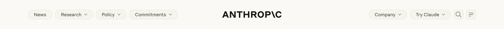
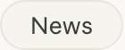
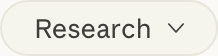
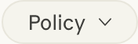
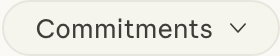
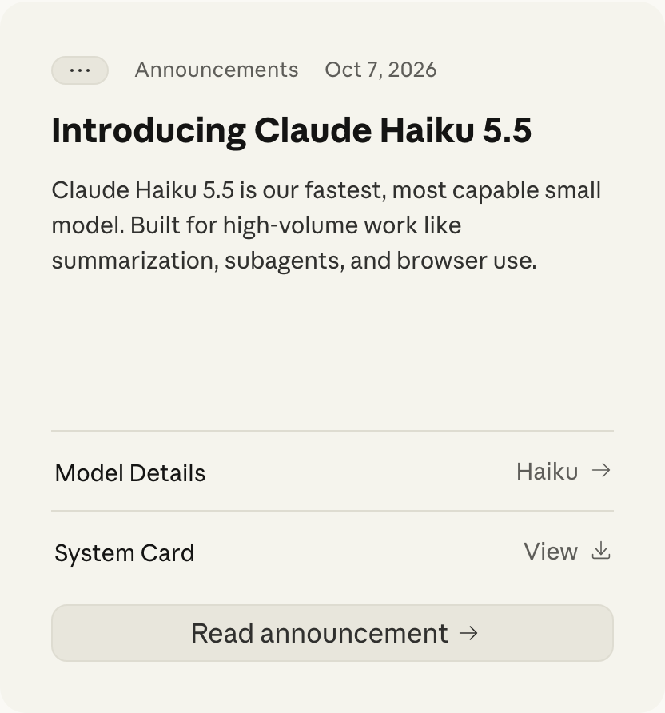
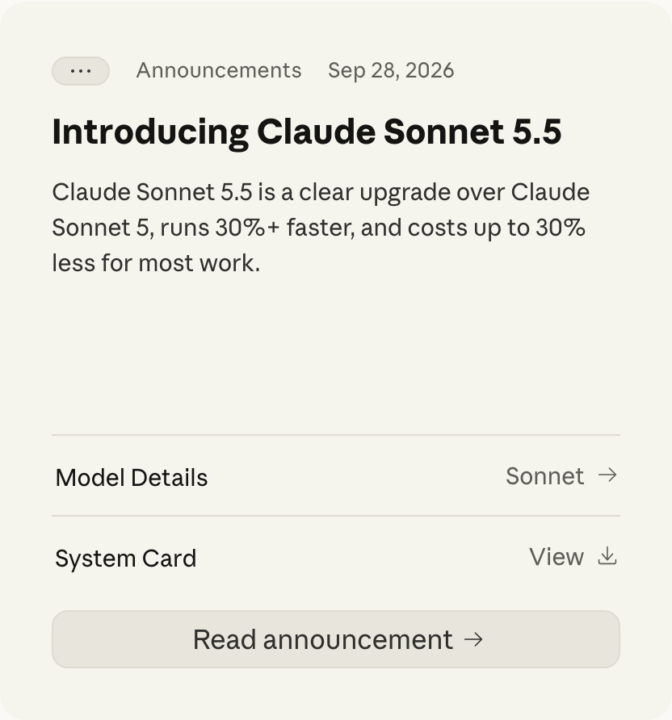
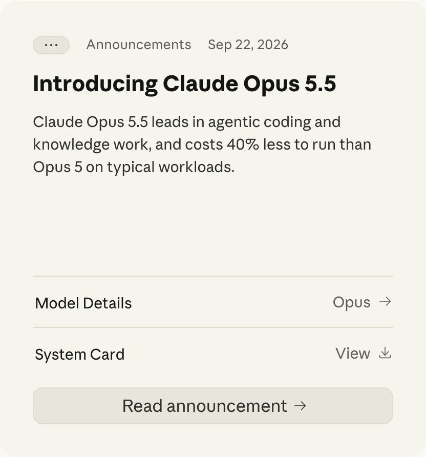
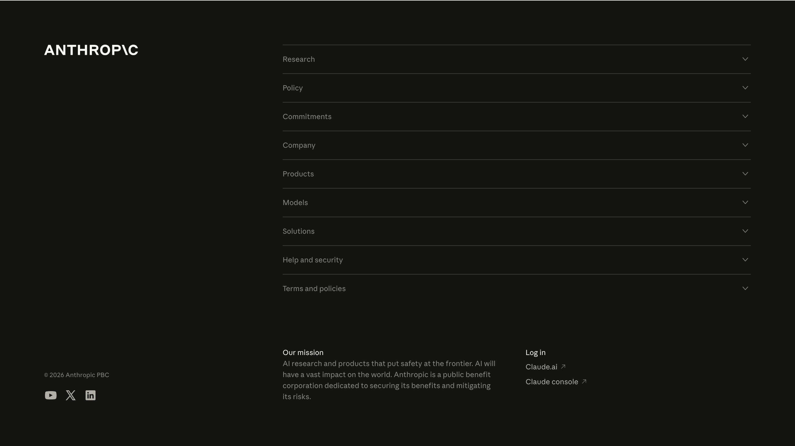
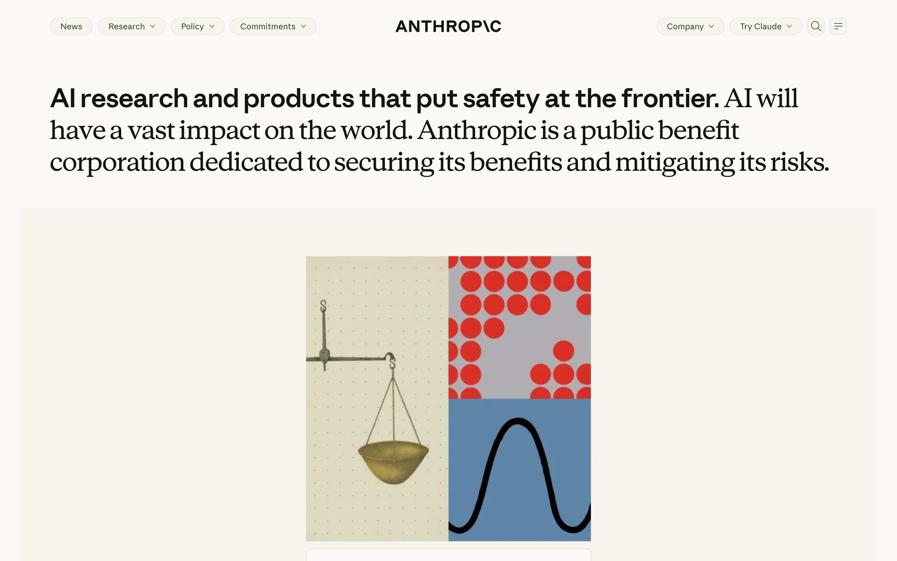

# Anthropic Video Style Guide

How Anthropic's brand translates to video in this repo: palette, type, motion, shape, components and
imagery, captured from <https://www.anthropic.com> on 2026-10-25. Read it before making a film for this brand.

Source of truth: [`brand.json`](../../../public/brands/anthropic.com/brand.json) (captured), [`overrides.json`](../../../public/brands/anthropic.com/overrides.json)
(curated choices) and the generated [`video-theme.json`](../../../public/brands/anthropic.com/video-theme.json). This file is
regenerated by `npm run brand:guide -- anthropic.com`; edit only between `curated:` markers — everything
else is overwritten. Related: [BRAND_CAPTURE.md](../../BRAND_CAPTURE.md) — how capture and generation
work; [MOTION_REEL.md](../../MOTION_REEL.md) — motion techniques, and the studio rules every film follows
([§22](../../MOTION_REEL.md#22-brief-persona-and-studio-rules)).

| Tag          | Meaning                                                                 |
| ------------ | ----------------------------------------------------------------------- |
| `[captured]` | Read from the live site by `brand/capture.mjs`                          |
| `[derived]`  | Computed from captured values by `brand/style-guide.mjs`                |
| `[curated]`  | Chosen in the review pass and recorded in `overrides.json` or a curated section |

| § | Section | Look here for |
| --- | --- | --- |
| 1 | [Video rules](#1-video-rules) | What films for this brand must and must not do |
| 2 | [Palette](#2-palette) | Colour roles, accent candidates, neutrals, colour tokens |
| 3 | [Typography](#3-typography) | Faces and files, web type scale, video type scale |
| 4 | [Motion](#4-motion) | Easing tokens as cubic-bezier, durations in beats, keyframes |
| 5 | [Shape](#5-shape) | Corner radii and shadows |
| 6 | [Components](#6-components) | Captured component crops and their styles |
| 7 | [Logo, imagery and copy](#7-logo-imagery-and-copy) | Logo, icons, social image, screenshots, headlines |
| 8 | [Voice and copy](#8-voice-and-copy) | How on-screen copy should sound |
| 9 | [Components to animate](#9-components-to-animate) | Which components and states to use in films |
| 10 | [Remotion theme](#10-remotion-theme) | Loading the theme, fonts and easing in a scene |
| 11 | [Capture details](#11-capture-details) | URL, date, browser, what the capture could not see |

---

## 1. Video rules

<!-- curated:rules -->
### Do

1. **Ground every shot on a warm neutral** — ivory `#faf9f5` / `#f0eee6` / `#e8e6dc` (`--color-ivory-*`)
   or ink `#141413`; `#0f0f0e` (`--color-dark`) for the deepest dark.
   - Why: the site's neutrals all lean warm (OKLab chroma ≈ 0.01, §2.3); pure `#ffffff` and `#000000`
     read as another brand.
2. **Use clay `#d97757` as a single point of emphasis per shot** — one word, one mark, one moving
   object. `#c6613f` (`--color-clay-interactive`) is its pressed/active state.
   - Why: the home page paints clay on 0 elements (§2.2); it is declared as the primary brand colour
     and held in reserve, so a clay surface or clay text block over-spends it.
3. **Set headlines in ink `#141413` and supporting text in `#5e5d59`** — the site's two text levels
   (§2.1, `overrides.json` sets ink as the text role).
4. **Pair the faces the way the hero does: a bold sans claim running into regular serif prose** in one
   sentence (§7, desktop and mobile screenshots). Use the serif alone for large display lines (`h1` is
   serif, §3.2) and the sans for UI, labels and metadata.
5. **Use pills for labels and tags** (radius `9999px`, 13 px sans on `#f5f4ed` with a `#e8e6dc`
   hairline, §6) and **16 px corners for cards** (§6) — never sharp-cornered panels.
6. **Ease UI motion out, short and without overshoot**: `--ease-out-quart` or the site's
   `cubic-bezier(0.25, 1, 0.5, 1)` over 0.3–0.5 beats at 128 BPM (§4).
   - Why: every curve the site uses decelerates into place and none overshoot; its transitions run
     150–250 ms (§4.2).

### Never

- **No gradients, glows or drop shadows** — the site uses one shadow in total, a 2 px ivory focus ring
  (§5).
- **No illustration colours as UI surfaces** — `--color-olive`, `--color-sky`, `--color-cactus`,
  `--color-fig`, `--color-coral`, `--color-heather`, `--color-iris`, `--color-periwinkle`, `--color-oat`
  belong to illustration and editorial imagery.
- **No captured Anthropic fonts in a published film without a licence** — the files in `fonts/` are
  for internal comps (§3.1). This repo's reel substitutes Instrument Serif for the display serif
  ([MOTION_REEL.md §15](../../MOTION_REEL.md#15-look-and-typography)); no sans substitute is chosen.
<!-- /curated:rules -->

---

## 2. Palette

Colour roles for video, from what the site paints and the tokens it declares.

### 2.1 Roles

| Role | Colour | Source |
| --- | --- | --- |
| Background | `#faf9f5` | `[captured]` page background |
| Text | `#141413` | `[curated]` |
| Accent | `#d97757` | `[curated]` `overrides.json` |

### 2.2 Accent candidates

Saturated colours (OKLab chroma ≥ 0.06), scored by use, use on links and buttons (× 3) and accent-like
token names (+ 25). `[derived]`

| Colour | Lightness | Chroma | Elements | Interactive | Named by | Score |
| --- | --- | --- | --- | --- | --- | --- |
| `#d97757` | 0.672 | 0.131 | 0 | 0 | `--color-clay` `--color-clay-primary` | 25 |
| `#c6613f` | 0.608 | 0.138 | 0 | 0 | `--color-clay-interactive` | 25 |

### 2.3 Neutrals

Low-chroma colours in use, light to dark. `[captured]`

| Colour | Lightness | Elements |
| --- | --- | --- |
| `#ffffff` | 1 | 1 |
| `#faf9f5` | 0.982 | 7 |
| `#f5f4ed` | 0.966 | 18 |
| `#e8e6dc` | 0.924 | 20 |
| `#dedcd1` | 0.893 | 17 |
| `#b0aea5` | 0.75 | 2 |
| `#87867f` | 0.619 | 11 |
| `#5e5d59` | 0.478 | 21 |
| `#3d3d3a` | 0.359 | 15 |
| `#30302e` | 0.308 | 6 |

### 2.4 Colour tokens

Opaque colour custom properties declared on `:root` (95 total; first 40 shown, all in `brand.json`). `[captured]`

| Token | Colour |
| --- | --- |
| `--color-cactus` | `#bcd1ca` |
| `--color-clay` | `#d97757` |
| `--color-clay-interactive` | `#c6613f` |
| `--color-clay-primary` | `#d97757` |
| `--color-cloud-dark` | `#87867f` |
| `--color-cloud-light` | `#d1cfc5` |
| `--color-cloud-medium` | `#b0aea5` |
| `--color-coral` | `#ebcece` |
| `--color-dark` | `#0f0f0e` |
| `--color-error` | `#bf4d43` |
| `--color-fig` | `#c46686` |
| `--color-focus` | `#2c84db` |
| `--color-gray-000` | `#ffffff` |
| `--color-gray-050` | `#faf9f5` |
| `--color-gray-100` | `#f5f4ed` |
| `--color-gray-1000` | `#000000` |
| `--color-gray-150` | `#f0eee6` |
| `--color-gray-200` | `#e8e6dc` |
| `--color-gray-250` | `#dedcd1` |
| `--color-gray-300` | `#d1cfc5` |
| `--color-gray-350` | `#c2c0b6` |
| `--color-gray-400` | `#b0aea5` |
| `--color-gray-450` | `#9c9a92` |
| `--color-gray-500` | `#87867f` |
| `--color-gray-550` | `#73726c` |
| `--color-gray-600` | `#5e5d59` |
| `--color-gray-650` | `#4d4c48` |
| `--color-gray-700` | `#3d3d3a` |
| `--color-gray-750` | `#30302e` |
| `--color-gray-800` | `#262624` |
| `--color-gray-850` | `#1f1e1d` |
| `--color-gray-900` | `#1a1918` |
| `--color-gray-950` | `#141413` |
| `--color-heather` | `#cbcadb` |
| `--color-iris` | `#dfdbfd` |
| `--color-iris-deep` | `#4a3aa7` |
| `--color-ivory-dark` | `#e8e6dc` |
| `--color-ivory-light` | `#faf9f5` |
| `--color-ivory-medium` | `#f0eee6` |
| `--color-light` | `#ffffff` |

---

## 3. Typography

### 3.1 Faces

| Role | Family | Files captured (weight style) | Google Fonts |
| --- | --- | --- | --- |
| Display | `anthropicSerif` | 400 italic, 400 normal | not on Google Fonts |
| Text | `anthropicSans` | 400 normal, 400 italic | not on Google Fonts |
| Mono | `anthropicMono` | 400 italic, 400 normal | not on Google Fonts |

- **Captured font files may be licensed to anthropic.com only.** They are saved for internal comps and are
  git-ignored; a published film needs a licence or a substitute recorded in `overrides.json`.

### 3.2 Web type scale `[captured]`

| Element | Family | Size | Weight | Line height | Letter spacing | Sample |
| --- | --- | --- | --- | --- | --- | --- |
| h1 | `anthropicSerif` | 40.8 px | 400 | 50.9804px | -0.407843px | AI research and products that put safety |
| h2 | `anthropicSans` | 51.9 px | 600 | 56.0541px | normal | 2026 Public Benefit Report |
| h3 | `anthropicSans` | 21.4 px | 700 | 26.7157px | normal | Introducing Claude Haiku 5.5 |
| body | `anthropicSans` | 16.7 px | 400 | 25.53px | normal | Anthropic is a Public Benefit Corporatio |
| button | `anthropicSans` | 13 px | 400 | 20.02px | 0.13px | Research |
| link | `anthropicSans` | 13 px | 400 | 20.02px | 0.13px | Skip to main content |
| nav | `anthropicSans` | 13 px | 400 | 20.02px | 0.13px | News |

### 3.3 Video type scale `[derived]`

Web sizes × 3.356 so body text lands on the 56 px phone-readable minimum at
1920 × 1080; ratios between levels match the site. Display type for kinetic moments goes larger
(160–520 px in [MOTION_REEL.md §15](../../MOTION_REEL.md#15-look-and-typography)).

| Level | Video size |
| --- | --- |
| UI / captions (minimum) | 56 px |
| Body | 56 px |
| H3 | 72 px |
| H2 | 174 px |
| H1 | 137 px |

---

## 4. Motion

### 4.1 Easing tokens

Declared easing tokens and the curves the site uses, as `cubic-bezier` control points; use them in a
scene with `brandEasing(theme, name)` (§10). `[captured]`

| Name | x1, y1, x2, y2 |
| --- | --- |
| `--ease-in-out-expo` | 1, 0, 0, 1 |
| `--ease-in-out-quart` | 0.77, 0, 0.175, 1 |
| `--ease-in-quart` | 0.895, 0.03, 0.685, 0.22 |
| `--ease-out-quart` | 0.165, 0.84, 0.44, 1 |
| `used: ease-in-out` | 0.42, 0, 0.58, 1 |
| `used: ease-out` | 0, 0, 0.58, 1 |
| `used: ease` | 0.25, 0.1, 0.25, 1 |
| `used: cubic-bezier(0.25, 1, 0.5, 1)` | 0.25, 1, 0.5, 1 |
| `used: cubic-bezier(0.2, 0.8, 0.2, 1)` | 0.2, 0.8, 0.2, 1 |

### 4.2 Durations

Transition durations in use, converted to beats at 128 BPM (0.4688 s per beat).
Web durations are UI micro-interactions; in film they suit small reactions, not scene moves. `[derived]`

| Duration | ms | Beats | Elements |
| --- | --- | --- | --- |
| `0.2s` | 200 | 0.43 | 81 |
| `0.15s` | 150 | 0.32 | 21 |
| `0.25s` | 250 | 0.53 | 15 |
| `0.1s` | 100 | 0.21 | 11 |
| `0.3s` | 300 | 0.64 | 5 |
| `0.633s` | 633 | 1.35 | 1 |

### 4.3 Keyframes

21 `@keyframes` declared: `Body-module-scss-module__PA4F1q__landing`, `HeaderLayout-module-scss-module__UTJ3Tq__hero-nav-return`, `MooHero-module-scss-module__WHJwZW__hero-words-return`, `MooHero-module-scss-module__WHJwZW__scrollcue`, `PacingHero-module-scss-module__dbN6Cq__fade-in`, `PacingHero-module-scss-module__dbN6Cq__word-rise`, `PacingHero-module-scss-module__dbN6Cq__unblur`, `ConstellationIcon-module-scss-module__xjGFCq__rearrange`, `ConstellationIcon-module-scss-module__xjGFCq__connect`, `ImageDrift-module-scss-module__OI3WYG__drift-x`, `ImageDrift-module-scss-module__OI3WYG__drift-y`, `ImageDrift-module-scss-module__OI3WYG__drift-zoom`, `ImageDrift-module-scss-module__OI3WYG__drift-turn`, `MobyHero-module-scss-module__rdpyvG__scrollcue`, `ModelComparison-module-scss-module__mnfOdW__fade-in`, `ModelComparison-module-scss-module__mnfOdW__reveal`, `ModelComparison-module-scss-module__mnfOdW__reveal-marker`, `WillyHero-module-scss-module__myou2q__willy-rise`, `WillyHero-module-scss-module__myou2q__willy-rise-far`, `WillyHero-module-scss-module__myou2q__willy-words-return`, `DeepDive-module-scss-module__QaiuSa__bd-tip-in`. `[captured]`

---

## 5. Shape

| Corner radius | Elements |
| --- | --- |
| `999999px` | 7 |
| `9999px` | 7 |
| `10px` | 5 |
| `4px` | 4 |
| `8px` | 3 |
| `16px` | 3 |

| Shadow | Elements |
| --- | --- |
| `rgb(250, 249, 245) 0px 0px 0px 2px` | 1 |

---

## 6. Components

First visible matches per kind at 1440 × 900, 2 × scale. `[captured]`

### 6.1 logo 1 — 170 × 24 px


| Background | Text | Radius | Padding | Font |
| --- | --- | --- | --- | --- |
| `rgba(0, 0, 0, 0)` | `rgb(20, 20, 19)` | `0px` | `0px` | `400 16.6863px anthropicSans` |

### 6.2 nav 1 — 1440 × 84 px



| Background | Text | Radius | Padding | Font |
| --- | --- | --- | --- | --- |
| `rgb(250, 249, 245)` | `rgb(20, 20, 19)` | `0px` | `0px` | `400 16.6863px anthropicSans` |

### 6.3 button 1 — 69 × 28 px



| Background | Text | Radius | Padding | Font |
| --- | --- | --- | --- | --- |
| `rgb(245, 244, 237)` | `rgb(61, 61, 58)` | `999999px` | `8px 16px` | `400 13px anthropicSans` |

### 6.4 button 2 — 109 × 28 px



| Background | Text | Radius | Padding | Font |
| --- | --- | --- | --- | --- |
| `rgb(245, 244, 237)` | `rgb(61, 61, 58)` | `999999px` | `8px 12px 8px 16px` | `400 13px anthropicSans` |

### 6.5 button 3 — 87 × 28 px



| Background | Text | Radius | Padding | Font |
| --- | --- | --- | --- | --- |
| `rgb(245, 244, 237)` | `rgb(61, 61, 58)` | `999999px` | `8px 12px 8px 16px` | `400 13px anthropicSans` |

### 6.6 button 4 — 139 × 28 px



| Background | Text | Radius | Padding | Font |
| --- | --- | --- | --- | --- |
| `rgb(245, 244, 237)` | `rgb(61, 61, 58)` | `999999px` | `8px 12px 8px 16px` | `400 13px anthropicSans` |

### 6.7 card 1 — 416 × 445 px



| Background | Text | Radius | Padding | Font |
| --- | --- | --- | --- | --- |
| `rgb(245, 244, 237)` | `rgb(20, 20, 19)` | `16px` | `32px` | `400 16.6863px anthropicSans` |

### 6.8 card 2 — 416 × 445 px



| Background | Text | Radius | Padding | Font |
| --- | --- | --- | --- | --- |
| `rgb(245, 244, 237)` | `rgb(20, 20, 19)` | `16px` | `32px` | `400 16.6863px anthropicSans` |

### 6.9 card 3 — 416 × 445 px



| Background | Text | Radius | Padding | Font |
| --- | --- | --- | --- | --- |
| `rgb(245, 244, 237)` | `rgb(20, 20, 19)` | `16px` | `32px` | `400 16.6863px anthropicSans` |

### 6.10 footer 1 — 1440 × 808 px



| Background | Text | Radius | Padding | Font |
| --- | --- | --- | --- | --- |
| `rgb(20, 20, 19)` | `rgb(250, 249, 245)` | `0px` | `0px` | `400 16.6863px anthropicSans` |

---

## 7. Logo, imagery and copy

Logo (SVG, inherits `color`): [`logo.svg`](../../../public/brands/anthropic.com/logo.svg)


| Image | File |
| --- | --- |
| shortcut icon | [`images/favicon.ico`](../../../public/brands/anthropic.com/images/favicon.ico) |
| icon | [`images/favicon-32x32.png`](../../../public/brands/anthropic.com/images/favicon-32x32.png) |
| apple-touch-icon | [`images/apple-touch-icon.png`](../../../public/brands/anthropic.com/images/apple-touch-icon.png) |
| apple-touch-icon 180x180 | [`images/apple-touch-icon.png`](../../../public/brands/anthropic.com/images/apple-touch-icon.png) |
| mask-icon | [`images/safari-pinned-tab.svg`](../../../public/brands/anthropic.com/images/safari-pinned-tab.svg) |
| og:image | [`images/6d4a0d28992ade92d6fa63646fd9c9d318245c6c-2400x1260.jpg`](../../../public/brands/anthropic.com/images/6d4a0d28992ade92d6fa63646fd9c9d318245c6c-2400x1260.jpg) |
| Desktop 1440 × 900 | [`screenshots/desktop-1440x900.png`](../../../public/brands/anthropic.com/screenshots/desktop-1440x900.png) |
| Mobile 390 × 844 | [`screenshots/mobile-390x844.png`](../../../public/brands/anthropic.com/screenshots/mobile-390x844.png) |
| Full page | [`screenshots/full-page.png`](../../../public/brands/anthropic.com/screenshots/full-page.png) |



| Copy | Text |
| --- | --- |
| Title | Home \ Anthropic |
| Description | Anthropic is an AI safety and research company that's working to build reliable, interpretable, and steerable AI systems. |
| Headline 1 | AI research and products that put safety at the frontier. AI will have a vast impact on the world. Anthropic is a public |
| Headline 2 | 2026 Public Benefit Report |
| Headline 3 | Learn moreLearn more |

---

## 8. Voice and copy

<!-- curated:voice -->
- **Calm, declarative, plain.** The hero states a position in full sentences ending in periods: "AI
  research and products that put safety at the frontier." No exclamation marks, no hype adjectives.
- **Sentence case for titles**: "Introducing Claude Haiku 5.5", "2026 Public Benefit Report".
- **Name products exactly** — "Claude Haiku 5.5", not "Haiku" or "our new model" — and keep version
  numbers.
- **Metadata is quiet**: category and date in small sans grey beside a pill ("Announcements · Oct 7,
  2026"), never as a headline.
- **On screen, one claim per beat or bar**; let the serif carry the claim and the sans carry labels.
<!-- /curated:voice -->

---

## 9. Components to animate

<!-- curated:animate -->
| Component (§6) | Use in film | Motion |
| --- | --- | --- |
| Announcement card (`card-1`…`card-3`, 416 × 445 px, radius 16 px) | A release or result: category pill, title, body, detail rows, full-width button | Card rises 40–60 px with `--ease-out-quart`; detail-row dividers draw left to right, staggered; the button's arrow nudges right on the beat |
| Nav pills (`button-1`…`button-4`, 28 px tall, radius `9999px`) | Chapter labels, tabs, filters | Selected pill fills `#f5f4ed` → `#e8e6dc`; label swaps only after the fill starts |
| Wordmark (`logo.svg`, viewBox 143 × 16) | Opening or sign-off lockup | Mask reveal left to right; it inherits `color`, so set ink or ivory per ground |
| Hero sentence (desktop and mobile screenshots) | Title card | Sans claim types or rolls in first; the serif continuation follows on the next beat |

- **Not captured**: the mobile header's "A\\" mark (a separate logo) and any product UI — capture
  `https://claude.ai` pages separately; they need a login (BRAND_CAPTURE.md §3).
<!-- /curated:animate -->

---

## 10. Remotion theme

`video-theme.json` holds the derived values above for scenes to import.

```tsx
import theme from "../../public/brands/anthropic.com/video-theme.json";
import { brandEasing, loadBrandFonts, type VideoTheme } from "../brand/theme";

const brand = theme as VideoTheme;
loadBrandFonts(brand); // captured files; licence first (§3.1)
const ease = brandEasing(brand, "--ease-in-out-expo");
// brand.colors.accent, brand.type.h1, brand.durations[0].beats …
```

Where it lives: [`src/brand/theme.ts`](../../../src/brand/theme.ts) — `VideoTheme`, `loadBrandFonts`, `brandEasing`.

---

## 11. Capture details

| Item | Value |
| --- | --- |
| URL | https://www.anthropic.com |
| Captured | 2026-10-25T12:37:48.492Z |
| Browser | 157.0.8080.0 (local-puppeteer-browser) |
| Viewports | 1440 × 900 @2x, 390 × 844 @3x |
| Duration | 8.6 s |
| Tokens | 259 custom properties, 95 colours, 4 easings |
| Font files | 7 |
| Notes | desktop: dismissed consent button /accept all/i; stylesheets fetched outside the page: 0 of 0; mobile: dismissed consent button /^accept$/i |

- **The capture sees the home page's first state only**: no hover, scroll-triggered or JavaScript-driven
  animation, no pages behind login.
